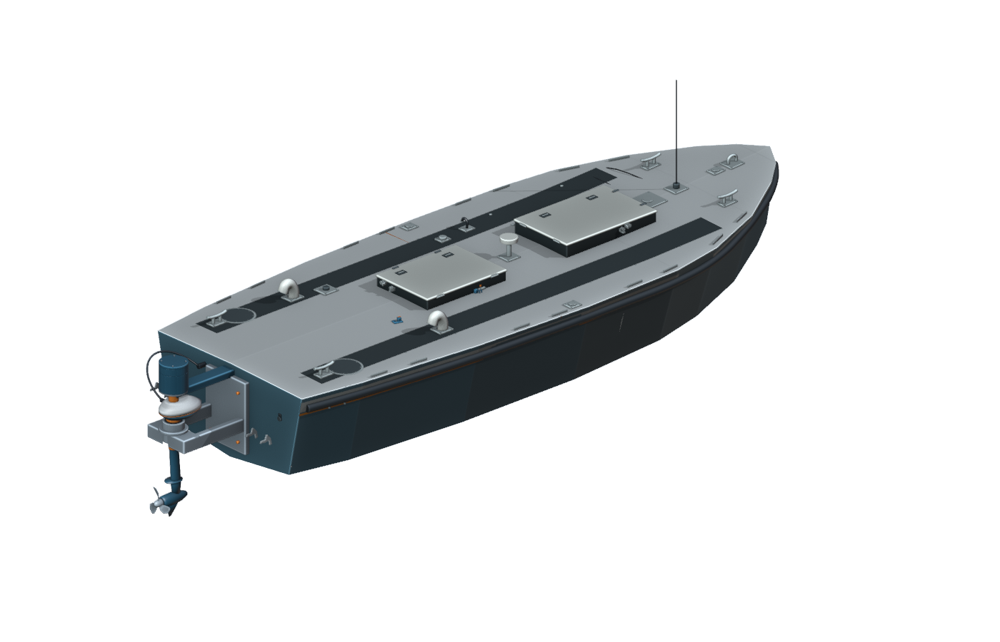
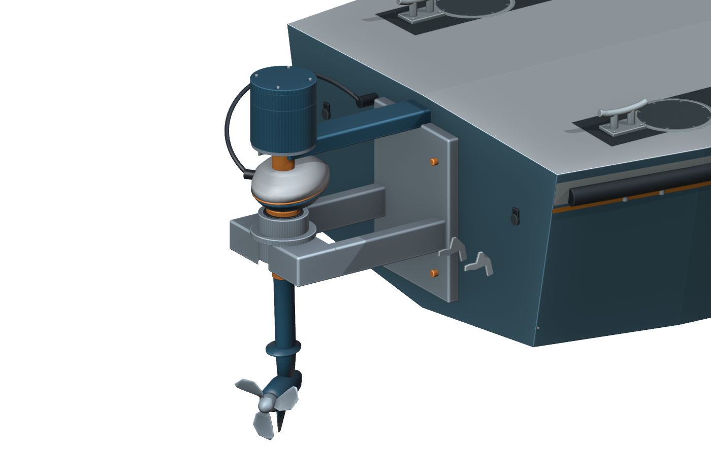
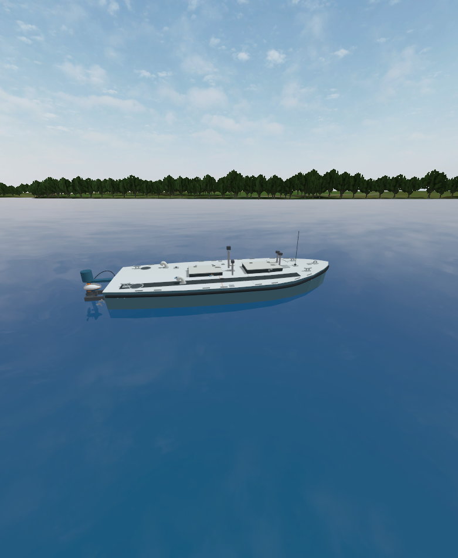
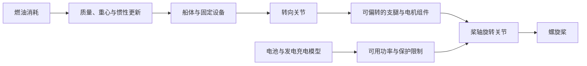
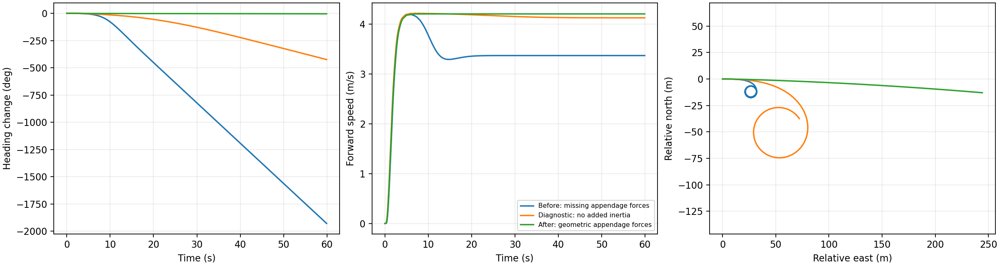
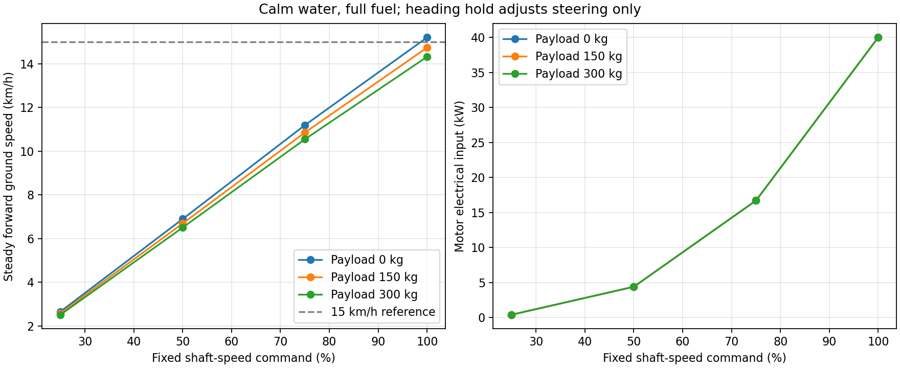

# 6 米实验无人船 · VRX 工程仿真平台

一个以**可解释的船体物理、可追溯的工程参数和可重复测试**为目标的无人船仿真项目。基于 ROS 2 Jazzy、Gazebo Harmonic 和 VRX 悉尼赛艇水域，当前重点是中央单机、桨舵一体推进的 6 米船模，同时保留双固定推进器原始设计。

> **2026-11-26大修分支状态：** 无鳍候选已补齐几何风阻，并完成22组操纵、8组环境及2组补充倒车扰动，共27/32组通过。满速前进约15.38 km/h，60%倒车扰动约24秒恢复；**满倒车两组与横风相关三组仍失败，尚未替换默认船模、未接飞控。** 下面的带鳍基线和历史导航结果不能当作新候选验收证据。[最新结果、科学依据与剩余问题](docs/validation/overhaul_2026-11-26/refinement/README.md)。

> **后续物理核查：** 已建立固定姿态拖曳台架，完成130组工况及28组数值复核，分开记录船体与附体力矩；这是现有模型内部检查，**不是独立CFD验证或新的航行验收**。已固定OpenFOAM容器，独立检查发现附体自交及粗网格质量问题；尚未流场求解、未据此调参。[台架结果与CFD准备](docs/validation/overhaul_2026-11-26/captive-tow/README.md)。

> **项目定位：工程仿真平台，不是经过海试标定的实船数字孪生。** 没有完整实船数据时，使用明确标注来源和假设的参数。能够运行、画面精细、控制器能保持航向，都不能代替物理验证。
>
> **保留的旧默认方案使用小型被动稳定鳍改善 60% 倒车受扰恢复，不使用航向保持。** 左右扰动后约 19.0 / 19.7 s 恢复，通过原 30 s 门槛；44 项固定版本工况通过。轻载全速约 15.03 km/h，仍有小幅配平偏航及工程参数边界。该物理专项当时未接 ArduPilot/Nav2。[原因、尺寸与结果](docs/validation/reverse_recovery_2026-11-23/README.md) · [ROS 操作指南](docs/getting_started/README.md)。

当前工程验证基线为 **`sim-baseline-2026-11-23`**：独立容器安装/操船/退出清理通过；两项物理热路径补齐标准编译优化，完整悉尼传感器长测平均实时率由约0.569升至**0.993**，没有改变物理步长、碰撞或传感器精度。[基线范围、前后对照、原始证据与剩余问题](docs/validation/stable_baseline_2026-11-23/README.md)。

**已通过的低速导航基线（2026-11-25）：** 低速参数优化后，左右完整验收各25项通过，最大航段偏差由8.43／8.90 m降到4.56／4.06 m。有流保持延长至120秒，稳定段对实际目标最大距离2.28／2.39 m；仍不等于精密靠泊或全工况认证。[原因、参数、失败方案与证据](docs/validation/corner_hold_2026-11-25/README.md) · [运行指南](docs/getting_started/low_speed_navigation.md)。

**恒流扩展验证（2026-11-25）：** 固定参数下东向0.15 m/s整轮通过；西向0.15、北向0.15/0.30 m/s的保持峰值为3.47/3.07/4.26 m，超过3 m要求，其余检查通过。当前优先改善跨流向保持，尚不能称全工况成熟。[四组结果与边界](docs/validation/current_envelope_2026-11-25/README.md)。

跨流向保持修正又筛选了七个参数/控制候选，均未达到强横流3 m门槛，实验版本未推广，正式配置保持原样。[失败方案、控制证据和下一步](docs/validation/current_hold_2026-11-25/README.md)。

低速开环响应辨识已完成静水及两种恒流对照，各9项数据检查通过，测得全舵换向约7.8秒；这不等于保持误差已修复。[辨识数据、输入校验与控制时序分析](docs/validation/response_identification_2026-11-25/README.md)。

依据辨识另测转向减速度1°/s²候选：完整24/25，强流保持峰值4.093 m，仍未达3 m且RMS变差，未采用。[候选筛选与原始证据](docs/validation/yaw_deceleration_2026-11-25/README.md)。

正反向切换时序已核查；官方始终船头朝向目标的对照保持峰值增至11.766 m，未采用，不能靠禁用倒车解决。[切换证据与完整对照](docs/validation/loiter_switching_2026-11-25/README.md)。

2026-11-26新增实测风浪导航门禁，并完成三组5 m/s风、波谱增益1.0下的直接推进物理敏感性检查；**有流3 m保持与正反推/慢舵机协调仍未解决**。本轮限转速、投影、迟滞、同步和船尾朝向候选均未采用，正式参数保留原基线。[本轮进展](docs/validation/control_weather_2026-11-26/README.md)。各模块科学依据、未标定参数和15 km/h概念方案的限制见[模型可信范围](docs/parameters/model_validity.md)。

指定的5 m/s向北风、波谱增益1.0、零恒流工况已完成隔离水域SITL导航30/30验收，保持峰值1.299 m；不等于完整悉尼GPU风浪长测或所有流场均通过。[原始结果与边界](docs/validation/control_weather_2026-11-26/weather_navigation/summary.json)。

## 船长什么样，结构是什么

**以下是设计渲染图和 Gazebo 仿真截图，目前没有实船照片。** 设计图用于说明结构；历史截图用于展示外观，不作为最新物理测试的证明。



*中央单机方案原始设计总览，早于当前传感器装配。原始模型与导出方法见 [建模说明](docs/modeling/README.md)。*

| 桨舵一体结构细节 | VRX 悉尼水域实景截图 |
|---|---|
|  |  |
| 原始设计中的 35° 转向姿态，展示安装架、转向轴、支腿和螺旋桨；不是运行关节测量。 | 2026-11-20 Gazebo 截图；这是仿真水域，不是实船拍摄。[图像来源](docs/validation/evidence/manifest.json)。 |



这是机械关系与仿真耦合示意，不是制造图或完整接线图。船体、甲板和固定设备计入质量台账；外观、刚体接触和水动力采用各自合适的几何表示。[装配与碰撞记录](docs/history/2026-11-19_物理覆盖与精细碰撞.md) · [转向扫碰记录](docs/history/2026-11-19_转向桨叶扫碰与单机估算.md) · [逐件质量台账](ros_ws/src/usv_description/config/component_mass_ledger.json)。

## 为什么做这个项目

希望先把“船”本身做好，再接自主航行系统：能合理漂浮和随浪、推力与功率相互约束、载荷改变吃水和操纵表现、油电消耗影响可用动力、燃油减少影响质量和惯性。之后再讨论飞控和导航算法的表现，避免控制器掩盖仿真对象的问题。

工程原则：

1. **外观、碰撞、浮力几何各有职责。** 外观保留精细结构，碰撞描述刚体接触，浮力采用封闭船体与分布式压力；不以整船网格直接替代所有物理。
2. **参数有唯一来源。** 质量和功耗使用逐件台账，区分工程估算、厂家参考、几何计算和未标定系数；历史参数快照不能冒充当前配置。
3. **力、能量与质量相互一致。** 推进受到电功率和转矩限制，舵机消耗能源；燃油用量与刚体质量、重心和完整惯性张量联动。
4. **用试验揭示问题。** 记录原始遥测、工况、源码版本与失败案例；不通过放宽检查或修改原始数据得到“通过”。
5. **先物理，后控制与导航。** 保留手动/ROS 控制以便验证，不急着堆叠飞控和任务系统。

## 每个模块的依据与证据

我们希望尽可能接近真实船舶，但**理论有依据、参数有来源、代码通过测试，是三个不同层次**。厂家额定值只能支持相应设备的参考工况；工程估算和仿真通过都不能代替海试。下面每个模块都给出可追溯入口，完整公式、来源适用范围和未解决问题见 [科学依据与证据地图](docs/parameters/evidence_map.md)。

| 模块与实现思路 | 参数、过程与验证材料 | 尚未证明的部分 |
|---|---|---|
| **船体、装配与碰撞**：保留原始设计，分别生成外观、接触和封闭浮力几何 | [建模入口](docs/modeling/README.md)、[物理覆盖](docs/history/2026-11-19_物理覆盖与精细碰撞.md)、[扫碰检查](docs/history/2026-11-19_转向桨叶扫碰与单机估算.md)、[薄鳍接触精度与后端对照](docs/validation/contact_endurance_2026-11-23/README.md) | 刚体接触不是强度、变形、制造净空认证 |
| **质量与功耗**：逐件质量加权求重心，平行轴定理合成惯性；按设备工作状态汇总功耗 | [权威台账](ros_ws/src/usv_description/config/component_mass_ledger.json)、[台账推导与组合工况](docs/history/2026-11-21_逐件台账与载荷油量风浪流验证.md)、[公开摘要](docs/validation/evidence/README.md) | 材料密度、结构厚度、安装位置和部分设备功耗仍是工程值 |
| **浮力与随浪**：封闭体积静水浮力、浸水表面压力积分，使用 VRX 波场 | [静水推导与验证](docs/history/2026-11-19_船体接入与静水试验.md)、[随浪方法](docs/history/2026-11-20_船体外观装配与随浪优化.md)、[随浪结果](docs/validation/evidence/waves_2026-11-20.json) | 没有实船波浪响应标定；未完整覆盖破波、砰击、滑行 |
| **阻力、附加质量与方向稳定性**：参考海洋航行器动力学框架，按几何求附体浸水面积及力臂，补全升阻力 | [理论与系数边界](docs/parameters/evidence_map.md)、[阻力配置](ros_ws/src/usv_description/config/resistance.json)、[附体参数](ros_ws/src/usv_description/config/appendage_hydrodynamics.json)、[15 项专项与对照数据](docs/validation/directional_stability_2026-11-21/README.md) | 系数未经 CFD/海试标定；仍有小幅配平偏航，附体阻力与集中船体阻力可能存在重复预算 |
| **被动方向稳定鳍**：小角度稳定性筛查，真实网格质量/浮力/接触与局部升阻力同步 | [原因、理论、结构图及 44 项回归](docs/validation/reverse_recovery_2026-11-23/README.md) | 没有实船标定；新鳍流体惯性、安装强度及薄面接触精度有限 |
| **推进与转向**：正反推、桨轴转矩/功率限制、舵角与速率约束 | [推进参数](ros_ws/src/usv_description/config/propulsion.json)、[厂家参考与建模假设](docs/history/2026-11-19_推进与操纵验证.md)、[当前操纵验收](docs/validation/reverse_recovery_2026-11-23/README.md) | 6 kW 厂家参考不证明 40 kW 概念方案；缺少真实桨的全工况性能图与空化数据 |
| **油量、电量与保护**：能量平衡、电流积分、发电/充电限制、负载和保护状态 | [能源配置](ros_ws/src/usv_energy/config/energy.json)、[原理与设备来源](docs/history/2026-11-19_油电能源与感知验证.md)、[能源基线](docs/validation/baseline_2026-11-21/README.md)、[加鳍后 20 分钟与保护复验](docs/validation/contact_endurance_2026-11-23/README.md) | 电池内阻、热参数及油耗曲线有估算；两小时能源计算不等于实际续航 |
| **燃油引起的动态质量**：准静态液面体积积分，更新质量、重心和完整惯性，回读物理后端 | [油箱参数](ros_ws/src/usv_description/config/fuel_tank.json)、[方法及后端验证](docs/history/2026-11-19_燃油质量重心惯性联动.md)、[公开测试摘要](docs/validation/evidence/fuel_mass_historical.json) | 未建模油液动态晃荡、进水及柔性结构 |
| **传感器与运行接口**：IMU、GPS、相机、点云、TF、健康检测；就绪检测、失联停推及退出清理 | [WAM-V 差距与接口改进](docs/history/2026-11-20_WAMV差距完善.md)、[启动与运行验证](docs/history/2026-11-21_阻力操纵与启动可靠性改进.md)、[完整悉尼图像/点云长测及 DDS 修复](docs/validation/sydney_rendering_2026-11-23/README.md) | 传感器噪声未实机标定；独立 amd64 容器复现已通过；其他平台和所有环境长期测试未覆盖 |
| **ArduPilot / Nav2**：保留历史适配，先完成船体物理，再验收控制所有权与导航 | [集成规划与当前边界](docs/integration/README.md) | 本阶段没有完成这两套自主航行系统的集成验收 |

历史过程记录保留当时参数，不应与当前配置混用。当前参数入口是 [参数说明](docs/parameters/README.md)；已公开的历史附件及其校验值见 [证据清单](docs/validation/evidence/README.md)。

## 完整悉尼场景与传感器运行

完整官方悉尼地图、三路相机和二维/三维 GPU 雷达完成 GUI 90 s 与 EGL 20 分钟仿真验收。早期修复侧相机投影和DDS大图丢帧，随后只优化两个C++目标；最新长测平均实时率 0.993，进程树RSS峰值约 2.06 GiB。[最新稳定基线](docs/validation/stable_baseline_2026-11-23/README.md) · [传输修复与原始失败对照](docs/validation/sydney_rendering_2026-11-23/README.md)。本机接近实时，不保证其他硬件或任意负载。

## 当前受力审计与操纵验证

最新 [薄鳍接触与长时复验](docs/validation/contact_endurance_2026-11-23/README.md) 明确加载自有后端，统一为 1 ms / DART 内 ODE 检测、ERP 0.2、最大回正速度 0.1 m/s。14 项生产接触检查通过，名义薄鳍末段残余小于 0.01 mm；保留 8 项归因对照及原失败。加鳍后 20 分钟风浪流航行、6 项保护/时钟、11 项操纵（含各 10 分钟零舵前进/倒车）通过；没有航向保持。刚体离散冲击仍有瞬态穿透，范围见报告。


最新 [倒车恢复专项](docs/validation/reverse_recovery_2026-11-23/README.md) 先用四项分项对照和横移—偏航线性分析定位失稳，再增加中心线小型稳定鳍，同步计入外形、碰撞、质量、惯性、浮力及升阻力。44 项固定版本工况通过原判据，涵盖倒车距离与受扰恢复、低油量和重载、参数敏感性、2 ms 步长、前进操纵及四种有限环境筛查。**恢复指回到扰动前角速度附近，不是自动回到原航向。**

[新增稳定鳍之前的四步验证](docs/validation/platform_readiness_2026-11-21/README.md) 保留当时的 60% 倒车恢复失败，以及 19 项环境、20 分钟航行、故障保护、独立容器安装的证据；本轮已补齐加鳍后长时与保护复验；旧容器结果仍不能冒充新硬件重新验收。原来的 [电池重布置](docs/validation/layout_2026-11-21/README.md) 仍是当前设备布置基础。

新增鳍不改推进功率、不删除附加质量科氏项、不施加航向控制力矩。300 s 倒车累计偏航由约 113.7° 减至 5.1°，但前进全速配平偏航由约 0.0448°/s 增至 0.0625°/s；55% 蛇形最大超越约 14.1°、回零额外转向约 18.0°，均通过原门槛但比旧版略大。改善和代价均保留在报告中。


## 上一轮方向稳定性修复（历史对照）

15 个专项工况通过，包括实际零舵、左右扰动释放、重载、低油量、1/2/4 ms 步长、旋转初始朝向和受力系数敏感性。另完成风浪流检查与完整悉尼场景操控回归。零舵无附加载荷末段航速约 **15.15 km/h**；60 秒对照中累计偏航从约 1,928° 降到约 4.8°。



这是上一轮工程模型的验证，不是海试认证；最新几何和预算结果见上面的受力报告。原型阻力/附加质量未重新调参，补充的升阻力系数仍需实测或 CFD 校准。后面的“历史性能基线”章节保留修复前数据；当前配重方案另列。

## 当前设备布置与性能

40 kW 概念方案把四块升级电池及托架改为前后各一对，取消约 167.86 kg 纵向配重，保留约 32.05 kg 横向配重。新增约 5.17 kg 稳定鳍后满油总质量约 1576.34 kg；电池容量、推进功率和原船体阻力预算不变，新鳍阻力额外计入。外形、碰撞和整船惯性同步更新。

| 当前静水工况 | 直接满油门、零舵航速 |
|---|---:|
| 无附加载荷、60 L 燃油 | 约 15.03 km/h |
| 300 kg 附加载荷、6 L 燃油 | 约 14.29 km/h |

满油轻载达到约 15 km/h，重载没有达到。相比无鳍版本，轻载全速由 15.10 降至 15.03 km/h；300 s 倒车末段偏航约 0.0172°/s，累计仍有约 5.1°。[固定版本结果及代价](docs/validation/reverse_recovery_2026-11-23/README.md) · [质量台账](ros_ws/src/usv_description/config/component_mass_ledger.json)。

## 历史性能基线：15 km/h 是哪个方案

项目保留 **6 kW 基准方案**，另有 **40 kW、六电池的概念升级方案**。下面是后者在满油 60 L、静水、固定桨轴转速请求、仅用舵保持航向时的仿真结果，不是实船性能保证，也不适用于 6 kW 配置。

| 附加载荷 | 满油门航速 | 电机电输入功率 |
|---:|---:|---:|
| 0 kg | 15.21 km/h | 40 kW |
| 150 kg | 14.75 km/h | 40 kW |
| 300 kg | 14.33 km/h | 40 kW |



基线完成 29 个 Gazebo/ROS 工况的运行检查，以及同一能源模型的 2 小时计算。**运行检查通过不等于物理模型全部验收**；零舵转圈已经作为明确失败项单独记录。两小时能源计算不是两小时完整六自由度航行。[公开基线报告与摘要](docs/validation/baseline_2026-11-21/README.md)。

## 环境与获取

当前验证环境是 ROS 2 Jazzy / Gazebo Harmonic。本地惯性适配固定使用 gz-sim 8.15.0、gz-physics 7.8.0 和对应 DART，不能直接假设其他版本兼容。

```bash
git lfs install
git clone https://github.com/luyunhong12/usv-experimental-6m.git
cd usv-experimental-6m
git lfs pull
mkdir -p dependencies/src
vcs import dependencies/src < dependencies/sources.repos
```

还需安装 ROS/Gazebo 系统依赖、Python 工具依赖及获取悉尼场景资产。详情见 [安装运行说明](docs/getting_started/README.md) 和 [依赖说明](dependencies/README.md)。第三方场景缓存、外部设备手册、构建产物和完整测试原始数据没有放进主仓库。**尚未完成全新机器的一键安装验收**，不要把下面的构建命令视为自动安装所有依赖。

## 打开水域与开船

在依赖已安装、场景资源可用的环境：

```bash
./usv build
./usv run                         # 悉尼水域图形窗口
# 或者：./usv run headless:=True   # 无窗口测试
```

看到 `Boat ready` 后，另开终端执行：

```bash
./usv drive --throttle 0.3 --duration 10
./usv drive --throttle -0.3 --duration 10
./usv drive --throttle 0.3 --steering-deg -20 --duration 10
./usv energy --duration 30
```

油门是有符号的归一化桨轴转速请求，不是功率百分比。舵角是物理转角，船尾推进器的负转角对应前进时左转。手动指令不自动保持航向；停止指令后停推，但船仍会滑行。默认分区为 `usv_platform15`，自定义时启动与操控终端必须一致。同一艘船不要同时发送多种控制指令。

## 文件结构

```text
usv-experimental-6m/
├── design/                 # 原始船模、设计依据和独立备份
├── ros_ws/src/             # 自有 ROS / Gazebo 包
│   ├── usv_description/    # 外观、碰撞、装配和物理配置
│   ├── usv_simulation/     # 水动力、推进与仿真场景
│   ├── usv_physics/        # DART 动态惯性适配
│   ├── usv_energy/         # 油电消耗与保护
│   ├── usv_control/        # ROS 控制与传感器接口
│   ├── usv_bringup/        # 整船配置、统一启动
│   └── usv_ardupilot/      # JSON SITL 接口，开始固定版本接入验收
├── dependencies/           # 固定上游版本、最小源码片段与补丁
├── deploy/                 # SITL 容器与后续编排的部署配置
├── tools/                  # 安装、建模、参数计算、分析和手动操作
├── tests/                  # 单元、集成、场景与回归
├── datasets/               # 构建输入与历史数据校验索引
├── docs/                   # 使用、架构、依据、验证和过程
└── artifacts/              # 本地原始记录与备份，不进入 Git
```

新增 SITL 目录职责见 [部署说明](deploy/README.md)；基础接口证据见 [接入记录](docs/validation/sitl_setup_2026-11-24/README.md)，GPU 双容器与 QGC 实际操船见 [联合验收](docs/validation/desktop_sitl_2026-11-24/README.md)。启动和摇杆操作见 [桌面 SITL 指南](docs/getting_started/desktop_sitl.md)。

原始 Blender 文件和较大的网格使用 Git LFS。部分历史文档引用本地 artifacts 路径；这不表示文件已上传，公开可读的主要结果见上面的基线报告。完整过程没有被删除。

## 测试与复现

```bash
./usv test
source /opt/ros/jazzy/setup.bash
source ros_ws/install/setup.bash
python3 tests/integration/validate_platform_launcher.py \
  --output artifacts/my_startup_test --kill-controller
python3 tests/regression/run_performance_suite.py \
  --spec tests/scenarios/performance.json --output artifacts/my_performance_run
```

每次试验使用新的输出目录，保留场景快照、遥测 CSV、健康日志及判定；复用必须显式 `--resume` 且版本、工况与证据一致。原生测试需要本机 ROS DDS / Gazebo Transport 通信权限。本轮 Code Supervisor full 与构建测试通过：12 项 C++、55 项 Python、5 项设计接口测试，[最新检查与24项人工审查](docs/validation/stable_baseline_2026-11-23/code-review.md)。相同生产 C++ 在此前通过 deep：选定核心头文件覆盖率 97.746%，12 个转向积分有限变异被杀死，ASan/UBSan 与原生回归通过；deep 当时 Python 为 46 项，之后新增受力分析反例测试。[检查范围、版本差异及证据](docs/validation/reverse_recovery_2026-11-23/README.md)。操纵品质另行核对原有门槛；这是本地验证，不是假称 GitHub CI 或实船验收。

## 已知问题与下一步

1. **仍有配平偏航**：受扰后可恢复到原偏航率，但不自动回到旧航向；本轮 600 s 全速前进累计 37.1°，60% 倒车累计 10.2°，末段分别 0.0625/0.0172°/s。
2. **水动力未标定**：升阻力、附加质量及船体遮挡仍用工程近似，新鳍非定常流体惯性尚未独立识别；敏感性通过不等于真实精度已知。
3. **高速与复杂海况不足**：兴波、滑行、砰击、出水/空化及长时间大风浪尚未充分覆盖。
4. **能源和实装边界**：40 kW 是概念动力方案；重载约 14.29 km/h。完整热管理、线长压降、安装强度及内部干涉仍待设计核查。
5. **接触精度有限**：已修复薄鳍持续毫米级穿透，名义末段小于 0.01 mm；10 kg、约 4.37 m/s 探针仍有 2.87 mm 瞬态峰值，不代表零穿透、整船冲击或结构强度认证。
6. **验证范围有限**：已补齐加鳍后 20 分钟物理航行与 10 分钟零舵长测；最新独立容器与完整GPU长测已通过，本机平均实时率 0.993、接近实时；原基线GUI验收90 s；本轮双容器GUI、SITL与完整传感器已另做20分钟连续运行，见[桌面联合验收](docs/validation/desktop_sitl_2026-11-24/README.md)。跨机器、跨RMW、多船和不同传感器负载仍待验证。

物理问题稳定后，再建立定位融合与 Nav2 船舶适配，重新验收 ArduPilot。两种控制模式必须明确执行器所有权，不能同时叠加控制。[集成规划](docs/integration/README.md) · [当前问题清单](docs/validation/known_issues.md)。

## 遇到问题，去哪里查

| 想了解或排查的问题 | 优先阅读 |
|---|---|
| 安装依赖、打开悉尼水域、不能启动、如何开船 | [安装运行](docs/getting_started/README.md)、[依赖说明](dependencies/README.md) |
| 船体结构、模型导出、碰撞与推进器装配 | [建模说明](docs/modeling/README.md)、[扫碰记录](docs/history/2026-11-19_转向桨叶扫碰与单机估算.md) |
| 为什么取这个质量、密度、功率、油量或水动力系数 | [参数入口](docs/parameters/README.md)、[科学依据地图](docs/parameters/evidence_map.md)、[逐件台账](ros_ws/src/usv_description/config/component_mass_ledger.json) |
| 不随浪、漂浮姿态是否合理 | [静水试验](docs/history/2026-11-19_船体接入与静水试验.md)、[随浪试验](docs/history/2026-11-20_船体外观装配与随浪优化.md) |
| 高速转圈、零舵偏航、倒车/转向和航速 | [当前操纵品质](docs/validation/reverse_recovery_2026-11-23/README.md)；[受力归因](docs/validation/force_maneuvers_2026-11-21/README.md)；对照旧版本看 [历史性能基线](docs/validation/baseline_2026-11-21/README.md) |
| 相机掉帧、侧相机标定、点云、GPU 性能与内存 | [完整场景传感器报告](docs/validation/sydney_rendering_2026-11-23/README.md)、[运行指南](docs/getting_started/README.md) |
| 油电消耗、质量重心变化是否真的接入 | [能源建模](docs/history/2026-11-19_油电能源与感知验证.md)、[动态惯性验证](docs/history/2026-11-19_燃油质量重心惯性联动.md) |
| 还有什么没做好、下一步怎么接飞控/导航 | [已知问题](docs/validation/known_issues.md)、[集成规划](docs/integration/README.md) |
| 如何核对测试结果，为什么有的历史附件打不开 | [公开证据及来源](docs/validation/evidence/README.md)、[全部文档索引](docs/README.md)；完整 artifacts 仍在本地，不假称已全部公开 |

## 文档、贡献与许可

[文档索引](docs/README.md) · [参数来源](docs/parameters/README.md) · [建模说明](docs/modeling/README.md) · [贡献约定](CONTRIBUTING.md)

自有代码沿用包中 Apache-2.0 声明；第三方源码保留原许可。模型、设备外观和外部资料不因代码许可而自动获得统一授权。未经确认可再分发的外部手册和场景缓存不上传。详细范围见 [第三方与资产说明](THIRD_PARTY_NOTICES.md)。不提供实船安全、适航或预测精度保证。
