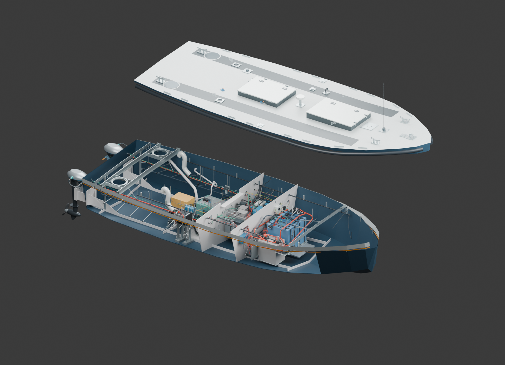

# 这艘船各部分是做什么的

这是最终安装布局模型的使用说明。主要机械、动力、管路和配电已经建入模型；设备内部按总成表达，真实控制协议与部分端头仍待资料确认。它不是已经下水验证的成品船。

图中右边是船头，左边是船尾。上方是移开的甲板与上部船壳，下方是剖去近侧部分舷板后的舱内总装。拆分仅用于看内部，实船甲板不是设计成可整块吊开的模块。几何尺寸和重量以“最终总装.blend”为准。

## 从船尾往船头看

船尾两侧是电动推进器；往前是机组、排气与舱底排水区域；中部布置燃油、控制和联锁相关设备；再往船头是双动力电池及主配电。各舱之间的隔板、纵骨和横框组成船体承力结构。具体设备坐标可以在 Blender 中按下表对象名称搜索，不能靠拆解图上的投影距离测量。

| 系统/零件 | 干什么用 | 与谁相连、有什么区别 |
|---|---|---|
| 船壳、船底、艏艉结构 | 排开水产生浮力，承受水压和外力，包住船内设备 | 船壳不是只追求厚重；强度、重量和重心必须一起考虑 |
| 纵骨、横框、舱壁、甲板梁格 | 防止船底和甲板大面积变形，把设备、人员和推进器载荷传进船体 | 舱壁分隔不同区域；不能仅凭外形把每道隔板都称为已验证水密舱壁 |
| 甲板、机组舱盖、电池舱盖 | 供人员通行，挡雨浪，提供日常检修入口 | 密封条、压紧扣和铰链共同工作；开盖用撑杆/锁销支撑 |
| 艉部局部检修口与加强圈 | 从甲板接近系缆座/艉部紧固件，伸手和工具进去 | 加强圈与梁格补偿开孔后局部刚度损失 |
| 两台 Navy 6.0 Evo 电动推进器 | 螺旋桨向后推水，推动船前进；反转用于倒车和制动 | 两台候选额定电输入各 6 kW。船以左右推力差转向；一侧多推、另一侧少推或反推会产生转向力矩。不是柴油机直接带桨，也不能把 12 kW 换算成一个已验证航速 |
| 艉座、肘板、连接纵骨 | 承受两台推进器重量、推力及反推力 | 将载荷传入骨架；外观贴合不等于焊接强度已经认证 |
| 抬机机构、检修支撑与防脱插销 | 使推进器抬起后可检查/拆桨，并限制支撑意外脱开 | 50° 检修为已有设计工况；内部净距与真实锁止仍需核验，80° 拖运未关闭 |
| 两块 E163 动力电池 | 储存推进与船载设备用电 | 两块并联保持约 51.2 V，容量合计 326 Ah、约 16.7 kWh 标称；这些是候选铭牌参数，不代表全部能量都能用完 |
| 电池托盘、限位与压紧件 | 把重电池固定在较低位置，防止船运动时滑移 | 电池本体、支承和紧固件一起受力；运行中不允许靠线缆拉住电池 |
| 柴油发电机组（Panda 5000i PMS 候选） | 把柴油的化学能变成电能，给船上电气系统补充能源 | 通过原配电力电子单元和交流回路给充电设备供电；并非直接机械驱动两副桨，也未证明能持续抵消双机满功率耗电 |
| PMGi/原配功率转换单元 | 将机组原始电输出变为系统需要的交流电 | 图中“逆变器”按机组原配系统边界理解，不是额外无限功率电源 |
| 动力电池充电器（25 A 候选） | 把交流电变成受控直流电，为 E163 充电 | 与电池管理系统配合限流；充电器不是直接给每台推进器提供满推功率 |
| 独立 12 V 启动电池 | 给柴油机起动机供短时大电流 | 与高压动力电池用途不同；独立维护充电器负责补电 |
| 启动维护充电器 | 长期维持启动电池电量 | 当前 Blue Smart IP67 12/7 候选；线缆、支架与散热间距已布局 |
| 油箱、加油口、通气管 | 储存柴油，允许加油及油箱随油量变化呼吸 | 通气出口不是排气管，也不是冷却排水口；三油况预算为 60/30/6 L |
| 燃油切断阀、粗滤器、输油泵、供回油管 | 控制燃油通断、滤除杂质、把油送入机组并让回油返回油箱 | 燃油滤杯是维护件；管嘴和实际泵能力仍须与选定实机匹配 |
| 海底取水口与海底阀 | 从船外取冷却水；关阀可隔离船外水源 | 海底阀必须能可靠关闭，不能靠滤杯或快接代替总隔离 |
| 冷却滤器、双快接、关阀机械联锁 | 滤掉水中杂物，方便拆洗；机械结构限制错误拆卸顺序 | 两个快接对应进、出水。低位运行是为了吸水条件，检修时才能按流程提起；快接不是“随便拔” |
| 机组冷却泵及机内换热通道 | 使冷却水流过机组相关换热部件，带走热量 | 机内部分按原厂总成处理；位置灯全绿不代表流量一定足够 |
| 冷却联锁控制盒、8 个探头、4 只状态灯 | 识别阀芯、锁销、海底阀及运行位，形成过程许可；灯显示四个阀芯位置 | LOGO 输入读取 PNP 探头，输出驱动灯；机组真实许可接口止于隔离端子，未猜针脚。普通 LOGO 不是安全 PLC，也没有因建模就自动具备已下载程序 |
| 湿排气软管、水锁、鹅颈与贯舷出口 | 排走机组废气和伴随冷却水；水锁接纳停机回水，鹅颈降低外水倒灌风险 | 它处理机组排气，不负责把船舱积水排掉。机内真实关键边尚缺尺寸，600 mm 高差不能宣布实机满足 |
| 舱底低点吸口、自吸排水泵、20→19 mm 接口 | 把机舱低处的少量积水抽到船外 | 与发动机冷却泵是两套系统。不是大破口进水时保证船不沉的设备 |
| 舱底排水回环、防虹吸阀、通舷口 | 停泵后打断可能形成的虹吸，减少船外水反向进入 | 防虹吸阀需能拆洗；不能把它当永远不会堵的单向保证 |
| 机舱通风筒、法兰和网罩 | 给机舱通风、为设备散热和机组进气提供通道 | 下端向机舱敞开是设计通风口，不是遗漏软管 |
| 主配电柜、母排、保险和隔离开关 | 分配电力，隔离检修回路，限制故障影响范围 | 动力大电流回路与辅助小电流回路分开；保护配合仍受实际保险曲线和短路电流约束 |
| 48→12 V、12→5 V、12→24 V 变换器 | 给不同电压的泵、控制器和传感器供电 | 低压设备不能直接接动力电池；专用正负回线已布局，船壳不当电源负线 |
| 工控机 | 运行任务管理、感知处理、航线等高层软件 | 目前是安装与供电布局，不代表自主驾驶软件已经完成 |
| 飞控/控制器 | 根据航向、速度等反馈执行控制逻辑 | 需要真实推进器接口与反馈；不能把两端画一根线就当控制协议已接通 |
| GNSS 接收机与定位天线 | 提供位置、速度等导航信息 | 天线需要合适视野；单天线不等同双天线航向测量系统 |
| 遥控接收机、遥测电台和通信天线 | 接收人工控制、把状态数据传回岸上 | 人工接管链路与普通数据链用途不同，抗干扰和失联响应未由模型证明 |
| 网络交换机、视频编码器及信号束 | 连接船内数据设备、汇集网络或视频数据 | 当前外部路径已有，确切端口和针脚仍须设备接口表 |
| 独立停机接收/许可模块 | 为外部停机或许可控制预留设备与回路 | 真实原厂停机接口未完全闭合；不能当作已认证的应急停机系统。未重新加回用户要求删除的甲板按钮 |
| 护舷条、艏艉系缆桩、背板 | 靠泊时缓冲接触、固定缆绳、把缆绳拉力分散到结构 | 收缆通道和天线间距应保留，不能让绳索扫过设备 |
| 线夹、管夹、支架、穿舱套和密封件 | 固定管线，减少振动、磨损和穿舱处渗水 | 这些不起眼的小件决定安装可靠性；模型仍不是逐条焊缝/压接的施工详图 |
| 摄像头与雷达 | 将来用于观察、感知和避障 | 按此前要求保持暂停/岸存状态，本轮没有重新安装；当前不能称为已具备 360° 视觉覆盖或完整雷达感知 |
| 码头独立检修平台、量规和样板 | 给岸上检修定位、测量及接近推进器使用 | 属于岸上附件，不计入航行时船上载荷，也不是船体的一部分 |

## 三条主要流程

1. **推进用电：**动力电池 → 保险/开关/配电 → 左右电动推进器 → 螺旋桨推水。
2. **补充能源：**柴油箱 → 供油系统 → 发电机组 → 原配电力电子与交流配电 → 充电器 → 动力电池。启动电池负责启动机组，辅助变换器给小设备供电。
3. **冷却与排水分开：**船外水 → 海底阀 → 冷却滤器/快接 → 原机冷却系统 → 湿排气。船舱积水 → 低点吸口 → 舱底泵 → 防虹吸回环 → 船外。

## 还不能称为“完成可用”的地方

主要模型已经具备，但自主控制协议/端口、机组真实许可接口、电池与推进器端头细节、保护协调、机内排气关键边、冷却性能和若干实物净距仍有未决项。详见[最终未决项](最终未决项.md)。缺资料与必须实测已经分开；没有用删除旧文件来删除这些工程问题。
