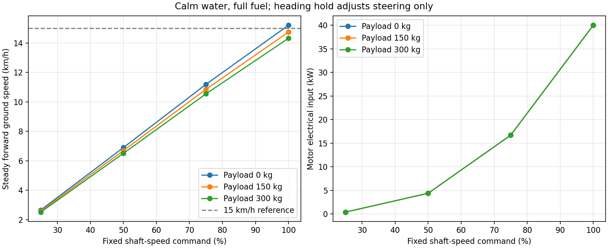
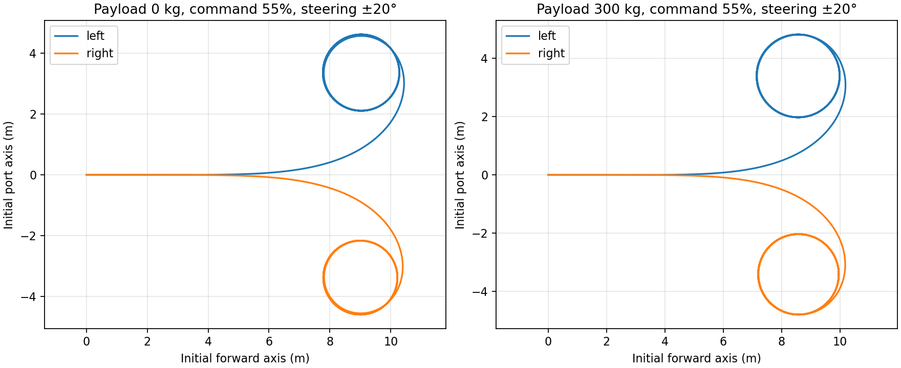
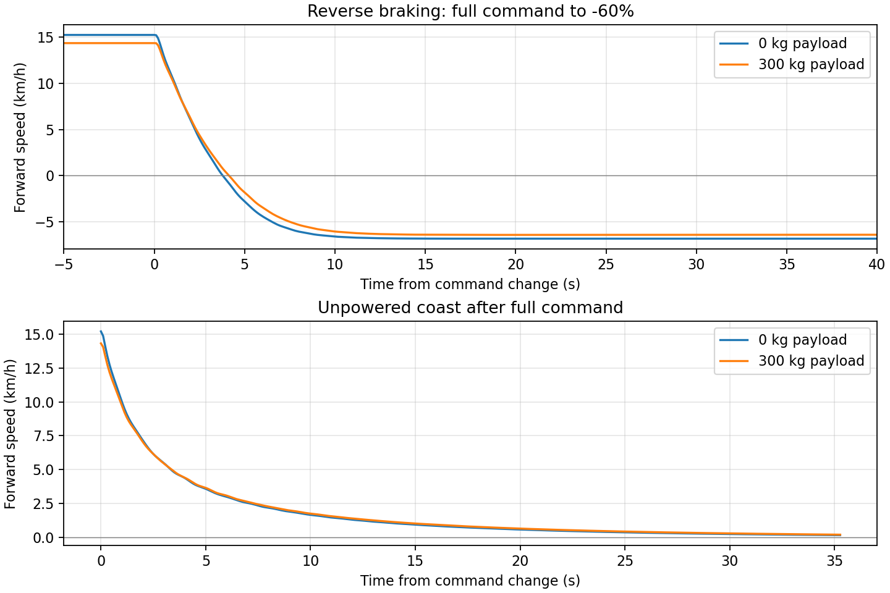
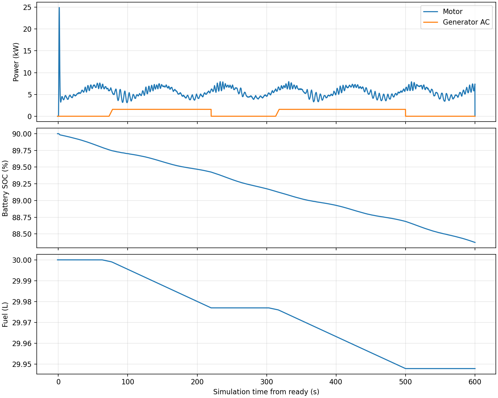

> 这是修复航向稳定性之前的基线报告；原始 CSV 和完整失败记录保留于本地 artifacts，未全部上传。历史命令请按当前目录结构转换。

# 2026-11-21 阻力、操纵与启动可靠性改进

## 结论与未解决项

完成 29 个本轮原生 Gazebo/ROS 工况，固定油门直航、回转、倒车制动、连续转向、10 分钟风浪流航行及保护测试；运行/数值检查全部通过。另完成同一 C++ 能源模型的 2 小时计算。本轮不运行或扩展 ArduPilot。

**仍未解决：高速零舵的被动航向稳定性。** 零舵试验的舵角跟踪通过，但船仍持续转弯。因此不能把所有运行检查通过解释成“船体物理模型已经全部验收”。当前正常直航应使用航向保持，后续需改进侧向/偏航水动力、尾部附体作用及系数辨识；不能靠提高航向控制增益或修改通过阈值掩盖这一问题。

## 已修改的部分

1. 控制器新增 `/usv/control/health`，待机也持续发布能源、推进反馈、舵机及导航数据的新鲜度、缺失项、通信重试次数和通信分区。启动入口等待连续就绪且物理时间确实推进，未就绪就超时退出。
2. 控制调度/健康检查改为 `STEADY_TIME` 定时器，控制积分和动态计算仍使用原生能源状态中的物理时间。避免 ROS `/clock` 未桥接或暂停时连看门狗都不执行。
3. 必需的 ROS 控制器或桥接节点退出时，launch 自动关闭其余接口，平台清理 Gazebo。每次性能试验采用唯一 Gazebo 分区，验证健康消息来源，记录初始 SOC，并在退出时清理分区内残留进程。
4. 阻力增加实际浸水几何依赖：线性和转动阻尼按浸水面积比例缩放；平动二次阻尼按对应方向的浸水表面法向投影面积比例缩放。名义参考固定，绝不为每个载荷重新归一化。
5. 舵机增加 `Ki=100 Nm/(rad·s)` 的积分力矩，受原有力矩、速率和功率限制，带饱和防积分累积与断电/复位清零。修正比例/微分控制在持续负载下留下的角度误差；这不是厂家标定参数。
6. 新增 `/usv/actuators/heading_hold_throttle`（ROS Float64，−1..1）：保持给定桨轴转速请求，只调舵保持航向，不闭环调航速。固定油门曲线采用此模式。原直接油门/舵角和 `cmd_vel` 接口仍保留。

## 阻力依据和适用边界

参考面积由现有封闭船体几何在名义满油静水平衡位置裁切得到：浸水面积约 10.3363 m²，X/Y/Z 方向半法向面积积分约 [0.36034, 1.24373, 4.49332] m²。参数在 `resistance.json`，完整来源和几何哈希随记录保存。

在固定系数近似下，二次阻力随参考面积变化；[ITTC 阻力试验规程](https://ittc.info/media/1816/75-02-02-01.pdf) 也用浸水面积进行阻力系数化。这里的分方向投影和线性/转动面积缩放是额外的工程假设，不能称为 ITTC 认证模型。没有额外叠加一套摩擦阻力，以免与原有总阻力预算重复计算。

阻力形式为 `F_i = −D_i·(S/S_ref)·v_i −Q_i·(A_i/A_i_ref)·v_i·|v_i|`，速度相对于当地水流。系数非负，阻尼相对于水的耗散功率非负，代码有对应解析单元测试和运行时记录。波浪/流仍可向船传递能量，这不等于整个船的世界坐标机械能只会下降。仍缺少实测/CFD阻力、频率相关附加质量、高速兴波、滑行、砰击和空化标定。

## 固定油门直航曲线

满油 60 L，附加载荷重心 [0,0,0.6] m，静水；各点给定固定油门 45 秒，取末 8 秒均值，再零油门滑行 35 秒。油门是归一化桨轴转速请求，**不是功率百分比**。航速为船体纵向对地速度，直航只通过舵控制航向。

| 附加载荷 kg | 25% km/h | 50% km/h | 75% km/h | 100% km/h | 满油门电功率 kW |
|---:|---:|---:|---:|---:|---:|
| 0 | 2.664 | 6.900 | 11.195 | 15.210 | 40.000 |
| 150 | 2.588 | 6.695 | 10.857 | 14.747 | 40.000 |
| 300 | 2.519 | 6.509 | 10.550 | 14.325 | 40.000 |



无附加载荷的满油整船约 1539 kg；载荷越大，浸水面积/投影面积和阻力随之变化。没有为了让全部工况达到 15 km/h 而增加功率或修改阻力系数。以上是 40 kW、六电池概念配置的仿真结果，不能拿来宣称 6 kW 基础配置也具有同样性能。

| 阻尼敏感性 | 满油门航速 km/h |
|---|---:|
| drag_low | 17.063 |
| curve_0_100 | 15.210 |
| drag_high | 13.858 |

drag_low / drag_high 为原阻尼系数的 0.75 / 1.25 倍；这是输入敏感性，不是概率置信区间。表格保留的小数位用于数值复现，不代表实船预测精度。

## 滑行、倒车制动与转弯

| 载荷 kg | 满油门后滑行至纵向速度绝对值<0.1 m/s 时间/距离 | −60%反推制动时间/距离 | 左/右回转半径 m |
|---:|---|---|---|
| 0 | 25.32 s / 16.78 m | 3.70 s / 7.31 m | 1.26 / 1.22 |
| 300 | 27.18 s / 17.24 m | 4.00 s / 7.42 m | 1.42 / 1.38 |

回转采用 55%固定油门、±20°舵角，取末 8 秒实际轨迹长度/航向变化量计算船体 link 原点的局部回转半径，不是重心半径或标准战术回转直径；因侧向/偏航模型尚未验收，不能当成实船最小转弯半径。另测 0/300 kg 载荷下 ±15°交替转向、持续倒车和松油门。这里的制动阈值是船体纵向速度，不是“绝对静止”；风浪流中的漂移也不应按静水停船理解。





## 零舵诊断

无附加载荷、100%油门、零舵指令的 45 秒诊断中，后段最大实际舵角偏差约 0.0000°，但累计航向变化约 -1375.0°。**舵机跟踪改善没有消除被动航向不稳定。** 此试验用于揭示侧向/偏航模型的不足，不作为直航极速数据，也不作为已解决项。

先前仅有比例/微分项时，同类零舵诊断约有 2°持续角度偏差；原始曲线在 attempts_before_heading_and_servo 中保留。禁止把零舵转圈时的船体纵向速度当作满油门直航航速。

## 长时间油电与故障保护

10 分钟实际 Gazebo 航行：150 kg载荷、30 L油、wave gain 0.3、世界坐标风 [0,6,0] m/s、流 [0.15,0.1,0] m/s，指令 2 m/s、偏航角速度 0.06 rad/s，辅助用电采用采集工况。发电机在 60–220 s、300–500 s 两次启用，实际经历启动、暖机和运行。结果：SOC 0.90000 → 0.88373，耗油 0.052150 L，电池最高温度 25.061°C。



- 暂停所属 ROS 传感器桥接后，导航过期会停推；恢复桥接并继续发送新指令后恢复航行。
- 初始 SOC=0.155 的 180秒工况检查低电量降功率；初始电池44.8°C、环境40°C的180秒工况检查温度降功率。这些是明确注入的边界条件，不是假称自然工况一定会过热。
- 初始燃油1.005 L、强制发电机启用的120秒工况检查拾油储备1 L处停机/故障；电池供电仍可继续推进，燃油耗尽不等于动力电池耗尽。

另运行相同 C++ 能源模型 2 小时：固定请求40 kW、6电池、采集辅助负载、8 W舵机代表值。它不计算长时间6自由度运动，不可当作真实续航/航程预测。

| 发电机 | 首次无法满足40 kW请求 min | 电池最高温度 °C | 2h耗油 L |
|---|---:|---:|---:|
| 关闭 | 53.50 | 45.167 | 0.0000 |
| 持续开启 | 55.33 | 44.383 | 0.9557 |

上述温度模型只覆盖现有集中参数电池模型；电机、驱动器、线缆温升及电芯不均衡尚未建模。25 A充电器限制实际补能，不能把4 kW发电机铭牌功率当作持续40 kW推进供电。

## 启动问题的复现、修复和证据

- 关闭时钟桥接：旧版无健康状态、未开始试验；改为独立调度后，相同条件可进入就绪并行驶。见 attempts_clock_before 与 clock_independent。
- 某次原生 fuel_mass 状态订阅未发现发布端：首轮拒绝开始，保存缺失流；新增有界重订阅后仍要求实际数据到达，未用占位值代替。
- 中止重试后发现同名分区残留实例，出现启动时物理时间已达约205秒、SOC非初值，导致混合数据。此轮数据废弃留档，改用每次唯一分区、健康消息分区匹配、初始SOC核对、完整退出清理后重跑。
- 调度器收到中止信号、测试子进程被强制杀死的独立试验均确认无残留分区进程；后者由父调度器兜底清理，不能仅依赖子进程 finally。
- 控制器强制退出试验：整个启动栈自动关闭，没有遗留子进程。无控制器的就绪检查按时超时拒绝，不会显示“可开船”。
- 故障注入脚本曾向 ROS double 字段传入整数而触发原生类型断言。已在构造消息时显式转换 float，保留失败记录并重做该工况；增加异常退出兜底清理。此问题属于测试工具，不是船体物理故障。
- 部分早期结果导出遇到 numpy.bool_ 无法JSON编码：原始CSV、阶段时间和就绪记录已保存。只重做后处理，并以 postprocess_recovered 标记；没有修改原始运动数据。

## 复现、接口与文件

在 gazebo_sim 目录，先 source /opt/ros/jazzy/setup.bash 和 install/setup.bash。正常开船仍用 `bash scripts/run_platform.sh`；看到 Boat ready 后再发送控制指令。健康状态可用 `ros2 topic echo /usv/control/health` 查看。固定油门航向保持可持续发布 Float64 至 `/usv/actuators/heading_hold_throttle`，停止发布后看门狗停推；不得同时混用直接舵角和该模式。

```bash
python3 scripts/run_performance_suite.py --spec docs/参数与数据/阻力操纵与启动验证_2026-11-21/spec.json --output docs/参数与数据/阻力操纵与启动验证_2026-11-21
python3 scripts/report_vessel_performance.py --output docs/参数与数据/阻力操纵与启动验证_2026-11-21
```

调度器跳过已通过的结果。完整重跑请使用新的输出目录并复制spec.json，避免覆盖历史证据。每个工况保存模型/世界快照、原始CSV、健康日志、就绪状态、阶段定义、来源哈希及结果。CSV无表头，字段见 schemas.json。读取已有CSV的独立后处理入口为 analyze_performance_run.py。

10项C++物理/能源/舵机测试、3项就绪窗口测试通过；实际运行证据见 summary.json、assessment.json、launcher_controller_exit.json 和 energy_2hour/result.json。

## 后续优先项

优先完善高速侧向/偏航水动力和艉部附体对方向稳定性的作用，做虚拟斜航/回转辨识与步长敏感性对照，再评估是否需要修改模型或实际几何。当前没有实船数据，不应直接给阻尼“调到看起来稳定”就当成真实。随后再扩展更长时间、更大风浪和设备热模型。继续暂缓 ArduPilot。
