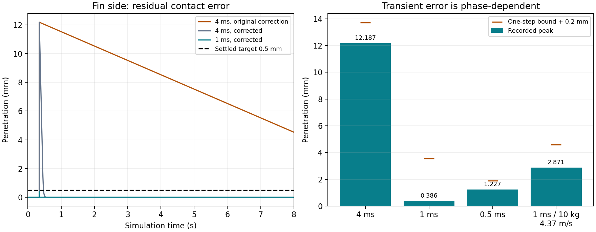

# 薄鳍接触精度与加鳍后长时运行

本轮保持鳍的真实外形、质量、惯性、浮力和水动力不变，不接 ArduPilot/Nav2。先修接触测试入口和数值接触精度，再用同一固定版本补长时航行与操纵验收。14 项生产接触检查、7 项可靠性工况、11 项操纵工况全部通过；另外保留 8 项接触归因对照，其中 3 项按预期失败。下面分别给出证据和未覆盖范围。

## 原因与证据纠正

上一轮接触脚本未设置 `GZ_SIM_SYSTEM_PLUGIN_PATH`，日志记录 `libUsvPhysics.so` 加载失败；Gazebo 使用默认 Physics 系统。因此旧 8/8 只能说明该次默认后端的宽松支撑测试，不是自有后端精度证明。原日志保留，旧报告添加纠正链接。生产航行入口本来就设置了插件路径，本问题不能直接推断旧航行试验也使用了错误后端。

原接触判据允许厘米级高度范围，没有直接约束薄鳍穿透；50 Hz 位姿采样还可能遗漏单步冲击峰值。新入口明确加载本地构建库，验证日志中的参数回读，逐物理步采样，以单条 `Pose.header.stamp` 为准（`Pose_V.header` 在此发布器中未填时间）。运行前后检查源码、安装产物和测试器内容一致。

DART 6.13.2 默认 ERP=0.01，最大回正速度 0.001 m/s。初次离散检测已经产生的穿透只能缓慢消除，4 ms 时约 3.36 m/s 的探针每步可移动 13.4 mm。稳态修正和瞬态积分误差应分别验证，不能通过把鳍加厚或移开碰撞面隐藏误差。

依据：[DART 6.13.2 ContactConstraint 源码](https://github.com/dartsim/dart/blob/v6.13.2/dart/constraint/ContactConstraint.cpp)、[gz-physics 7.8 接触适配](https://github.com/gazebosim/gz-physics/blob/gz-physics7_7.8.0/dartsim/src/SimulationFeatures.cc)、[Gazebo PosePublisher 时间戳实现](https://github.com/gazebosim/gz-sim/blob/gz-sim8_8.15.0/src/systems/pose_publisher/PosePublisher.cc)。这是已安装版本的数值算法依据，不是本船材料或接触刚度实测。

## 正式策略

- 场景最大步长 1 ms，DART 内部碰撞检测器显式使用 ODE；动力学仍为 DART，没有换成 ODE 动力学引擎。
- ERP=0.2，最大法向回正速度 0.1 m/s。保留默认零穿透容差及 CFM；没有增加接触面的几何厚度、恢复系数或摩擦系数。
- DART 6.13.2 的这两个设置是进程级静态参数，不能用未实现的逐材料 SDF 字段冒充生效。自有 Physics 通过原生 API 设置并回读；同进程显式冲突设置被拒绝。本平台每个试验独立进程和分区；混合不同设置的多世界进程不在支持范围。
- `tools/lib/contact_physics.py` 为静水和悉尼生成器提供同一规则；原始 Blender 和鳍网格未改。补丁同步保存在 `dependencies/patches/gz-sim8-runtime-inertia.patch`。

## 接触试验方法和门槛

固定船体，半径 25 mm 均质球自由下落。法向无摩擦导轨只约束侧移和转动，不提供竖直支撑，避免球从窄鳍或曲面滚落被误判为穿透。原六个支撑方向和鳍端、鳍侧共八个位置保留；原高度判据不放宽。该夹具测试法向接触，不声称验证自由滚动或真实撞击损伤。

薄鳍另按实际凸网格计算有符号距离；球心进入实体内部也算穿透，防止只用无符号最近距离漏判。要求：

1. 仿真记录至少 8 s，逐步采样无跳步；最后 1 s 球面间隙绝对值 ≤0.5 mm。
2. 峰值穿透 ≤ `v_impact * dt + 0.5*g*dt² + 0.2 mm`。这是离散检测的一步运动上界加求解余量，不是零穿透保证。冲击速度由球心高度减半径计算。
3. 默认 1 ms、0.5 ms 收敛、0.1 kg 轻探针及 10 kg / 1 m 落高（约 4.37 m/s）分别验证；基准与 40 kW 概念装配都覆盖。
4. 源码/构建绑定、插件加载和参数回读均为必需项；合成单元反例确认 6 mm 穿透、球心进入实体和漏采样均不能通过。

开发中未设置插件路径、错误读取 Pose_V 顶层时间戳及自由球滚落的尝试均保留在本地 artifacts，不替换为成功记录。诊断全局预加载器只用于归因，没有进入仓库或正式运行入口。最终归因采用随后正确加载并绑定版本的对照。

## 长时与回归范围

复用原 `platform_reliability.json` 七项：完整 1200 s 六自由度风浪流运行，以及低电量、高温、燃油储备、导航断流、指令停发、独立时钟检查。长时工况为 150 kg、30 L、wave gain 0.3、横风 6 m/s、流 [0.15,0.1,0] m/s，直接油门 0.55、舵 5°，包含两次发电启停。不是航向保持，也不是两小时完整航行。

另预声明 `contact_physics_regression.json` 十一项：40%/60% 左右倒车恢复、轻载与重载全速、左右回转、蛇形，以及 600 s 全速前进和 600 s 60% 倒车。沿用原操纵判据。所有航行测试保留船体六自由度、波场、油电、质量更新，隔离水面和图像计算；不冒充完整悉尼地图长期避障或 GPU 验收。


## 测试隔离修正与保留的失败

首次同时启动两份航行 spec 时，旧测试器以 `30 + 工况索引` 选 ROS 域。不同 spec 的相同索引发生重叠：保护试验的停推区间收到另一套倒车试验的 −0.4 指令，另一试验也出现导航新鲜度异常。因此两套首轮航行停止并保留，不能把被串扰的片段拼成连续验收。

现在原生性能测试使用同用户共享文件锁，独占租用 120–159 的测试域，记录实际域号；租约保持至子进程清理完毕。跨进程单元测试验证互斥与释放。它只能协调使用该机制的本机测试，不保证隔离任意外部、不遵守租约的 ROS 节点或独立容器。

接触多探针并行发布曾出现最后几个探针无数据，不能视为物理通过。正式矩阵逐位置独立运行；暂停启动、微步握手，所有采样就绪后才释放落球。启动服务超时和缺采样仍为失败，不改变穿透门槛，不从其它运行补帧。

## 最终结果

[接触矩阵](contact-results.md) / [逐项原始接触结果](contact_summary.json) / [长时与操纵测量表](long-run-results.md) / [完整判据与结果摘要](long_run_summary.json)。

- 原 4 ms / 默认回正的末 1 s 薄鳍残余穿透约 4.46–5.46 mm；这是仍在缓慢衰减的残差，不称渐近稳态。修正后的 1 ms 名义鳍端最大残余 0.00981 mm、鳍侧 0.000745 mm。
- 名义冲击峰值 0.386 mm；10 kg、约 4.37 m/s 探针峰值 2.871 mm。0.5 ms 末段误差减小，但峰值 1.227 mm 大于名义 1 ms 的实测峰值，因为首次碰撞采样相位不同。两者均在各自一步运动上界内；不能声称峰值单调收敛或零穿透。
- 修正 ERP 后的 4 ms / FCL 鳍端仍有约 11.78 mm 残余，而 1 ms / FCL 对照通过。本结论仅适用于该窄鳍接触，不泛化为 FCL 所有几何无效。
- 两项非法参数原生测试均被拒绝；见 [非法参数记录](invalid_contact_settings)。
- 加鳍后完整 1200 s 风浪流航行、6 项保护/时钟测试、600 s 全速前进和 600 s 60% 倒车均完成；所有试验使用直接指令，没有航向保持。



## 复现与证据范围

在 ROS 环境和依赖已安装后，从仓库根目录执行（安装及开船见 [ROS 操作指南](../../getting_started/README.md)）：

```bash
./usv build
python3 tests/integration/validate_contact_directions.py --case stabilizer_side --output artifacts/contact_recheck
python3 tests/regression/run_performance_suite.py --spec tests/scenarios/platform_reliability.json --output artifacts/reliability_recheck --workers 2
python3 tests/regression/run_performance_suite.py --spec tests/scenarios/contact_physics_regression.json --output artifacts/contact_maneuvers_recheck --workers 2
```

新输出目录避免覆盖证据。接触矩阵其余参数见每个工况的 `settings.json`；依次切换位置、步长和质量，不用缺帧数据补齐其它工况。1 ms 的计算量比旧 4 ms 更高，报告中的 20 分钟是仿真时间，可能需要更长墙钟时间。

每个长时工况先经 `trial_evidence.verify_case` 校验全部本地封存文件，再用原 `assess_maneuvers.assess_case` 对 11 项逐项评估，并按同一判据计算 55% 左右回转比较。通用 CLI 的 `--suite-kind maneuvers` 还强制要求完整旧套件的 35%/65% 航速及 100% 回转，因此不把本子集伪装为完整旧套件通过；未改变该检查器或其门槛。

公开目录包含原结果、工况、实际船模/世界/波场、版本与封存清单、选择性无损 gzip 原始遥测；完整本地封存包在 `artifacts/contact_endurance_2026-11-23`。公开选择集不是所有原始文件的完整镜像，`case_binding.json` 中未公开文件仍在本地原包；`published_manifest.json` 单独列出公开文件哈希。gzip 解压后的字节可对照原封存哈希。实际 SDF 中的绝对路径是当时运行记录，复现请用生成器重新生成，不直接跨主机加载证据 SDF。

版本以运行输入和二进制 SHA-256 为准，不给旧 Git HEAD 伪贴新结果。测试时工作区已有的悉尼预览文件未纳入本次提交：gain 0.3 的差异仅为等价 `ros_ws/../dependencies` 路径；额外 gain 1.0 模型没有被这些试验使用。快照仍如实包含这些本机资产，工况自身的波场副本单独封存，因此不声称原机整个资产树与干净检出逐字相同。

## 仍需完善与下一步

接触探针是刚体数值检查，不是整船撞码头、碰撞变形或鳍安装强度验证；10 kg 探针不能代表约 1.6 t 整船冲击。尚有配平偏航累积，重载航速仍约 14.29 km/h；水动力、热参数、真实桨性能图、滑行/砰击/空化和燃油晃荡仍缺少独立标定。1 ms 有性能代价，尚未补做加鳍后的完整悉尼地图 + GPU 图像/点云长时运行或独立容器复验。

建议下一步先做完整悉尼场景与传感器的连续运行及资源占用检查，再扩展水动力参数不确定性和实装净空/强度检查。继续暂缓 ArduPilot/Nav2。[当前问题清单](../known_issues.md)

## Code Supervisor 与版本绑定

[24 项人工工作表](code-review.md) 已完成。[最终 full](supervisor/full_final/report.txt) 的全部必需检查通过，实际构建后 12 项 C++、50 项 Python、5 项桨舵接口测试通过；构建结束后再次确认两份长时套件的输入/产物快照与当前工作区一致。上游源码加本地补丁逐字还原当前 Physics.cc，见 [补丁核验](patch_verification.json)。

本轮较早的 [deep](supervisor/deep/report.txt) 完成选定核心头文件 97.75% 行覆盖、12 项 ASan/UBSan 测试、12/12 转向积分有限变异，以及原生受力/推进回归。随后修改了 ROS 域隔离和接触启动确认，经过最终 full 和实际集成复验；[源码差异](supervisor/version_delta.json) 明确列出，不能把早期 deep 冒充最终测试器逐字相同的 deep。生产接触 C++ 与数值策略未在 deep 后变化。未运行 TSan，选定头文件覆盖率不代表整个 Physics.cc 或全工程覆盖率。

这些结果绑定修改后的工作树内容哈希；报告里记录的起点 Git HEAD `0ecd6719` 不是声称该旧提交已包含此次修复。发布提交可由本报告的 Git 历史查到；提交只包含本轮变更，用户已有预览生成文件留在本地。
