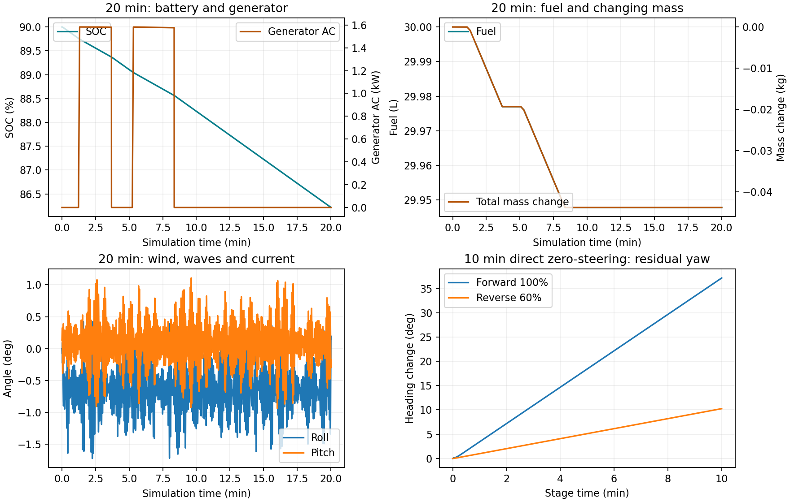

# 加鳍后固定版本长时与操纵复验

全部 18 项运行检查通过；11 项操纵另通过原独立逐项判据，55% 左右回转通过原半径对称性门槛。未执行的 35%/65% 航速阶梯及 100% 左右回转不计入本轮通过范围。

| 工况 | 结果 | 主要测量 |
|---|---|---|
| endurance_20min | 通过 | 完整阶段、健康/故障检查、能量/燃油质量一致性；详情见结果 JSON |
| sensor_dropout | 通过 | 完整阶段、健康/故障检查、能量/燃油质量一致性；详情见结果 JSON |
| low_soc | 通过 | 完整阶段、健康/故障检查、能量/燃油质量一致性；详情见结果 JSON |
| hot | 通过 | 完整阶段、健康/故障检查、能量/燃油质量一致性；详情见结果 JSON |
| fuel_reserve | 通过 | 完整阶段、健康/故障检查、能量/燃油质量一致性；详情见结果 JSON |
| clock_independent | 通过 | 完整阶段、健康/故障检查、能量/燃油质量一致性；详情见结果 JSON |
| command_dropout | 通过 | 完整阶段、健康/故障检查、能量/燃油质量一致性；详情见结果 JSON |
| recovery_40_right | 通过 | approach: -4.006 km/h, 偏航率 0.00226°/s, 累计 0.238°；pulse: -4.005 km/h, 偏航率 -0.51608°/s, 累计 -1.085°；disturbance_recover: -4.006 km/h, 偏航率 0.00226°/s, 累计 -5.104°；恢复 12.108 s |
| recovery_40_left | 通过 | approach: -4.006 km/h, 偏航率 0.00226°/s, 累计 0.238°；pulse: -4.005 km/h, 偏航率 0.52043°/s, 累计 1.094°；disturbance_recover: -4.006 km/h, 偏航率 0.00227°/s, 累计 5.433°；恢复 12.108 s |
| recovery_60_right | 通过 | approach: -6.752 km/h, 偏航率 0.01716°/s, 累计 1.667°；pulse: -6.749 km/h, 偏航率 -1.21183°/s, 累计 -2.529°；disturbance_recover: -6.752 km/h, 偏航率 0.01680°/s, 累计 -10.866°；恢复 19.575 s |
| recovery_60_left | 通过 | approach: -6.752 km/h, 偏航率 0.01716°/s, 累计 1.666°；pulse: -6.749 km/h, 偏航率 1.24876°/s, 累计 2.601°；disturbance_recover: -6.752 km/h, 偏航率 0.01747°/s, 累计 12.767°；恢复 18.970 s |
| neutral_100 | 通过 | neutral: 15.027 km/h, 偏航率 0.06246°/s, 累计 10.915° |
| loaded_low_fuel | 通过 | neutral: 14.287 km/h, 偏航率 0.06612°/s, 累计 7.697° |
| turn_055_left | 通过 | approach: 7.669 km/h, 偏航率 0.00841°/s, 累计 0.215°；turn: 6.583 km/h, 偏航率 13.84059°/s, 累计 664.847°；coast: 0.261 km/h, 偏航率 0.00349°/s, 累计 25.614° |
| turn_055_right | 通过 | approach: 7.669 km/h, 偏航率 0.00841°/s, 累计 0.215°；turn: 6.586 km/h, 偏航率 -13.81300°/s, 累计 -663.619°；coast: 0.262 km/h, 偏航率 -0.00348°/s, 累计 -25.650° |
| zigzag_10_10 | 通过 | approach: 7.669 km/h, 偏航率 0.00841°/s, 累计 0.215°；execute_1: 7.628 km/h, 偏航率 3.54851°/s, 累计 10.133°；execute_2: 7.471 km/h, 偏航率 -3.79004°/s, 累计 -20.973°；execute_3: 7.426 km/h, 偏航率 3.86912°/s, 累计 21.536°；execute_4: 7.426 km/h, 偏航率 -3.77654°/s, 累计 -20.715°；recover: 7.670 km/h, 偏航率 0.00857°/s, 累计 -17.750°；超越 [13.20329583220867, 14.192476874140262, 14.024533578697316]° |
| reverse_60_long | 通过 | reverse: -6.752 km/h, 偏航率 0.01716°/s, 累计 10.245° |
| forward_100_long | 通过 | neutral: 15.027 km/h, 偏航率 0.06246°/s, 累计 37.149° |

20 分钟工况原始 summary：

```json
{
  "max_roll_pitch_deg": [
    1.7231315795962008,
    1.1074033794269846
  ],
  "soc_start_end": [
    0.8999999988203634,
    0.8621654827114282
  ],
  "temperature_max_c": 25.148480381625056,
  "fuel_consumed_l": 0.052112767731099296,
  "sim_end": 1201.126
}
```

55% 左右回转比较：

```json
{
  "turn_055": {
    "left_radius_m": 7.763014315266854,
    "right_radius_m": 7.7813302981820405,
    "relative_radius_difference": 0.0023566105063496825,
    "limit": 0.2,
    "passed": true
  }
}
```



图中横轴均为仿真时间。600 s 零舵累计偏航如实保留；通过的是原角速度稳定门槛，不是自动保持原航向。
