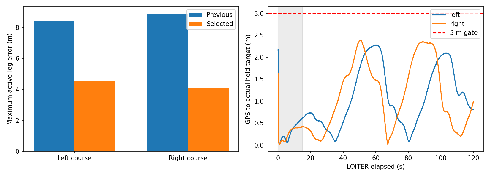

# 首弯与有流保持优化：2026-11-25

已采用低速参数组合，左右镜像航线各完成一次完整验收，均为 **25/25 通过**。本轮修改 ArduPilot 低速配置及验收工具，没有修改 ArduPilot 源码、船体水动力或推进器物理，也未接入 Nav2。结果只支持下述仿真工况，不代表实船标定或全工况保证。

## 结果与范围

| 指标 | 左向 | 右向 |
|---|---:|---:|
| 旧配置最大实际航段偏差 | 8.431 m | 8.897 m |
| 本轮最大实际航段偏差 | 4.557 m | 4.063 m |
| 本轮航段偏差 P95 | 3.593 m | 3.128 m |
| 本轮航段偏差 RMS | 1.498 m | 1.240 m |
| 实际保持目标最大距离，第15–120秒 | 2.280 m | 2.386 m |
| 实际保持目标距离 P95，第15–120秒 | 2.227 m | 2.335 m |
| 保持稳定段平均电机功率 | 291.2 W | 331.6 W |
| 同期平均辅助负载 | 172.5 W | 172.5 W |

测试使用低速 AUTO 1 m/s、RTL 0.8 m/s，恒流东向0.15、北向0.10 m/s；隔离水域、无波浪、关闭相机/点云渲染。LOITER 从60秒延长至120秒。航段最大偏差是整条路线的指标，不能当作首弯单独峰值。保持距离使用实时 GPS 到飞控实际目标的位置差，不以进入模式的位置代替目标。旧基线目标距离来自 DataFlash NTUN.WpDist，第15–60秒最大值为4.215/5.258 m；时窗不同，不能据此计算严格同比改善率。

完整数值见 [汇总](selected-comparison.json)、[左向结果](selected-left-result.json)、[右向结果](selected-right-result.json)。持续纠偏需要推进功率，上表不是长时间续航测量。

## 原因和采用参数

1. 原高速工作点的线性前馈在低速过大：约0.97 m/s直航只需8.6%控制油门，却给出约21.7%前馈，再靠约−13%积分抵消。采用 `CRUISE_SPEED=1`、`CRUISE_THROTTLE=9` 的局部拟合，同时设置 `SPEED_MAX=1`，避免外推摇杆速度。见[前馈证据](feedforward-fit.json)。这不是实测推进器曲线，不能直接用于15 km/h控制；原始 MANUAL 油门也不受该速度参数直接限速。
2. `ATC_DECEL_MAX` 从0.2降为0.1 m/s²，1 m/s的理想规划停止距离从2.5增至5 m，给有限惯性、推进和舵机响应留出减速距离。该参数控制规划，不直接修改船体速度或水动力。
3. 速度积分采用 `ATC_SPEED_I=0.02`、`ATC_SPEED_IMAX=0.05`，减少低速过量积分。保留 `ATC_BRAKE=1`；仅滑行制动的候选未通过双向保持。
4. `LOIT_RADIUS=0`、`LOIT_SPEED_GAIN=0.3`、`LOIT_TYPE=0`：取消自由漂移死区，允许前进/倒车回归。零死区不等于零误差。船首单向回归方案出现大圈，未采用。
5. `TURN_RADIUS=6 m`，请求转速/角加速度限幅20°/s、10°/s²，AUTO横向加速度限幅仍为0.03g。物理舵角±35°、关节速度和力矩限制保持不变。

完整参数见 [navigation_low_speed.parm](../../../ros_ws/src/usv_ardupilot/config/navigation_low_speed.parm)。[物理运行文件哈希对照](physical-runtime-comparison.json)证明模型、桥接及六个物理库保持一致。不能通过减小惯性或放大舵机能力来解释此次改善。

科学依据采用固定 ArduPilot 提交 `d9c5097c3d8333435712ffed86bca8ce00c4bb46` 的实现：

- [AR_AttitudeControl.cpp](https://github.com/ArduPilot/ardupilot/blob/d9c5097c3d8333435712ffed86bca8ce00c4bb46/libraries/APM_Control/AR_AttitudeControl.cpp)：速度前馈、积分及停止控制。
- [mode_loiter.cpp](https://github.com/ArduPilot/ardupilot/blob/d9c5097c3d8333435712ffed86bca8ce00c4bb46/Rover/mode_loiter.cpp)：LOITER目标、死区及前后回归。PSC参数不能直接当作LOITER控制增益。
- [AR_WPNav.cpp](https://github.com/ArduPilot/ardupilot/blob/d9c5097c3d8333435712ffed86bca8ce00c4bb46/libraries/AR_WPNav/AR_WPNav.cpp)：路径速度和停止规划。
- [Log.cpp](https://github.com/ArduPilot/ardupilot/blob/d9c5097c3d8333435712ffed86bca8ce00c4bb46/Rover/Log.cpp)：NTUN目标距离定义。

## 验收修正与版本证据

参数回读改为逐项限速，避免请求突发丢失回应；全部参数仍须正确才能正常解锁。失联注入前不再仅等待固定12秒，而是等待至少12秒，并验证连续至少2秒处于GUIDED、实测纵向速度>0.3 m/s且推进请求>0.05；最长准备60秒，失联后的18秒验收窗口未放宽。目标/GPS新鲜度、目标稳定性与连续观测也有独立检查。

- 左向原始记录：`artifacts/navigation/corner_hold_balanced_left_01/`。
- 右向原始记录：`artifacts/navigation/corner_hold_balanced_right_01/`。
- 两轮选用模拟镜像 `sha256:9a39de035e72e6d673e2b72dd39f33d20741e3990e60eded78ee2fb6adb5de45`，SITL镜像 `sha256:c94217aaf947e46f224d32512f84bb64067f87dabe1a3d45906a1da64b34fbcf`。
- 完整版本必须包含镜像和只读挂载的输入快照；镜像内早期参数副本不是实际验收参数。当前配置、测试和验收 helper 已与两轮输入逐字节核对一致。[左向镜像](selected-left-images.json) · [右向镜像](selected-right-images.json) · [左向输入哈希](selected-left-input-sha256.txt) · [右向输入哈希](selected-right-input-sha256.txt) · [Python依赖指纹](dependency-fingerprint.json)。
- ROS构建、12项C++测试、64项Python单元测试、5项接口测试通过，见[构建与测试日志](build-test-final.log)。
- code-supervisor **quick** 检查通过，见[报告](supervisor-quick-final.log)。quick不包含完整复杂度、覆盖率、sanitizer或mutation检查；构建及运行验收另行执行，不能称全档位审查通过。

[调查记录](investigation.md)保留失败和被放弃的方案；其中“下一候选”是当时的研究过程。只有上述balanced左右两轮是本次采用结果，文件名含final的旧候选不能代替本次结果。所有旧原始测试数据保留。

## 桌面状态及剩余工作

首次验收结束时桌面Gazebo已关闭，未向残留SITL写入参数。随后按用户要求于2026-11-25完成桌面演示：重启完整链路，使用已验收模拟镜像9a39de0，未解锁时应用并逐项读回26个低速参数，正常解锁后依次向东、北、西低速航行，LOITER保持30秒，再HOLD停推并确认上锁。保留悉尼场景及0.3波浪增益；这是GUIDED可视化演示，不是AUTO航线或抗流定量复验。见[桌面参数读回](desktop-parameters.json)、[事件](desktop-demo-events.json)；原始日志及截图位于 `artifacts/diagnostics/corner_hold_demo_2026-11-25/`。窗口和容器保持运行，船处于HOLD且未解锁。旧镜像标签保留为 `usv-simulation:pre-demo-20261125`。未发布GitHub或接入Nav2。

仍有约4–4.6 m航段峰值误差，尚不适合精密靠泊或狭窄航道。下一步应做不同流向/流速、风浪、载荷、水平定位扰动以及更长时间保持测试；不能只继续单工况调参。本次关闭渲染，不能代替完整悉尼相机/点云性能验收。15 km/h是另一动力工况，不是本轮导航验收速度。实体船仍缺少海试标定。

后续[恒流扩展试验](../current_envelope_2026-11-25/README.md)发现西向及北向流下保持超过3 m门槛，原双向结果依然有效但不能外推全流向；当前测试结束后桌面容器已关闭，参数和数据保留。
