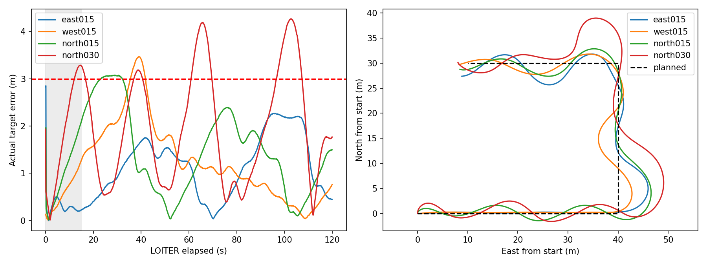

# 恒流方向与强度包络试验（2026-11-25）

四组完整流程已完成：东向0.15 m/s为25/25通过，其余三组均24/25，唯一失败项为LOITER实际目标最大距离超过3 m。自动航线、有流返航及其余检查全部通过。没有更改控制参数、船体物理或门槛来掩盖失败；目前不能宣布任意流向下均满足保持精度。

## 工况与定义

第一段航线朝东。世界坐标东向0.15 m/s、西向0.15 m/s、北向0.15 m/s及北向0.30 m/s各运行一轮完整验收。“顺流/逆流/横流”只相对第一段而言，转弯后相对方向随之改变。流场在AUTO、LOITER及RTL阶段生效，其他阶段清零，故不能把本轮称为全程恒流失联或全程恒流手动接管验收。

保持120秒、实际目标距离稳定段3 m门槛、原15 m航线走廊及其他检查均不变。无波浪、无风、默认载荷，关闭相机和点云渲染。每组仅一次，不能据此估计成功概率或认定最大安全流速。

使用现有入口新增 `--current-east`、`--current-north`（m/s），以及 `--current-navigation`（将水流覆盖AUTO和RTL；默认仍仅作用LOITER）。方向和阶段写入result.json的scope，切换命令写入events。输入分量要求有限且绝对值不超过1 m/s；该输入上限不是船体能力认证。默认参数0.15/0.10保留旧工况。

```bash
./usv navigation-test current_east015_new --current-navigation --current-east 0.15 --current-north 0 --timeout 1200
./usv navigation-test current_west015_new --current-navigation --current-east -0.15 --current-north 0 --timeout 1200
./usv navigation-test current_north015_new --current-navigation --current-east 0 --current-north 0.15 --timeout 1200
./usv navigation-test current_north030_new --current-navigation --current-east 0 --current-north 0.30 --timeout 1200
```

沿用[低速参数及物理依据](../corner_hold_2026-11-25/README.md)。测试使用独立飞控实例43及独立Gazebo分区；桌面仿真暂停，原数据保留。输入快照、镜像ID、DataFlash及CSV在各自artifacts/navigation目录保存。没有接入Nav2。

## 最终结果

以下保持误差使用GPS到实际飞控目标的距离，第15–120秒稳定段。原航段门槛15 m较宽，满足门槛不等于精密航行。

| 世界坐标流场 | 最大航段偏差 | 保持最大误差 | 稳定段平均电机功率 | 完整检查 |
|---|---:|---:|---:|---:|
| 东0.15 m/s | 5.990 m | 2.267 m | 324.6 W | 25/25 |
| 西0.15 m/s | 3.931 m | **3.468 m** | 395.5 W | 24/25 |
| 北0.15 m/s | 6.588 m | **3.075 m** | 378.1 W | 24/25 |
| 北0.30 m/s | 9.091 m | **4.265 m** | 841.0 W | 24/25 |



三项失败均为 `loiter_target_radius`，未放宽3 m门槛。全部流程到达complete；没有把未执行的检查计为通过。原始NTUN实时观察峰值与最终GPS重算峰值有少量采样差异，上表以result.json最终计算为准。辅助负载约172.5 W，应另计入总功耗；该短时均值不能外推完整续航。

[结果、全部检查、事件及参数](results.json)包含精确数值、原始结果SHA256和路径。用于图表的保持序列每10个原始观测取一个点保存于各工况 `*-hold.csv`，门槛判断和峰值使用全量原始观测，不能从降采样图重算验收。

## 发现与下一步

- 流向会改变跟踪和保持表现，不能把一次对角流通过当作全流向包络通过。恒流本轮也在AUTO/RTL阶段开启，与旧基线仅LOITER加流并非完全同条件对照。
- 保持稳定段实际舵角绝对值达到34°及以上的采样比例分别约51.6%、56.1%、48.2%、50.4%，表明执行器限幅频繁参与控制。它是调查线索，不是单凭相关性确定的唯一根因；即使通过的东向流也存在此现象。
- 加大北向流后航段偏差和功耗明显增加。应优先分解“目标距离峰值出现前后”的船头方向、舵角/参考角、正反推切换、速度积分和目标速度，区分转向受限、纠偏时序和速度控制的作用，再进行跨流向共同调参。不要提高舵机物理能力或削弱水动力只为过关。
- 当前不推荐立即接Nav2。下一步先解决西向/横流保持超限，并至少复测上述四组和原双向基线。风浪、载荷、水平定位噪声、通信延迟及完整相机/点云长测尚未在本轮执行。
- 每个工况只测一次，未测南向流，也未覆盖不同初始船头、随机种子、变流或流场切换的敏感性；不能宣称已找到临界流速或全向最大抗流能力。

## 代码、版本和验证

仅扩展已有集成测试和容器入口的水流选项，不新增常驻运行脚本，不改控制配置和生产物理。四组输入快照均与当前测试、入口、验收helper及低速参数逐字节一致，输入清单分别为 [东](east015-input-sha256.txt)、[西](west015-input-sha256.txt)、[北0.15](north015-input-sha256.txt)、[北0.30](north030-input-sha256.txt)。[当前源码SHA256](source-sha256.json)用于绑定本轮修改。

模拟镜像固定为 `sha256:9a39de035e72e6d673e2b72dd39f33d20741e3990e60eded78ee2fb6adb5de45`，飞控为 `sha256:c94217aaf947e46f224d32512f84bb64067f87dabe1a3d45906a1da64b34fbcf`。本轮新增测试和参数快照只读挂载，完整测试版本必须同时包含镜像ID与输入哈希，不能只引用镜像标签。

- [code-supervisor quick报告](supervisor-quick.log)：通过；未执行full/deep专项，不能称全档位通过。
- [构建及现有测试日志](build-test.log)：对未改生产代码的固定镜像重新构建12个ROS包，12项C++、64项Python、5项接口测试通过。新增集成脚本由宿主输入快照挂载后在四组实际试验中执行，不把镜像内旧脚本当成本轮测试代码。
- [输入拒绝检查](invalid-input-checks.json)：NaN、无穷及超范围水流均在启动仿真前返回错误；Shell语法、Python编译和diff空白检查通过。
- 试验原始目录为 `artifacts/navigation/current_{east015,west015,north015,north030}_20261125_01/`；批次退出记录位于 `artifacts/diagnostics/current_envelope_2026-11-25/runs.json`。失败原始数据完整保留，没有覆盖旧试验。

结束后四组临时容器已清理，桌面Gazebo/SITL保持关闭，既有EEPROM及参数文件保留。没有推送GitHub或接入Nav2。

后续[保持修正调查](../current_hold_2026-11-25/README.md)的七个候选仍未通过强横流门槛，未替换正式版本，不能把本轮失败项视为已修复。
