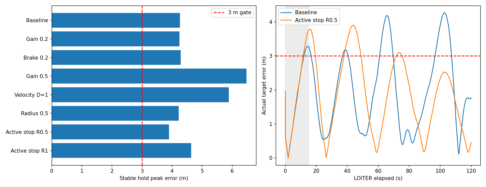

# 跨流向位置保持调查与未采用方案（2026-11-25）

**本轮未解决3 m保持门槛超限，不能宣布修复完成。** 七个候选均未满足北向0.30 m/s强横流工况。最好的本轮候选峰值为3.902 m，仍不合格；没有推广实验飞控、没有放宽门槛、没有改船体物理，正式低速参数已恢复到原验收版本。西向/北向0.15 m/s的问题也不能宣称已修复，因为这些候选没有通过强横流筛选，未进一步做全流向回归。

## 对照结果

全部候选使用相同模拟物理镜像、相同目标航速1 m/s、相同AUTO/LOITER/RTL恒流安排、无风浪和默认载荷。保持采样120秒，门槛使用第15–120秒GPS到飞控实际目标的全量距离峰值。

| 方案 | 保持峰值 | 稳定段电机均功率 | 状态 |
|---|---:|---:|---|
| 原正式基线 | 4.265 m | 841.0 W | 完整24/25 |
| 回归增益0.2 | 4.246 m | 533.0 W | 保持完成后中断筛选 |
| 制动0.2、WP_ACCEL=0.1 | 4.284 m | 866.0 W | 保持完成后中断筛选 |
| 回归增益0.5 | 6.472 m | 1017.8 W | 保持完成后中断筛选 |
| 实验水平速度阻尼D=1 | 5.888 m | 716.0 W | 完整24/25 |
| 原版保持半径0.5 m | 4.219 m | 466.7 W | 保持完成后中断筛选 |
| 实验主动零地速、半径0.5 m | 3.902 m | 539.0 W | 完整24/25 |
| 实验主动零地速、半径1 m | 4.640 m | 807.0 W | 完整24/25 |

完整24/25的唯一失败项均为 `loiter_target_radius`，HOLD、手动接管、有流返航及清流后的失联停推通过。筛选中断的工况，尚未执行或未完成的检查仍保持失败，不能算完整24/25。功率是短时稳定段电机均值，未包含约172.5 W辅助负载，不能外推续航。

精确结果、参数、事件、镜像ID和原始结果SHA256见[试验汇总](trial-summary.json)。每轮原始DataFlash、CSV、参数快照及日志保留在汇总中的 `raw_path`，没有覆盖或改写旧数据。每个候选只有一轮，不能把小幅数值差异当作统计上确定的改善。

## 查到的现象及尚未证实的原因

1. 基线强横流峰值前，船头与回归方向长时间相差约70°，实际舵角接近±35°，仍存在明显侧向速度。逆流峰值附近还出现推进换向。见[逆流峰值窗口](west015-baseline-peak.csv)、[横流峰值窗口](north030-baseline-peak.csv)和[峰值定位](baseline-peaks.json)。窗口使用最近时刻对齐，表中yaw为Gazebo世界坐标偏航角，不是磁罗盘航向。
2. 固定上游LOITER按距离给回归速度、按目标方位给船头方向，目标在后方时切倒车；航向误差90°时回归速度仍保留50%。矢量推进混控又受可用油门和实体舵角约束，所以请求转速不等于实际转头速度。
3. 更低/更高回归增益及单独加强制动均未奏效。速度阻尼改变回归方向后更差，说明不能照搬全向平台的速度矢量思路。
4. 原版停止控制达到停止判据时清空速度积分并停推；这与有流时持续维持零地速不同。实验仅在LOITER保留零地速反馈得到小幅改善，但半径增大后又退步，不能认定这就是唯一根因。

这些证据指向回归方向、有限转向能力、侧移和正反推时序之间的耦合；**尚未证明唯一根因，也未证明3 m在此硬件下不可能达到**。不能据此放宽指标、夸大物理能力或宣称已有通用最优参数。

固定源码依据：[mode_loiter.cpp](https://github.com/ArduPilot/ardupilot/blob/d9c5097c3d8333435712ffed86bca8ce00c4bb46/Rover/mode_loiter.cpp)、[AR_AttitudeControl.cpp](https://github.com/ArduPilot/ardupilot/blob/d9c5097c3d8333435712ffed86bca8ce00c4bb46/libraries/APM_Control/AR_AttitudeControl.cpp)、[AP_MotorsUGV.cpp](https://github.com/ArduPilot/ardupilot/blob/d9c5097c3d8333435712ffed86bca8ce00c4bb46/libraries/AR_Motors/AP_MotorsUGV.cpp)。完整假设和时序见[调查记录](investigation.md)。

## 保留的工程改动与版本

- 现有测试入口新增可选 `USV_SITL_IMAGE` 和 `USV_NAV_CONFIG_DIR`，供独立镜像、完整参数目录试验；默认仍为原正式镜像和原配置。输入仍冻结并只读挂载，不连接桌面实例。
- 两个互不叠加、默认关闭的实验补丁和离线构建配方保留用于复现失败结果，见[实验飞控说明](../../../deploy/sitl/README.md)。它们**不是官方发布固件，也未采用为正式方案**。原上游checkout无修改，正式镜像 `usv-sitl:rover-4.7.3` 未覆盖，Compose未切换。
- 所有试验模拟端为 `sha256:9a39de035e72e6d673e2b72dd39f33d20741e3990e60eded78ee2fb6adb5de45`；各飞控不可变ID和参数在汇总中逐轮列出。实验镜像包含显式补丁副本，版本必须按镜像+输入快照判断。
- [当前实验源码清单](final-source-sha256.json)、[构建输入镜像](build-images-final.json)、[速度阻尼编译日志](experimental-build.log)、[主动零地速编译日志](active-stop-build.log)。初始 `experimental-source-sha256.json` 对应第一版速度阻尼配方；后续配方改成可选补丁，以最终清单和所选补丁复现，不把旧哈希当当前文件。
- [code-supervisor quick报告](supervisor-quick-final.log)：仅其配置范围通过，未执行full/deep。上游补丁位于dependencies，未被项目自有C++自动规则扫描；已人工核对默认关闭、模式/船型门控、无效速度回退、参数索引及HOLD分支，完成真实编译和所列SITL测试，不能称为补丁已通过全档自动审查。

## 下一步

先停止继续盲扫增益，补做低速、有流情况下的定舵/换舵及正反推响应辨识，对齐期望转速、真实转速、侧移、推力建立和反转延迟。再据此设计回归方向切换的迟滞、制动与转头协调策略，并明确与官方固件兼容的实现范围。新策略必须复测四种流场和原双向基线，未经验证不推广。

风浪、不同载荷、定位扰动及传感器长测仍未覆盖。本轮未接Nav2、未推送GitHub。测试结束临时容器清理，桌面保持关闭，正式参数与数据保留。

后续[响应辨识](../response_identification_2026-11-25/README.md)三组9项检查通过，量出了约7.8秒全舵换向、约1秒推力反向与约5–7秒地速反向；保持超限仍未解决。
