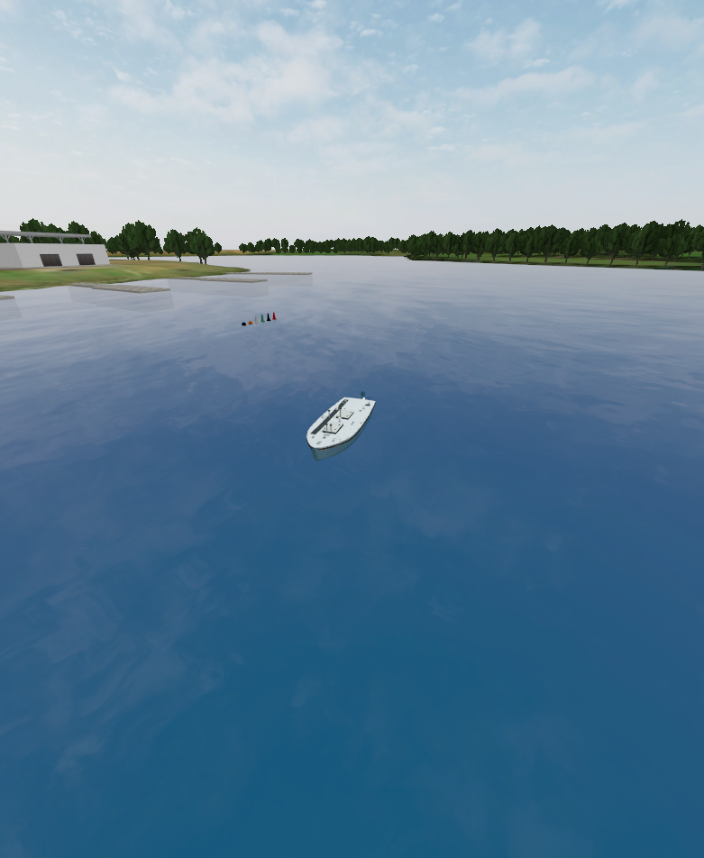
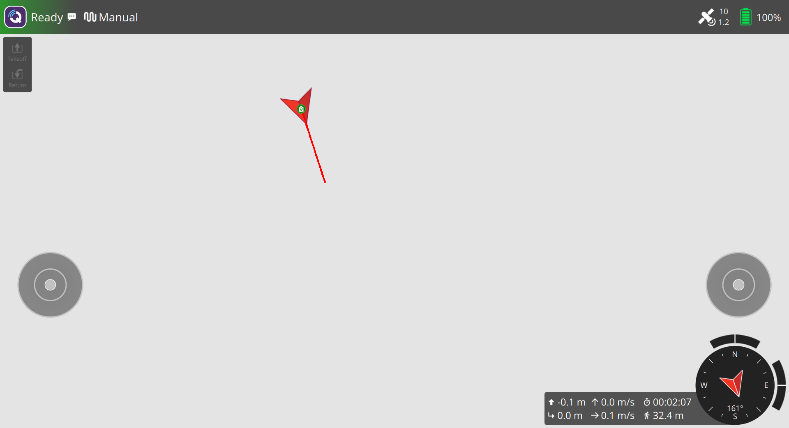
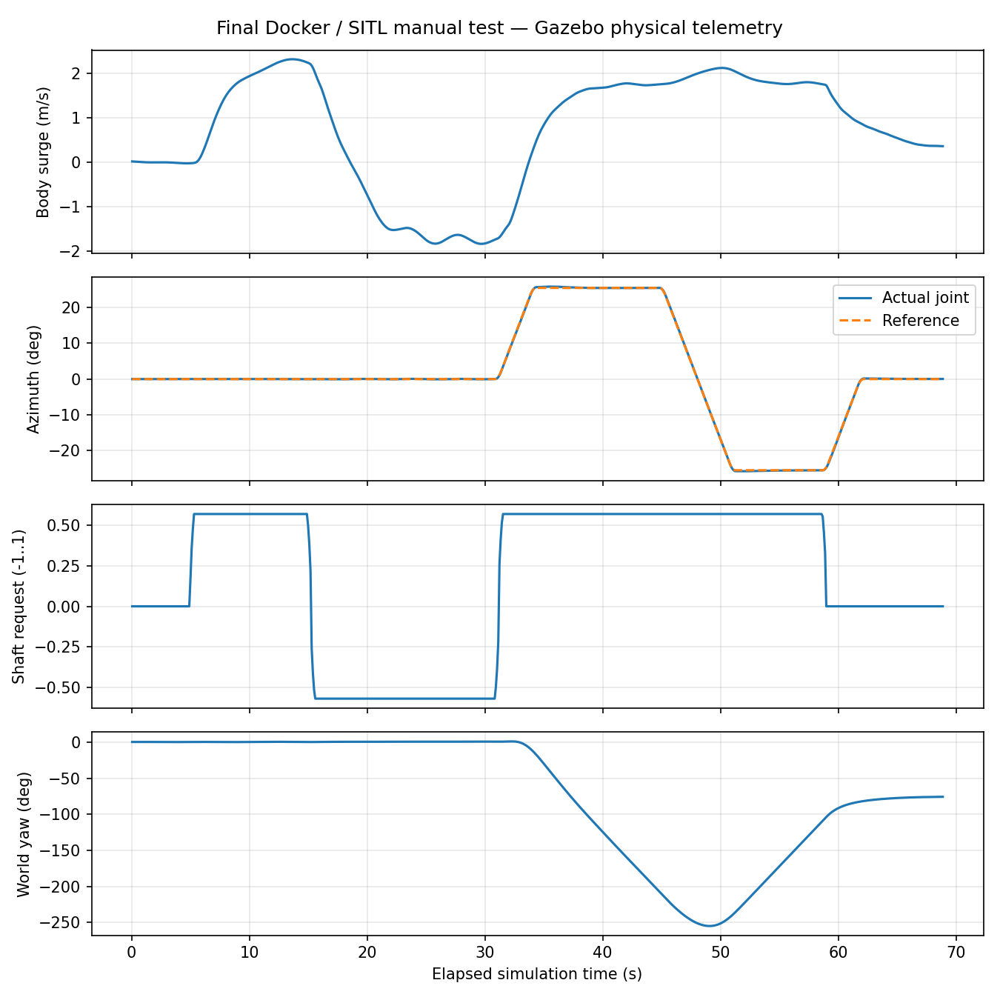

# 2026-11-24 桌面容器与 QGC 联合验收

本轮范围是本机Docker中的完整悉尼场景、相机/点云、ArduRover SITL、QGC基本手动操纵、资源与生命周期检查；不是对所有自动航行模式、真实硬件或所有故障类型的认证。Nav2未接入。操作入口见[桌面SITL指南](../../getting_started/desktop_sitl.md)。

## 发现的问题与修复

1. Docker构建上下文中父目录的否定匹配包含了旧build/install和无关依赖。最初两轮构建因此引用宿主机旧绝对路径。根因在上下文筛选，**不是基础依赖镜像本身含旧构建**。最终收紧父子目录规则，并在构建前断言旧产物、ArduPilot源码不存在；没有用删除缓存掩盖错误上下文。
2. Sydney顶层资源虽然本地化，地面站嵌套帐篷/桌椅、浮标跨模型网格和纹理仍用Fuel URL。新递归解析器生成离线副本、保留原文件，缺资源明确失败；补充[三个依赖的版本/摘要](additional-fuel-assets.json)。不删减地图模型来让启动通过。
3. NVIDIA设备和库已注入，但容器缺GLVND的NVIDIA EGL清单。Ogre实际选择llvmpipe，观测约0.3倍实时。Compose只读挂载清单并显式选用NVIDIA，日志确认RTX3060；没有降低相机/点云频率来改善数字。
4. 正式跨容器控制锁使用共享目录和同UID；本机和容器内第二控制器均被正在运行的JSON桥拒绝。该协作锁不是对任意第三方发布者的强制隔离。
5. 首次运行波浪生成物落在源码区，触发版本绑定失效。生成波浪与递归资源统一放入已有instances区，原始源文件和物理参数仍受绑定；未放宽真实源码变更检查。

## QGC 与手动操纵证据

GUI操纵发生在GPU修复后的前期镜像 `feb8f166…`。随后只调整构建内容筛选和生成资源目录，最终镜像 `81e65ba5…` 重新执行协议操纵、实际关节观测和完整长测。船体动力学和JSON/PWM映射未在两批之间修改；不将前期批次伪装成最终镜像的独立GUI重测。

QGC v5.1.5实际连接UDP14550，显示GPS、电池和轨迹；通过界面正常Arm/Disarm，未强制解锁。界面布局为默认左右手布局、Virtual Joystick和Auto-Center Throttle打开。

- 左摇杆上推：SERVO3最高1738µs，按MAVLink速度/航向投影的船体纵向速度最高约1.586m/s。
- 左摇杆下拉：SERVO3最低1252µs，纵向速度最低约−1.468m/s。
- 右摇杆左右：SERVO1分别到1352/1648µs；这段GUI单鼠标试验油门在中位，证明转向命令映射，**不把它当作带油门转圈验收**。
- 右摇杆上下：本船无推进响应，符合Rover对MANUAL_CONTROL中y/z的映射。用户操作指南已明确左右摇杆职责。
- 独立协议测试同时施加推进和转向，右/左阶段航向增量约+203.94°/−95.37°；前进峰值2.219m/s，倒车−1.859m/s。阶段过渡包含惯性和执行器限速，不把整段最小/最大值解释为稳态控制误差。
- 两组控制测试记录中没有EKF variance消息；不等于所有估计器异常均已穷尽。

GUI原始观测在首次Disarm后2秒截断，交还桌面后的额外人工操作不纳入本轮中位判据。原始完整记录保留本机artifacts中，公开文件明确标识裁切边界。

最终镜像实际物理遥测的纵向速度范围为−1.841～2.327m/s，桨舵实际关节角为−25.759～25.836°，结束推进请求为零。[数值](manual-physical.json)。这与前期MAVLink估计速度是不同观测量，不把二者峰值当作同一时刻的误差。

## 最终批次结果

最终镜像 `sha256:81e65ba5ca5c7642a144abf56597fb54275a195abb84f8f71c3239182d0a9463`。完整镜像/依赖摘要见[images.json](images.json)，自有源码154个文件逐一一致见[source-comparison.json](source-comparison.json)，部署文件见[deployment-manifest.json](deployment-manifest.json)。运行前后完整输入绑定一致，见[开始快照](execution-start.json.gz)和[结束快照](execution-end.json.gz)。

| 检查 | 实际结果 | 证据 |
|---|---|---|
| 完整悉尼、NVIDIA GUI与传感器 | RTX3060渲染；不使用llvmpipe | [后端日志](gpu-renderer.txt)、[完整Ogre日志](ogre-final.log.gz) |
| 连续1200仿真秒 | 完成并通过全部13项汇总检查 | [结果](endurance-result.json) |
| 三路相机、三路CameraInfo、LaserScan、PointCloud2 | 去掉事前声明的30秒预热后，每路5850帧、交付率100%、最大间隔0.2秒 | 结果中的streams和本目录sensor_*.csv.gz |
| 运行性能 | 平均RTF 0.992741；进程树RSS峰值3775.49MiB、增长219.40MiB；全卡显存峰值3307MiB | [资源原始采样](rendering_resources.csv.gz) |
| 最终镜像基本手动操纵 | 前进、倒车、左右真实关节偏转、回中PWM和停止请求通过 | [基本检查](manual-checks.json)、[物理曲线](manual-physical.png) |
| 参数通信 | WP_SPEED=4.166666985m/s同值写回/读回成功，未调参 | [协议结果](parameter-roundtrip.json) |
| SITL/JSON链路中断 | 断开前推进请求0.432、纵向速度0.776m/s；约1.038墙钟秒后请求归零，随后保持零 | [断开判据](json-dropout-result.json)、[物理记录](json-dropout-state.jsonl.gz) |
| 生命周期 | 重复up不重建容器；down移除两服务；锁可再次获取；恢复启动后导航估计就绪、保持未解锁 | [停止结果](lifecycle.json)、[重启健康](restart-health.json) |
| Code Supervisor | quick/full通过，构建12包；12项C++、57项Python、5项设计接口测试通过 | [报告](supervisor/report.txt)、[原始测试日志](supervisor/usv-build-and-test.log)、[人工24项](code-review.md) |

长测是**完整场景和传感器连续运行**，包含首段手动操纵和之后上锁随浪，并非20分钟持续推进航行。RSS包括观察进程，整卡GPU/显存还包括QGC及其他桌面任务；不把整卡使用量当作仿真独占。增长低于既有512MiB门槛，但不能由20分钟结果宣称无限时运行无泄漏。

断开试验停止的是SITL进程，Gazebo与JSON桥继续运行；依据桥的1秒看门狗，加上遥测/调度余量检查1.5秒内停推。它不替代纯GCS心跳丢失、传感器失效或电源故障的独立验收。停推后船速按惯性衰减，不是瞬间静止。

失败证据保留[缺递归资源启动日志](compose-start.log.gz)和[软件EGL日志](ogre-software-failure.log.gz)；最终[干净构建日志](simulation-build-bound.log.gz)、[联合运行日志](final-compose.log.gz)分别归档。最早的旧缓存构建失败完整日志被后续构建覆盖，原因和错误路径仅保留本报告摘要，不冒充完整原始记录。

所有逐帧元数据、推进/关节记录和MAVLink记录保存在本地 `artifacts/sitl/gui_acceptance_2026-11-24`，本目录发布压缩选择证据。报告验证的是已记录的环境与范围；物理公式未修改，历史船体基线继续有效但不被当成本轮重跑结果。

## 已知边界

- QGC的Google局部在线底图请求出现Network Not Available，地图灰色；Gazebo的本地悉尼场景完整显示。这是两个不同的数据源，当前没有改用户网络或伪造底图成功。
- QGC通用界面仍显示Flying/Land等飞行措辞和通用图标；MAVLink心跳实际为SURFACE_BOAT/ArduRover。
- 本轮没有证明所有AUTO任务、LOITER、RTL及任意载荷风浪下的闭环性能，也没有进行Nav2或真实飞控硬件连接。
- 宿主机Gazebo依赖漂移未回退；本轮只保证记录中的容器环境。
- 船体依旧是有工程依据、未实船标定的仿真模型，原物理基线的航速/载荷/自然偏航限制仍适用。
