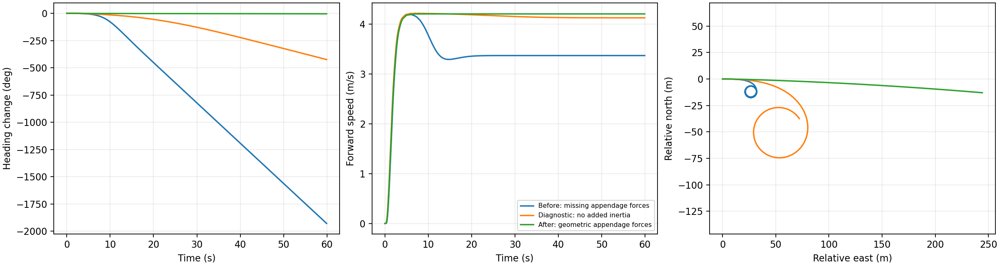
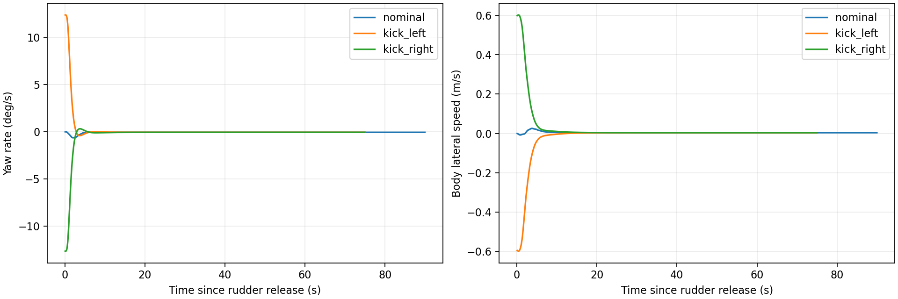

# 2026-11-21 高速零舵方向稳定性修复

## 结论

补全原船模已有水下支腿、底鳍及电机外壳的升阻力后，原来的高速零舵发散转圈已在本轮工程验收工况中消除。没有新增实体鳍片，没有改变质量台账、原船模、推进功率、附加质量或原船体阻尼，也没有修改航向控制器。

**这不是“零舵绝对不偏航”的承诺。** 当前满油无附加载荷末段偏航角速度约 -0.05843°/s、航速约 15.150 km/h，仍存在小幅稳态偏航。单桨水动力反扭矩、船体姿态和质量不对称都可能形成实际配平偏差，尚无实船数据将其逐项校准。验收要求偏航不发散且扰动衰减，不强制锁住原航向。

## 原因与诊断

原先只对船体施加集中阻尼和附加质量耦合，推进器相关支腿、底鳍只有外观与碰撞，没有水动力。40 kW 满油方案整船重心 x 约 −0.841 m，原集中阻力参考点 x 约 −0.642 m，处在重心前方；对侧向速度的阻力不能自动提供合理的艉部方向稳定力矩。附加质量的 Munk 耦合又会放大斜航趋势。这种简化遗漏不能靠伺服增益或航向闭环修补。

在相同隔离水域、满油门零实际舵角的 60 秒对照中：

| 模型 | 累计航向变化 ° | 末段偏航角速度 °/s | 末段航速 km/h |
|---|---:|---:|---:|
| 旧受力模型 | -1927.99 | -36.95150 | 12.140 |
| 仅移除附加质量（诊断，未采用） | -424.48 | -10.19581 | 14.869 |
| 补全现有附体受力 | -4.84 | -0.05843 | 15.150 |



关闭附加质量不能代替补全受力。保留原附加质量与原阻尼作为固定基线，新增真实存在部件的局部受力。较早的一次完整悉尼对照中，无附加质量工况偏航后出现疑似岸碰停船，后半段数据不能用于稳定性判断（未单独辨识具体碰撞体），因此保留在 diagnostic 目录但不纳入上表。正式物理对照保留 VRX 水面和环境系统，移除岸边及浮标碰撞干扰；正式完整悉尼场景未删改。

## 几何、公式与参数

从原 Blender 求值网格投影提取凸侧轮廓，以 azimuth link 为参考：支腿面积约 0.04088 m²、跨度 0.463 m；底鳍约 0.01053 m²、跨度 0.12247 m；电机外壳侧投影约 0.02559 m²、跨度 0.108 m。这些是完整轮廓，运行时根据姿态和波面裁切，使用当时浸水面积、跨度及形心，不假定永远全浸。

每个部件取作用点相对于当地水体的速度，包含 link 平移和角速度产生的点速度。有限展弦比升力斜率：`CLα = π AR / (1 + sqrt(1 + (AR/2)²))`，`AR = b²/S`。15–30°攻角区间平滑过渡至有界平板近似，避免大侧滑时无限增大升力。阻力包含正的型阻和诱导阻力，反向航行采用对称近似。

力作用在可转动的真实 azimuth link 的浸水轮廓形心，自动通过关节传递到船体并影响舵机负载。升力与相对速度垂直；阻力的相对功率非正。无目标航向、无目标航速、无隐藏舵角修正。几何外形没有修改。

参考：[Fossen 船舶动力学](https://www.fossen.biz/html/marineCraftModel.html)、[MSS 有限展弦比升阻力模型](https://github.com/cybergalactic/MSS/blob/master/LIBRARY/modeling/coeffLiftDrag.m)。本实现根据模型方程独立编写，不复制第三方源代码。

工程假设：效率系数 e=0.7，支腿/底鳍/外壳型阻系数分别为 0.03/0.02/0.1；几何已知不等于升阻力已标定。凸轮廓、形心压力中心、反向和失速近似均需要后续实测/CFD验证。未引入桨后流放大、通气、空化。原集中阻力预算未能精确拆分附体部分，新增型阻可能与其部分重复，因此保留前后航速对照并明确此限制。

## 验收方法与结果

阈值在正式工况运行前写入独立判定脚本并保存 SHA-256。零舵/恢复工况末 15 秒要求：绝对偏航角速度 <0.003 rad/s，侧滑角 <1°，航速 >3.8 m/s，实际舵角 <0.1°，持续满油门，所有控制健康记录只有 direct/idle 模式。该角速度限值是工程回归门槛，不是实船适航标准。

扰动工况先加速，再给左右各 5°、持续 4 秒的舵角，随后真实舵角回零并观察 75 秒；要求偏航角速度衰减至扰动时的十分之一以下，并回到同一小幅配平状态。步长 1/2/4 ms 和初始朝向改变 90°的末段速度差 <0.03 m/s、偏航角速度差 <0.0002 rad/s。系数 0.75/1.25 倍用于不确定性敏感性，不是改变真实水密度或调整到通过。

| 工况 | 判定 | 末段航速 km/h | 末段偏航角速度 °/s |
|---|---|---:|---:|
| nominal | 通过 | 15.150 | -0.05843 |
| step_1ms | 通过 | 15.150 | -0.05843 |
| step_4ms | 通过 | 15.150 | -0.05843 |
| payload_300 | 通过 | 14.276 | -0.03999 |
| fuel_6 | 通过 | 15.297 | -0.06284 |
| heading_90 | 通过 | 15.150 | -0.05843 |
| coeff_075 | 通过 | 15.165 | -0.09023 |
| coeff_125 | 通过 | 15.135 | -0.04589 |
| kick_left | 通过 | 15.150 | -0.05843 |
| kick_right | 通过 | 15.150 | -0.05843 |
| curve_0_100 | 通过 | — | — |
| brake_0 | 通过 | — | — |
| turn_0_left | 通过 | — | — |
| turn_0_right | 通过 | — | — |
| step_2ms | 通过 | 15.150 | -0.05843 |

操纵回归行不采用零舵末段指标，具体阶段指标见 [运行摘要](runtime_summary.json)。



新增解析测试覆盖浸水裁切、面积与形心、干态零受力、相对能量耗散、镜像与反向对称、艉部恢复力矩。11 项 C++ 测试以及现有 Python/设计接口测试通过。完整悉尼场景的公开启动入口、前进/反推、左右舵角和松手停推另做实际回归，保留岸景与碰撞，结果见 [完整场景检查](full_sydney_smoke.json)。

## 代码、遥测与复现

- `ros_ws/src/usv_simulation/include/AppendageHydrodynamics.hh`：几何裁切与升阻力公式。
- `ros_ws/src/usv_simulation/src/AppendageHydrodynamics.cc`：Gazebo 原生受力插件。
- `ros_ws/src/usv_description/config/appendage_hydrodynamics.json`：轮廓、来源哈希和工程参数。
- `tools/modeling/export_appendages.py`：原模型无损重新导出。
- `tests/scenarios/directional_stability.json`：15 个正式工况。
- `tests/regression/assess_directional_stability.py`：独立物理判定，不依赖通用运行 passed 字段。

新遥测 `/usv/hydrodynamics/appendages` 的 Double_V 字段为 `[t, wet_area, Fx, Fy, Fz, Mx, My, Mz, dissipated_power]`；力矩关于 azimuth link 原点，不能直接当成整船重心偏航力矩。单位为 SI。

```bash
./usv build
./usv test
source /opt/ros/jazzy/setup.bash
source ros_ws/install/setup.bash
python3 tests/regression/run_performance_suite.py --spec tests/scenarios/directional_stability.json --output artifacts/new_directional_run --workers 3
python3 tests/regression/assess_directional_stability.py --output artifacts/new_directional_run
```

完整原始数据、消融试验和失败尝试在本机 `artifacts/directional_stability_2026-11-21/`。此公开目录提供验收参数、判定、对照 CSV 和图片；没有把本地大数据归档全部上传。本轮仍未接入 ArduPilot 或 Nav2。

## 补充风浪流检查

150 kg 载荷、30 L 燃油、wave gain 0.3、侧风 6 m/s、水流 [0.15,0.1,0] m/s，70%直接油门运行 60 秒后滑行 15 秒。运行、姿态、能源检查通过，新增附体相对耗散功率非负；实际浸水面积范围 0.07450–0.07699 m²。该工况允许风浪流造成漂移，不按静水零舵方向稳定阈值判定，也没有使用航向控制。[结果](weather_result.json) · [工况](weather_spec.json)。

后处理首次导出遇到 numpy.bool_ 无法 JSON 编码，已只增加布尔类型转换后重新生成判定；没有改动验收门槛或原始数据。修复前脚本及预先登记哈希保存在本地证据目录。

## 最终基础入口补测

最终审查发现轮廓导出循环复用了静水平衡求解的 z 变量，可能令基础静水场景出生高度错误。已改为独立轮廓坐标名，并直接使用求解器 sol.x 生成世界出生姿态。悉尼工况独立重算每个载荷的姿态，因此前述专项数据不受影响。修正后基础 6 kW 静水入口重新运行 30 秒并取得渲染图，位置/姿态与独立平衡解相符；高度误差约 4 微米，判定通过。[补测结果](baseline_equilibrium.json)。
