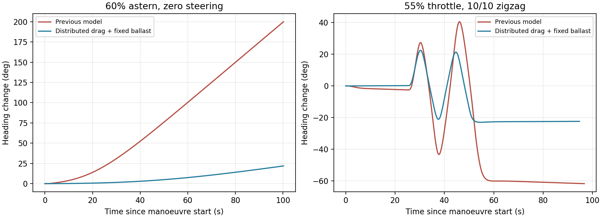

# 分布式侧向阻力、固定配重与操纵复验

**当前结论：22 项操纵及数值/载荷扩展检查通过原门槛，Code Supervisor full 通过。仍有持续倒车配平回转，且配重后名义全速约 14.59 km/h；不能称完全直航或达到严格 15 km/h。**

日期：2026-11-21。目的：继续处理 60% 持续倒车偏航和 55% 油门蛇形超越。保留 [上一轮全部结果](../preflight_2026-11-21/README.md)，不改旧 CSV、不放宽 v3 门槛、不加入航向保持，不接入 ArduPilot/Nav2。

## Code Supervisor 的含义

开始修改前，当前执行快照与上一轮最终 native runner 快照完全一致；上一轮 full 报告退出码为 0。检查通过证明配置范围内的格式、文档、静态规则及相关测试通过，不证明操纵品质合格，更不是实船认证。本轮代码改变后重新检查，不沿用旧报告声称新版本通过。

## 1. 修正侧向阻力的空间分布

旧实现把全部船体侧向阻力施加于一个参考点，再用独立的 900 N·m·s/rad 和 2200 N·m·s²/rad² 系数计算偏航阻尼。转动时船头和船尾横向水速不同，集中模型未体现这种空间耦合。

新模型使用当前湿表面网格。沿船长位置 x 的局部横向相对水速为 `v + x*r`，每个裁切面片产生侧向阻力并通过 x 力臂产生偏航力矩：

```
v_i = v + x_i * r
Y_i = -(600 / A_wet_ref) * A_wet_i * v_i
      -(1500 / A_side_ref) * A_side_i * |v_i| * v_i
Y = sum(Y_i)
N = sum(x_i * Y_i)
```

这里 600、1500 沿用原有侧向工程预算，没有按试验结果优化增益。线性项仍按浸水表面积分配，二次项按单侧等效侧投影面积分配；参考面积固定，不能随载荷重新归一化。该分布式 Y/N **替代**旧集中 Y 阻力和独立 N 阻尼，不叠加；纵向、垂向、横摇、纵摇及附体模型维持各自职责。

原理参考 [Fossen/MSS crossFlowDrag](https://github.com/cybergalactic/MSS/blob/master/LIBRARY/modeling/crossFlowDrag.m) 的局部横流速度与力矩积分，以及 [Fossen 船舶动力学](https://www.fossen.biz/html/marineCraftModel.html)。本实现把现有工程预算分配到实际湿表面，并非直接取得了本船水池系数。浸水变化来自当前波面裁切；相对流速仍以阻力参考点的水速为基准，并非求解完整空间流场。

耗散性质可以直接检查：`Y*v + N*r = sum(Y_i*v_i) <= 0`。没有航向误差、目标航向、目标速度或“偏航越大就自动调参”的输入。旧分支仅供 `distributed_lateral_drag=false` 对照。

实现复用 [Resistance.hh](../../../ros_ws/src/usv_simulation/include/Resistance.hh)，[湿表面几何矩](../../../ros_ws/src/usv_simulation/include/WavePressure.hh) 与 [HullHydrostatics.cc](../../../ros_ws/src/usv_simulation/src/HullHydrostatics.cc)。新增测试覆盖均匀船长解析积分、纯横移预算、纯偏航力矩、反向对称性、耦合运动耗散及干面片零力。

## 2. 实体配重，不是修改重心数字

用户同意加入有依据的仿真实体配重。原设备逐件位置与质量保留，先增加一块横向配平钢板（下文另列升级方案纵向配重），并在 [质量台账](../../../ros_ws/src/usv_description/config/component_mass_ledger.json) 单列 `fixed_trim_ballast`。

原干船横向质量矩为 **-20.835158 kg·m**。选择 y=+0.65 m 的安装位置，由静态质量矩平衡得到：

`m_ballast = -sum(m_i*y_i) / 0.65 = 32.05409 kg`。

钢密度取 7850 kg/m³，为工程假设；平面尺寸 0.4×0.2 m，厚度由质量/密度/面积计算，约 0.05104 m。惯性按均匀长方体解析计算，再由平行轴定理合并到 hull。外形与碰撞由同一台账几何生成，几何生成不重复加质量。

安装中心为 **[1.25, 0.65, 0.30] m，模型 FLU 坐标**。x 的选择基于改善原先艉倾：在 0.25 m 纵向网格上选择最靠前、且钢板八角距船体凸包至少 0.05 m 的位置；不是搜索哪个 x 能让偏航检查通过。y 保证横向配平，z 和尺寸保持舱内包络余量。中部初选位置 x=0 的试验也完整保留，未删掉未达标结果。

这块板在不同油量、载荷、速度和转向时保持固定，**不是自动配平系统**。不抹去惯性积，不取消真实桨反扭矩，不改变原 CAD/Blender 文件。名义横向质量矩平衡不等于所有运行状态绝对水平。

测试验证质量=密度×体积、盒体惯性、横向质量矩、八角包络余量，以及显示/碰撞各生成一次。包络检查不是内部线缆、舱内所有设备干涉或安装强度认证；这是明确的仿真硬件设计变更，不能称作已有实船配置。

## 3. 中间试验为什么保留

- 仅分布侧向阻力的第一版：55% 蛇形通过，最大超越约 12.4°、回零额外约 15.2°；60% 倒车约 0.718°/s，仍失败。
- 初选中部配重：倒车进一步降至约 0.532°/s，仍失败；没有把 0.5°/s 门槛改大。
- 对照表明质量与桨力偶都影响剩余偏航；不能只把质量强制镜像或把桨力偶置零来作为生产修复。
- 最终版本按既有阻力预算分别使用浸水表面积和侧投影面积，并采用几何约束选定的前部配重位置。所有新运行各有独立源码、安装产物、实际工况及遥测绑定。

早期采用同一侧投影权重分配线性/二次项的试验属于探索版；最终实现恢复线性项与原湿表面积缩放口径一致。旧探索数据不冒充最终数据。

## 4. 纵向静态配平方案与代价

仅加入横向板并采用最终湿表面线性分配的 17 项试验，15 项品质通过，`reverse_60` 与 `brake_100` 仍失败；60% 倒车末段 **0.53431°/s**，没有满足 0.5°/s 门槛。此结果保留在 `artifacts/distributed_drag_2026-11-21/maneuvers`，不冒充最终通过记录。

原设备位置保持不变，另行计算升级方案的纵向固定配重：以 60 L、无载荷、静态横倾/纵倾为零作为独立设计目标，同时求解排水体积等于质量/水密度、浮心与重心纵向坐标相同。不是用偏航误差反求配重。新增 `fixed_fore_trim_ballast` 仅适用于 `speed15_concept`：

| 参数 | 工程设计值 |
|---|---:|
| 质量 | 167.859226 kg |
| 中心 FLU | [1.8, 0, 0.3] m |
| 均匀钢板尺寸 | 0.6 × 0.4 × 0.0890973 m |
| 密度假设 | 7850 kg/m³ |
| 八角与船体凸包最小余量 | 0.11124 m |
| 两块新增配重合计 | 199.913316 kg |
| 名义满油整船总质量 | 1739.033756 kg |
| 名义静态模型原点 z | −0.2706552 m |

z 是模型原点相对静水面的高度，不是船体吃水深度。静态平衡残差、板厚和惯性来自几何与质量计算；没有重新归一化阻力参考面积来抵消增加的重量。这个方案有真实的排水量、航速和载荷能力代价；不是“无成本修复”。配重固定，不会随油量与载荷自动调整。内部安装、结构承载和实际舱容仍需工程设计核实，凸包余量不能证明没有设备干涉。

计算记录：[纵向配重解](longitudinal_trim_design.json) 与 [整船静态复算](fore_trim_static.json)。以现有湿面裁切器 `tools/modeling/fuel_equilibrium.py` 的 `displaced([z,0,0])` 得到 V(z) 与 x_B(z)，联立：

```
1000 * V(z) = 1571.1745300420835 + m
x_B(z) = (-1253.923710718726 + 1.8*m) / (1571.1745300420835 + m)
```

其中水密度沿用 1000 kg/m³，1571.17453 kg 已含横向板与 60 L 燃油；纵向质量矩也包含这些项。未知量是 z 与新增板质量 m，不包含航向或偏航指标。安装中心 x=1.8 m、y=0、z=0.3 m 及 0.6×0.4 m 平面包络是明确的布置假设；板厚由解出的质量推导。动力学复验与最终采用结论另列，静态调平本身不能证明倒车合格。

### 配重为什么影响偏航

[末段受力对照](trim_force_comparison.json) 把所有外力矩换算到整船重心，并投影到世界竖直轴。比较最终横流模型加横向板、与再加入纵向板两种方案，60% 倒车 100 s 的末 15 s：

| 量 | 仅横向板 | 再加纵向板 |
|---|---:|---:|
| 横倾 | 0.1903° | 0.1953° |
| 纵倾 | −1.0439° | +0.0368° |
| 桨外部水动力力偶的竖直轴分量 | +1.3063 N·m | −0.0460 N·m |
| 船体阻力竖直轴力矩 | −22.8081 N·m | −15.5507 N·m |
| 附加质量竖直轴力矩 | +13.3118 N·m | +9.3346 N·m |
| 附体竖直轴力矩 | +6.3530 N·m | +4.5611 N·m |

这说明静态布局、运行姿态、反扭矩和侧向—偏航响应存在耦合。不是把反扭矩关闭，不是把附加质量科氏项删除，也不是用额外航向力矩抵消它们。100 s 末段仍有约 +0.173 N·m 合力矩，不能只凭这一短窗口宣布已经达到严格稳态，因而增加 300 s 检查。上表是当前工程模型的仿真归因，不是实船参数辨识。

## 代码审核与复现

[Code Supervisor full 报告](supervisor-full.txt) / [机器报告](supervisor-full.json)：退出码 0；12 个 C++、37 个 Python、5 个设计接口测试通过，见 [构建与测试原日志](unit-tests.log)。已执行文档、格式、静态规则、复杂度、重复代码和所配置核心头文件的覆盖率检查。本轮没有运行 deep 的 ASan/UBSan、变异检查及其原生运行套件，不能称全部模式通过。操纵回归是另行执行的固定版本试验。

```bash
./usv review --profile full --run-commands
python3 tests/regression/run_performance_suite.py \
  --spec tests/scenarios/distributed_drag_regression.json \
  --output artifacts/my_distributed_drag_run --workers 4
python3 tests/regression/assess_maneuvers.py \
  --output artifacts/my_distributed_drag_run \
  --criteria tests/scenarios/maneuver_acceptance.json \
  --spec tests/scenarios/distributed_drag_regression.json
```

运行使用 ROS 2 Jazzy/Gazebo Harmonic，本地通信权限与依赖见 [运行指南](../../getting_started/README.md)。操纵套件期间不要修改运行源码、模型、配置或重新构建。新增的是复用现有执行器的 JSON 工况清单，没有新增常驻控制器或一次性公共脚本。

## 仍需明确的边界

- **通过倒车角速度门槛不等于自然保持直线。** 300 s 零舵 60% 倒车末段约 0.4291°/s，累计航向变化约 107.1°，末段总外力矩约 7×10⁻⁶ N·m：这是小角速度配平回转，不是航向不变。不能把这个现象隐去，再声称“全部偏航问题都解决”。实船也需要在当前推进布局与任务要求间做取舍；没有实测时只能报告当前模型行为。
- **配重带来性能代价。** 名义满油全速约 14.59 km/h；300 kg 载荷 + 6 L 燃油约 13.92 km/h。当前没有达到严格的 15.00 km/h 要求，未提高功率或降低阻力来掩盖增重。若后续仍要求至少 15 km/h，应优先评估移动现有重设备代替大量配重的布置方案，再核对功率，而非只改目标速度。
- **静态配平设计不等于制造设计。** 7850 kg/m³、安装包络和质量误差范围是工程假设；内部设备干涉、底座强度、实际舱容和载荷限额尚未认证。轻重质量敏感性沿用固定外形与质量区间，不代表实际钢板制造公差证书。
- **水动力仍需标定。** 分布模型改正局部速度与力臂关系，但既有侧向预算不是本船实测；横滚—横移的全空间局部水速、完整辐射记忆、反向复杂尾流与桨横向力未全部求解。不能从数值收敛推出对真船精确。
- **本轮以静水操纵为主。** 旧风浪流结果不能直接宣称覆盖当前新增配重和全部恶劣海况。ArduPilot/Nav2 仍未接入，也没有把航向控制用于这些试验。

## 最终固定版本验收结果

**22/22 项运行与原门槛品质检查通过，另 3 项跨工况比较通过。** 其中包含原 17 项操纵工况，以及持续时间、油量、载荷、步长和网格 5 项扩展。执行指纹：`9d1ea2c675cd47c4910c5afbbf04480e8bd64136d688b605e622ebde5123a09e`。

| 工况 | 实测指标 | 判据/说明 |
|---|---:|---|
| 名义 60% 倒车 100 s | 0.392306°/s | 末 15 s 航向拟合，绝对值 <0.5°/s |
| 名义 60% 倒车 300 s | 0.429069°/s | 末 15 s 航向拟合，绝对值 <0.5°/s |
| 6 L 低油量倒车 | 0.407370°/s | 末 15 s 航向拟合，绝对值 <0.5°/s |
| 300 kg + 6 L 倒车 | 0.303688°/s | 末 15 s 航向拟合，绝对值 <0.5°/s |
| 2 ms 步长倒车 | 0.392173°/s | 末 15 s 航向拟合，绝对值 <0.5°/s |
| 0.175 m 细分网格倒车 | 0.391629°/s | 末 15 s 航向拟合，绝对值 <0.5°/s |
| 55% 蛇形最大超越 | 12.294° | <25° |
| 55% 蛇形回零额外转向 | 13.003° | <30° |
| 回零稳定时间 | 4.304 s | <20 s，低偏航连续保持 5 s |
| 名义满油全油门 | 14.593 km/h | 直接油门/零舵；未达到严格 15 km/h |
| 300 kg + 6 L 全油门 | 13.920 km/h | 直接油门/零舵；未达到严格 15 km/h |



[完整品质评估](maneuver_assessment.json) · [运行汇总](summary.json) · [固定工况](distributed_drag_regression.json) · [原验收门槛](maneuver_acceptance.json) · [版本绑定](suite_binding.json)。

这里通过的是明确列出的工程筛查，不是完全无偏航、实船标定、IMO 或制造认证。旧模型曲线来自保留的上一轮原始 CSV；新曲线来自本次固定版本。旧失败结果及中间配平方案仍保留在本地 artifacts，对应摘要见 [探索记录](exploration/maneuvers/maneuver_assessment.json)。

公开目录 `final/<case>/` 保存未修改的主要推进/执行器 CSV、阶段、场景、健康状态与绑定清单，便于查看曲线及指标。[文件摘要清单](manifest.json) 仅证明内容一致性。完整受力/能源流仍在本地 `artifacts/distributed_drag_2026-11-21/final`，公开选摘不是完整离线 verify_case 数据包；全量核验请用本地原始目录或按上面的命令重新运行。

另对全部 22 项实际阻力遥测检查耗散功率非负，见 [耗散检查](dissipation_check.json)；解析测试同时检查局部横流力与力矩的能量一致性。
