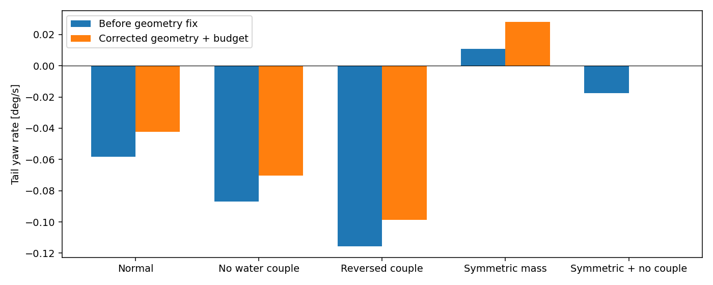
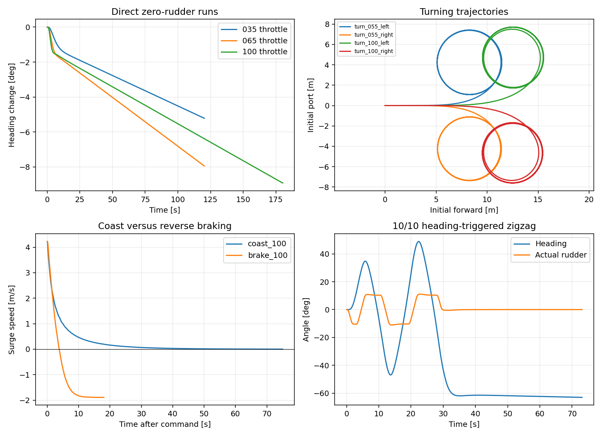

# 零舵偏航归因、阻力预算与直接操纵验收

> 历史版本记录：本页数值及 v1/v2 宽松门槛保留。当前版本的绑定证据及 v3 操纵品质检查见 [后续接入前验收](../preflight_2026-11-21/README.md)，不能把本页“通过”延伸为所有倒车、超越工况合格。

日期：2026-11-21。范围：中央单机 40 kW 概念方案；先查受力，再修几何与阻力预算，再做直接操纵。没有接入 ArduPilot/Nav2，没有增加航向保持、隐藏舵角补偿或目标航速调参。

## 先说明本轮结论的性质

本轮发现并修正了封闭船体网格的左右三角剖分不对称。正常配置仍保留原设备质量分布和桨反扭矩，因此仍有小幅配平偏航。取消反扭矩、对称化质量仅用于隔离诊断，不是正常船的“修复方案”。

科学方法支持方程及诊断方式，不证明缺失的实船参数。40 kW 仍是概念升级；本轮没有得到真实推进器性能图、拖曳水池结果或海试数据。

## 1. 为什么原先看不清偏航来源

旧遥测中的力矩分别参考 hull/azimuth link 原点，不能直接相加。新增统一审计：将压力、船体阻力、附加质量、空气阻力、桨推力、桨水动力力偶和附体受力全部转换到**当前整船重心**，分量用船体坐标表示。

转换为 `M_G = M_O + (O-G) × F`，再作坐标旋转；分析另外计算世界竖直轴力矩。全船重力关于全船重心的合力矩为零；舵机及桨轴电机的关节转矩是内部力矩，不能重复计入。浮力在倾斜船体坐标中的纵向分量不意味着无中生有的推进力，必须与重力一起理解。

理论框架参考 [Fossen 海洋航行器模型](https://www.fossen.biz/html/marineCraftModel.html)。施力参考点按当前 gz-sim 8 的 `Link::AddWorldWrench` 本地头文件定义核对：默认作用于 link 原点。新增单元测试验证坐标旋转和力矩参考点变换。

代码：[统一变换](../../../ros_ws/src/usv_simulation/include/WrenchAudit.hh)、[分析工具](../../../tools/analysis/analyze_force_audit.py)。

遥测均为 `Double_V`，前 4 项为 `[sim_time_s, whole_cg_body_x_m, y_m, z_m]`，随后每组 `[Fx,Fy,Fz,Mx,My,Mz]`，单位 N / N·m：

| 话题 | 顺序 |
|---|---|
| `/usv/audit/hull` | 压力、船体阻力、附加质量、空气阻力 |
| `/usv/audit/propulsion` | 桨推力、外部桨水动力力偶 |
| `/usv/audit/appendages` | 附体总受力 |

只记录，不改变受力。采样约 10 Hz。审计不是高频瞬态动力学残差求解器，本轮力矩闭合结论来自末段近稳态窗口。

## 2. 诊断怎样隔离变量

各诊断工况静水、无风无流、65 秒满油门、零实际舵角。岸边和浮标只在试验世界中移除；原悉尼场景保留。末 15 秒用于比较。输入及源文件哈希随试验保存。

- **正常配置**：原质量台账、原桨反扭矩。
- **取消/反转水动力力偶**：保持桨本身的水动力负载及轴速动力学，在船体施加诊断反向力偶，隔离全船外部力偶效果。这是人工反事实，不是可运行的真实推进器配置，也不是生产航向控制。
- **对称质量**：各刚体质量分布与自身 y 镜像取平均，保留质量、x/z 重心和对角惯性，令 y 重心及 xy/yz 惯性项为零；不改总质量。
- **对称质量 + 无外部水动力力偶**：用于检查剩余几何/数值偏置。
- **仅修几何**：恢复旧二次阻力系数和旧面积参考，用来避免把预算变化误当成几何修复效果。

### 发现的几何问题

站位顶点关于 y=0 对称，但非共面站间四边形的左右两侧使用了不互为镜像的对角线，形成不同的三角曲面。仅检查顶点距离、封闭性或静水求解器与 Gazebo 一致，发现不了这个问题——它们可以使用同一份有偏差的网格而相互一致。

在 z=-0.242 m、roll=0、pitch=-0.024 rad 的独立裁切检查中：

| 指标 | 修复前 | 镜像剖分后 |
|---|---:|---:|
| 排水体积 m³ | 1.552337 | 1.566982 |
| 浮心横向位置 m | +0.00341386 | 约 -9.3×10⁻¹⁸ |

修复采用左右镜像对角线，保留原站位顶点、封闭性和统一外法线。原 Blender 和外观网格不改；由站位生成的浮力/碰撞网格随之更新，静水姿态及固定阻力参考面积重新计算。体积变化是修正曲面后的实际差异，没有暗改重量抵消它。

[生成器](../../../tools/modeling/prepare_hull.py) · [多吃水、纵倾、横倾镜像测试](../../../tests/unit/test_hull_symmetry.py) · [独立数值结果](geometry_symmetry.json)。

### 末段偏航对照（°/秒）

| 工况 | 原几何 | 修正几何及预算 |
|---|---:|---:|
| 正常配置 | -0.058427 | -0.042282 |
| 取消外部桨力偶 | -0.086976 | -0.070394 |
| 反转外部桨力偶 | -0.115559 | -0.098563 |
| 质量对称 | +0.010957 | +0.028070 |
| 质量对称且取消外部桨力偶 | -0.017586 | 约 +3×10⁻⁹ |

仅修几何、保留旧阻力系数和面积参考时，偏航约 -0.042310°/秒，航速约 15.2018 km/h。正常最终配置短诊断末段约 15.2115 km/h。不能把原 -0.058°/秒全部解释为真实单桨效应。

正常整船重心横向约 -13.54 mm（原台账值，非实测），质量对称与反扭矩对照共同说明：几何偏置修复后，剩余配平来自当前模型中的质量分布、反扭矩和姿态/受力耦合。各效应是非线性耦合，不作精确线性比例分摊；更不把这些数值称为实船偏航预测。



正常最终配置的末段世界竖直轴力矩如下（N·m，整船重心参考）：

| 压力 | 船体阻力 | 附加质量 | 空气阻力 | 桨推力 | 桨力偶 | 附体 |
|---:|---:|---:|---:|---:|---:|---:|
| 约 0 | +49.3105 | -2.8150 | +0.1480 | -49.6212 | -5.1734 | +8.1511 |

合计约 6.2×10⁻⁷ N·m，与末段角速度近恒定相符。不能从“合力矩近零”推导“角速度必须为零”。[完整分项数据](force_audit.json)。

## 3. 阻力怎样分账

原来的 180 N·s²/m² 纵向二次阻力是未经识别的集中预算；再直接叠加附体型阻，存在重复预算风险。本轮采用明确的**参考工况预算重分配约定**，而不是声称完成实测分解：

`K_appendage = 0.5 × ρ × Σ(S_i × Cd0_i)`，面积从现有附体轮廓重新计算；参考为完全浸水、零攻角。运行时仍逐部件裁切浸水几何、按局部相对速度计算力。

| 项 | 二次系数 N·s²/m² |
|---|---:|
| 原纵向总参考预算 | 180 |
| 支腿型阻分配 | 0.613155 |
| 底鳍型阻分配 | 0.105302 |
| 电机外壳型阻分配 | 1.279377 |
| 船体剩余纵向系数 | 178.002166 |

参考总预算保持 180，附体项不再直接加到这个总预算之上。实际运行时两者的浸水和速度不同，总阻力不必保持旧值。横向、角向及线性集中阻力暂不作无依据扣减；它们与显式附体作用的可辨识分解仍是未解决问题。ITTC 摩擦估计仍仅作独立量级检查，不另外叠加到未知组成的总阻力上。

权威阻力系数从推进配置移至 [resistance.json](../../../ros_ws/src/usv_description/config/resistance.json)，由 [预算计算](../../../tools/lib/resistance_budget.py) 生成船体剩余系数，负预算会被拒绝。[计算结果](resistance_budget.json)。这没有提高真实阻力参数的标定等级。

## 4. 操纵试验与判据

[工况](../../../tests/scenarios/maneuver_audit.json)、[判据](../../../tests/scenarios/maneuver_acceptance.json) 和 [独立判定脚本](../../../tests/regression/assess_maneuvers.py) 在运行前保存哈希：[登记](maneuver_preregistration.json)。

13 个工况覆盖三档油门零舵长航、两档油门左右 20° 回转、停推滑行、反推制动及持续倒车、倒车左右转向、10/10 蛇形操纵、300 kg 载荷/6 L 燃油。所有阶段为 direct，检查健康记录中没有航向参考。

蛇形试验在相对初始航向达到 ±10° 时切换到相反的固定 ±10° 舵角，记录超越角；这是试验动作的触发，不是航向保持控制。借鉴 [IMO MSC.137(76)](https://wwwcdn.imo.org/localresources/en/KnowledgeCentre/IndexofIMOResolutions/MSCResolutions/MSC.137%2876%29.pdf) 的回转、蛇形和停车指标定义，不声称这艘 6 m 桨舵一体船符合该标准的适用范围或通过认证。

判据包括零舵偏航 <0.172°/秒、稳态速度标准差 <0.12 m/s、左右回转半径相对差 <20%、姿态 <20°、实际舵角和速率检查。距离和超越角上限是宽范围工程回归门槛，不是实船操纵性能设计保证。原始量值比“通过”标签更重要。

**判据更正记录：** 首版把 0.15 rad/s 的参考轨迹速率误当成实际关节上限，并设置了没有配置依据的 0.16 rad/s 判据。原模型的物理关节上限一直是 0.20 rad/s。V2 从每个生成 SDF 分别读取两项上限，同时检查实际速度和参考轨迹速度；没有改物理参数或原始遥测。保留 [V1 判据](acceptance_v1/maneuver_acceptance.json)、[V1 判定结果](acceptance_v1/maneuver_assessment.json) 及 [更正时间/哈希](maneuver_criteria_correction.json)。这项更正不应被描述成全部判据均在首轮前无误冻结。

停推停车定义为水平速度 <0.1 m/s 持续 1 秒；反推制动定义为纵向速度首次非正，并单独报告当时侧向速度，避免将“纵向过零”误报为“完全停止”。

### 最终结果

13/13 工况通过 V2 工程回归判据，所有健康记录均为 direct/idle，无航向参考。左右回转方向、实际舵角、速率、单调航速、停推与反推定义分别检查；不是只检查进程退出码。[独立验收 JSON](maneuver_assessment.json)。

| 工况 | 实测仿真指标（不是海试值） |
|---|---|
| 35% 油门零舵 | 4.343 km/h；偏航 -0.03482°/秒；观察 120 秒 |
| 65% 油门零舵 | 9.474 km/h；偏航 -0.05586°/秒；观察 120 秒 |
| 100% 油门零舵 | 15.211 km/h；偏航 -0.04228°/秒；观察 180 秒 |
| 55% 油门、左右 20° 舵 | 稳态半径 3.166 / 3.124 m；左右差 1.34% |
| 100% 油门、左右 20° 舵 | 稳态半径 2.986 / 2.954 m；左右差 1.11% |
| 全速停推滑行 | 到上述停车/过零定义：25.436 s、16.879 m |
| 全速切换 -60% 油门反推制动 | 到上述停车/过零定义：3.900 s、7.386 m |
| 300 kg 载荷、6 L 油量 | 14.453 km/h；零舵偏航 -0.02896°/秒 |

反推制动首次纵向非正样本的侧向速度约 -0.00157 m/s；10 Hz 记录意味着过零时间有采样分辨率限制，不应把三位小数当成真实测量精度。

**回归通过仍暴露两项需要完善的操纵表现：**

- -60% 油门持续零舵倒车阶段，末段偏航约 +2.476°/秒，60 秒航向变化约 135°。它通过的是“能倒车且角速度有界”的宽范围检查，不是倒车方向稳定性验收。-40% 倒车的前 30 秒偏航较小，但不能据此保证长时间稳定。
- 10/10 蛇形的前三次反舵超越角约 24.77°、36.92°、38.88°，明显不小；最终回零舵后还继续转过约 52.49°才进入小幅稳态偏航。这里没有航向闭环把曲线压平。舵机参考速度、惯性和水动力耦合需要继续验证，不宣称达到理想操纵品质。



完整悉尼场景通过公开 `./usv run` / `./usv drive` 的启动、前进、反推、左右转向及松手停推回归：[结果](public_cli.json)。该短检查只证明入口与执行器响应，不替代上表的稳态试验。构建通过 12 个包，单元检查包括 12 项 C++、23 项 Python、5 项设计接口测试；均为本地验证，不是 GitHub CI。

后处理遇到 NumPy 布尔量不能直接 JSON 序列化，已转换为原生 bool/float 后重做判定；没有改物理工况、阈值或遥测。详见 [后处理记录](postprocessing_note.json)。


## 5. 复现与证据

安装依赖、构建完成后：

```bash
./usv build
./usv test
source /opt/ros/jazzy/setup.bash
source ros_ws/install/setup.bash
python3 tests/regression/run_performance_suite.py --spec tests/scenarios/force_diagnostics.json --output artifacts/my_force_diagnostics --workers 3
python3 tools/analysis/analyze_force_audit.py artifacts/my_force_diagnostics
python3 tests/regression/run_performance_suite.py --spec tests/scenarios/maneuver_audit.json --output artifacts/my_maneuvers --workers 3
python3 tests/regression/assess_maneuvers.py --spec tests/scenarios/maneuver_audit.json --criteria tests/scenarios/maneuver_acceptance.json --output artifacts/my_maneuvers
```

每次使用新的输出目录；套件会跳过已有 passed 结果，不能用旧目录冒充重新验收。不同套件应顺序运行，避免默认 ROS domain 分配重叠。正常启动不含任何 diagnostic 配置。

`propulsion_state.csv` 的列依次为：时间、油门、实际 RPM、参考 RPM、推力、轴电机转矩、水动力转矩、轴功率、浸水比例、桨轴向相对水速、船体 u/v、世界 x/y、yaw/roll/pitch（角度列为 rad）。`actuators_state.csv` 为时间、实际舵角、实际舵角速度、参考舵角、转矩、功率、累计 Wh、能源可用标志。曲线由这些记录生成，未平滑或改写。

本地完整资料在 `artifacts/force_audit_2026-11-21/`；本目录提供关键工况、分项力矩、操纵遥测和结果，复制来源与 SHA-256 见 [清单](manifest.json)。未将大体积场景、日志全部上传。原失败/旧几何结果保留，不覆盖。

## 6. 仍有的边界

- 正常质量分布不是严格对称，零舵仍有缓慢偏航。本轮解释当前模型的成因，没有证明这些估算质量位置等于实船。
- 横向/角向阻力、附加质量、附体压力中心、反向近似及桨性能仍需独立数值或实测识别；轴向分账约定不等于消除所有模型误差。
- 40 kW 及 15 km/h 是概念工况；高速兴波、滑行、砰击、空化、液体晃荡、结构损伤和完整热限制尚不完整。
- 持续较大油门倒车有明显偏航，蛇形超越角较大；已量化记录，但尚未解决或标定。
- 本轮正式操纵在隔离静水中进行，不替代复杂海况、岸边接触、长时能源或新机器安装验收。
