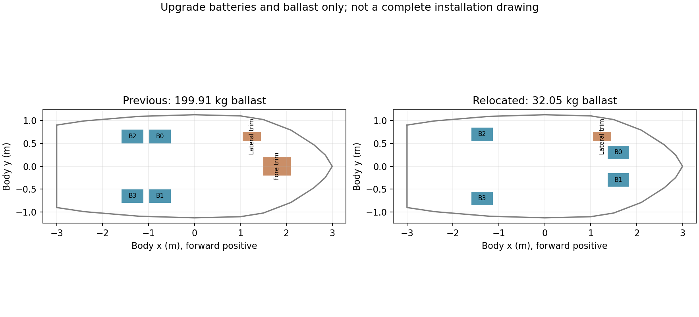
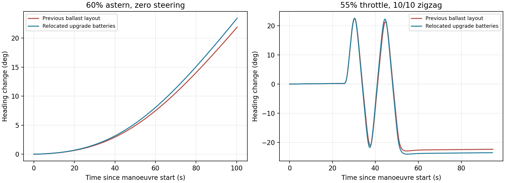

# 升级电池重布置与减少配重

本轮保留原设备、船体、推进功率和水动力预算，评估移动升级方案的四块电池与托架，以减少配重。未接 ArduPilot/Nav2。上一版配重方案及全部证据保留在 [上一轮报告](../distributed_drag_2026-11-21/README.md)。本轮结果以文末固定版本验收为准。

## 独立静水设计

上一版保留约 32.054 kg 横向配重，并另加 167.859 kg 前部纵向配重。取消后者，满油整船质量为 1571.17453 kg。采用现有封闭船体裁切几何，在 roll=pitch=0 时由 `1000 V(z)=1571.17453` 求得模型原点 z≈−0.252616 m、浮心 x≈−0.566058 m。需要将原纵向质量矩前移约 **364.547811 kg·m**。

四块升级电池各 76 kg，四只托架各 2 kg，总计 312 kg；原平均 x=−1.05 m。因此新平均 x=−1.05+364.547811/312≈0.11842247 m。前对安装 bay 取 x=1.6 m、y=±0.3 m；后对由质量矩方程得到 x=−1.36315506 m、y=±0.7 m。电池 z=0.5 m、托架 z=0.23 m 保持原值，部件质量与关于自身重心的惯性不变；整船惯性通过平行轴定理重新汇总。

这不是按倒车偏航数值搜索位置。所有电池整体前移的初选布局会与电控箱、充电器等包络重叠，因此拒绝。前后两对布局保留中央通道和其他设备位置。新位置的最小船体凸包余量约 36.5 mm；显式集中设备包络检查未发现新增重叠。分布式线缆、护舷、紧固件等台账包络不是实际实体占满空间，不能按整体长方体当障碍物；仍需实际布线、安装强度与完整 CAD 装配核查。

升级电池和托架新增由同一台账生成的外形与碰撞，不再只有质量代理；基础方案不增加这些升级设备。保留横向配重，因为左右对称移动电池不能抵消原设备的横向质量矩。钢板材料密度与电池包络不能混用：电池尺寸是设备外包络，不把内部当均匀实心钢。

## 验证范围

构建、Code Supervisor 检查、静水平衡、质量与惯性、包络及固定版本操纵复验。旧的失败与配重方案数据不改写，门槛不放宽，推进功率不提高，阻力系数不降低。测试结果不构成实船标定或制造认证。



图仅显示升级电池、配重与船体 XY 凸包，不能据此认为全部内部装配已验证。电池托架随各自电池同步移动；原 CAD 与原厂设备尺寸未更改。现有分布式线缆质量预算保留，并未完成新线长、压降、保护器和冷却布置设计，因此本方案仍为仿真布置方案。

[静态复算](static_equilibrium.json) · [新台账](component_mass_ledger.json) · [旧台账原件](previous_ledger.json)。两版差异只有升级电池/托架位置、对应几何，以及删除前部配重；推进功率、容量、燃油、其他设备质量与位置保持一致。

[Code Supervisor full](supervisor-full.txt) 与 [构建测试日志](unit-tests.log) 通过：12 项 C++、38 项 Python、5 项设计接口测试。新增包络干涉检查覆盖台账集中设备、原两块电池和保留的横向配重；同箱内部元件仅作为障碍物检查，不把其合法包含关系误判为装配错误。基础方案仍只有横向板，升级方案生成四块电池与四个托架。未执行 deep，full 通过不能代表所有高级模式或实船验证。

## 为什么减重后偏航没有同时改善

静态横倾/纵倾为零只约束浮心—重心平衡，不保证有推力时的零舵直航。减重及设备前后移动还改变了吃水和整船惯性。[质量与惯性变更审计](layout_change_audit.json) 确认仅八个升级设备条目移动、一个纵向配重删除，其他设备条目不变。

300 s 倒车末段，[浸水面积对照](immersion_comparison.json) 显示湿面积从约 10.829 降到 10.555 m²，单侧等效投影面积从约 1.393 降到 1.288 m²。因此即使阻力预算不变，实际浸水阻力分布也会改变；同时倒车速度也变了。现有数据支持这些量一起变化，不能将偏航增量全部归因于单一项。

[长时倒车受力审计](long_reverse_force_audit.json) 显示末段总竖直轴外力矩接近零，但偏航角速度非零，属于配平回转。仍然需要继续评估倒车方向品质；当前 0.5°/s 门槛只是工程筛查，并不保证自然直线或任务航迹精度。

## 固定版本动态结果

运行完成 22 项，品质通过 22 项；总验收 passed=True。执行指纹 `167b72e71272ef6d1114d7f0bcc49faf7e5152590a5a41500b02958ea399421c`。

| 指标 | 上一版配重方案 | 电池重布置 |
|---|---:|---:|
| 满油全速 km/h | 14.5933 | 15.0979 |
| 300 kg + 6 L 全速 km/h | 13.9197 | 14.3473 |
| 60% 倒车 100 s 末段 °/s | 0.3923 | 0.4177 |
| 60% 倒车 300 s 末段 °/s | 0.4291 | 0.4545 |
| 300 s 倒车累计航向 ° | 107.1050 | 113.7253 |
| 6 L 倒车 °/s | 0.4074 | 0.4312 |
| 重载低油量倒车 °/s | 0.3037 | 0.3227 |
| 2 ms 倒车 °/s | 0.3922 | 0.4175 |
| 细网格倒车 °/s | 0.3916 | 0.4169 |
| 蛇形回零额外转向 ° | 13.0029 | 13.9632 |
| 蛇形最大超越 ° | 12.2942 | 12.3628 |



**设计结论：减少配重是成功的；不能说倒车偏航也改善了。** 新布局保留静态配平、容量和推进能力，以更少配重运行；动态偏航略增，虽仍满足当前 0.5°/s 门槛，持续倒车也仍会累计转向。因此本方案是质量与速度优先的工程取舍，不是三个目标同时改善的证明。后续应针对倒车侧向力与单桨耦合继续辨识，不能以加航向控制或放宽门槛掩盖。

所有工况使用直接油门/舵角。没有提高 40 kW 概念方案功率、修改阻力预算、关闭桨反扭矩或增加航向保持。位置来自静水平衡和包络约束，不按偏航输出调参。当前缺少实船标定，不能保证真船具有相同表现。

[品质评估](maneuver_assessment.json) · [运行汇总](summary.json) · [版本绑定](suite_binding.json) · [工况](distributed_drag_regression.json) · [门槛](maneuver_acceptance.json)。主要 CSV、阶段、场景与绑定原件选摘位于 `final/<case>/`；全量原始受力/能源流在本地 `artifacts/layout_2026-11-21/final`。公开选摘不是完整离线 verify_case 包，文件摘要清单仅用于内容完整性核对。

复现命令：
```bash
./usv review --profile full --run-commands
python3 tests/regression/run_performance_suite.py --spec tests/scenarios/distributed_drag_regression.json --output artifacts/my_layout_run --workers 4
python3 tests/regression/assess_maneuvers.py --output artifacts/my_layout_run --criteria tests/scenarios/maneuver_acceptance.json --spec tests/scenarios/distributed_drag_regression.json
```
构建和运行环境见 [ROS/VRX 指南](../../getting_started/README.md)。测试期间不要修改执行输入或重新构建。
