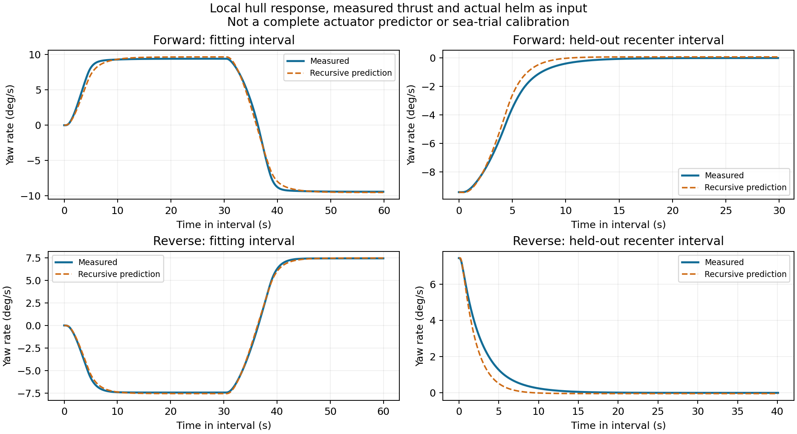

# 有流保持与有限执行器协调（2026-11-26，续）

目标仍为原完整25项导航验收和第15–120秒相对飞控实际目标的峰值≤3 m，不修改船体受力、舵机速度/力矩，不接Nav2。此前失败候选不叠加，正式参数与镜像保持原基线，见[上轮完整记录](../control_weather_2026-11-26/README.md)。

## 步骤一：区分船体响应与转舵迟滞

使用既有9/9通过的[开环记录](../response_identification_2026-11-25/README.md)，以实际舵角和实际推力构造横向推进分量 `Fδ=T sinδ`，世界ENU偏航率r由解包航向中心差分取得。只用静水左右满舵片段拟合 `dr/dt=a r+b Fδ+c`；前进与倒车分开。模型时间常数为`−1/a`，力到稳态转速增益为`−b/a`。这是局部经验降阶模型，c不能解释成已识别的物理常力矩，b也不能直接倒推整船惯量。

| 局部工况 | 拟合时间常数 | 静水留出回中片段转速RMSE | 该片段峰值误差 |
| --- | ---: | ---: | ---: |
| 前进 | 1.567 s | 0.342 °/s | 0.925 °/s |
| 倒车 | 1.765 s | 0.323 °/s | 0.952 °/s |

训练段不计独立验证；预测每段只初始化一次转速，随后递推，不逐样本用实测转速纠正。北向0.30 m/s、西向0.15 m/s的开环片段作为额外验证，未参与拟合，数值见[模型及误差](model.json)。验证依然来自同一仿真物理，不能称为实船标定；测得输入包含真实推力/舵角，**这不是包含执行器预测误差的完整控制器模型**。倒车回中段同时停推，不能当作保留反推的舵机单变量试验。

此前实际舵机从35°回中约4秒、两端换舵约7.8秒。静水前进满舵回中后仍累计转过44.376°，初始转速9.405°/s，对应约4.718秒的残余转动积分；倒车回中且停推对应约2.997秒，二者工况不同。见[停止转角数据](stopping-angle.json)。因此不能用“船体惯性时间常数约1.6秒”代替整个执行链的停止时间。

固定源码 `AR_AttitudeControl::get_turn_rate_from_heading()` 使用当前航向误差给转速目标，默认没有专门减速度时按10°/s²规划；按9.4°/s计算的理想制动角约4.4°，显著小于上述包含转舵时间的实际残余转角。这支持研究提前收舵与执行器动态不匹配，但不同控制动作并不等价，不能据此声称解释了全部3 m保持超限。上一轮只降低转向减速度仍失败，已经保留该反证。

复现附件[identify.py](identify.py)固定训练/验证划分，输入SHA256在model.json，预测CSV无损归档。本附件仅用于这一步证据复核，不新增仿真启动入口，不供控制器读取Gazebo真值。默认输出新目录，拒绝覆盖旧证据；复现前将旧`artifacts/diagnostics/loiter_dynamics_20261126/model`整体移到另名保存。

## 下一步候选与边界

独立测试LOITER航向角速度预见：用EKF的地球系偏航角速度估计短时残余转动，在原几何/正反向选择完成后提前收舵。4秒为根据上述响应选定的工程筛选时域，不是实船标定或最优值。不会向飞控提供实际舵角、真实水流或额外物理力；速度回归、原混控、推力与舵机约束继续生效。必须先按原强流工况筛选，通过后再做多方向回归，未通过不推广。

三个恒流开环工况使用相同推进激励，均匀流下相对水体的转向响应接近，不能把它们当作已覆盖其他油门、载荷和风浪。

## 混控可用转向量的旁路审计

读取三个原基线DataFlash的MODE、PIDS、THR；MODE=5且入位15秒后，每条THR关联此前最近PIDS，年龄≤0.15秒。THR.ThrOut按固定源码是百分比，PIDS各项为归一化转向请求；对照上游混控极限`abs(ThrOut/100)*tan(35°)`。这是日志近时关联，不是逐控制周期重放，也不是实际舵机饱和占比。

| 基线 | 总转向请求超过当时混控上限 | D项单独超过上限 | D项使总请求与去掉D的和异号 |
| --- | ---: | ---: | ---: |
| 北0.30 m/s | 94.76% | 43.05% | 7.81% |
| 西0.15 m/s | 94.76% | 50.57% | 8.38% |
| 东0.15 m/s（保持已通过） | 94.20% | 51.09% | 9.23% |

[数值、样本数和原日志哈希](pid-audit/summary.json)，全量对齐CSV同目录无损保存。D项是目标与实测转速误差的导数，包含目标变化，不只是船体转速阻尼。原D=0.4，在10°/s²目标变化下单是目标导数贡献约0.0698，超过9%油门下约0.0630的混控范围；这里是未计滤波和实测角加速度的量级分析。通过的东向案例也有上述现象，不能单凭比例认定因果；暂不与预见候选叠加修改D项。

## 步骤二：默认关闭的航向预见候选（第一版，仅收舵）

[第一版补丁原件](heading-only-preview.patch)只在无帆动力船、矢量推进、LOITER自动正反向选择且处于保持半径外生效；在原几何方向和速度缩放完成后，将航向目标减去`yaw_rate_earth * LOIT_YAW_TAU`。只处理本周期新计算航向，不对半径内保留航向累计修正。时域默认0、最大5秒，非有限输入返回0，修正量最大90°。4秒是本轮单独试验值，未获验收不能推广。

[固件真实编译](preview-build.log)、[输入哈希](preview-source-sha256.json)、[实际应用的头文件](preview-test/Rover/LoiterYawPreview.h)、[边界测试](preview-test/preview_test.cc)。测试涵盖已知40°角积分、左右对称、零/负/非法时域、非法角速度、最大有限数和极小时域。沙箱内ASan/UBSan程序遇到[LeakSanitizer与ptrace环境不兼容](preview-test/sanitizer-sandbox-error.log)，不算通过；同一二进制在已授权的普通沙箱外运行，[检查通过](preview-test/sanitized-outside-sandbox.log)，没有关闭检测。该结果只覆盖这个纯函数，不是整套ArduPilot的sanitizer认证。

该补丁与之前实验都占G2槽62，互斥使用独立镜像与全新EEPROM；正式飞控不变。北向0.30 m/s完整25项正在筛选，不因编译/边界测试通过而提前采用。

### 第一版完整结果：未采用

`hold_preview4_north030_20261126_01` 完整24/25，唯一失败为保持；峰值3.816 m、RMS 1.748 m。结果及原始数据见[摘要](heading_only_run/summary.json)。该轮使用提交`8bac566`对应补丁/独立镜像，输入哈希中补丁路径的内容以该版本及上述原件为准，不套用之后修订。虽然末段误差下降，原15–120秒3 m门槛仍未通过，不截取后半段替代验收。

## 步骤三：换向和收舵采用同一预见状态

第一版在当前航向下选择正反向，再按预见航向收舵，跨90°时可能冲突。例如目标在右方100°、当前正在右转10°/s，4秒预见后的相对角为60°：当前姿态会选倒车，但预计姿态可以前进。相反，目标右方80°、当前正在左转10°/s，预计相对角120°，应提前考虑倒车。这是状态一致性问题，不是固定角度迟滞。

第二版仅将相同有界预见量放到原正反向选择和速度缩放之前：统一用`wrap(bearing−yaw−rate×tau)`判断，保留原90°选择规则与下游控制器；时域仍4秒，不同时更改数值。没有新增状态、定时器或物理力。原几何目标位置不变；调整的是控制器对残余转动的估计。上一版镜像和补丁保留，第二版使用新镜像名，禁止覆盖第一版证据。

[当前补丁](../../../dependencies/patches/ardupilot-rover-loiter-yaw-preview.patch)。这是独立单变量结构对照，尚未获得运行结果；不能因逻辑更一致就宣布3 m已修复。

用第一版实际GPS目标方位与近时NTUN/PIDS审计，保持15秒后、距离目标大于0.1米的10170个样本中，按当前航向和按4秒预见航向作出的正反向选择约14.85%不同；最大对齐年龄0.124秒。见[定义与哈希](choice-audit.json)、[全量审计](choice-audit.csv.gz)。这不是精确控制周期重放或根因的充分证明，但说明两种判断在实际记录中确实会分歧，值得做统一状态的对照。

第二版[真实编译日志](motion-preview-build.log)、[补丁哈希](motion-preview-source-sha256.json)、[镜像内补丁哈希](motion-preview-image-patch.txt)。纯函数头文件与第一版逐字节相同，沿用该函数真实边界/ASan+UBSan结果；整体接线变化由完整固件重编译和独立SITL运行验证，不能只用头文件测试代替。
