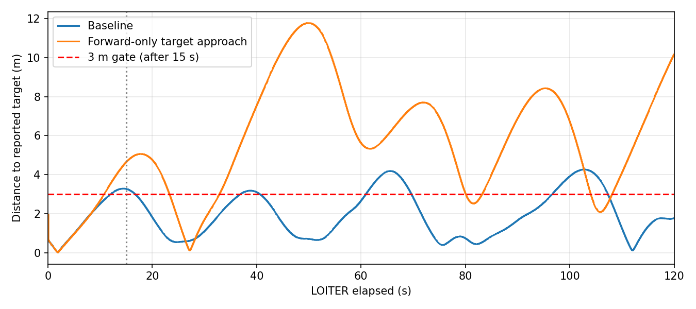

# LOITER 正反向切换调查（2026-11-25）

**仍在调查，不是修复完成。** 前一轮[转向减速度候选](../yaw_deceleration_2026-11-25/README.md)未达3 m门槛。本轮先读取既有 DataFlash，区分目标运动方向切换、限加速度后的期望速度、执行器请求和真实推力，避免把它们当成同一信号。

## 步骤一：固定旧日志的时序证据

| 工况 | 稳定段目标航向跳变超过90°次数 | 相邻跳变间隔中位数 | 限加速度后期望速度变号次数 |
| --- | ---: | ---: | ---: |
| 东向0.15 m/s，已通过保持 | 14 | 7.50 s | 14 |
| 西向0.15 m/s，保持未通过 | 13 | 7.80 s | 13 |
| 北向0.30 m/s，原基线未通过 | 9 | 7.10 s | 9 |
| 北向0.30 m/s，减速度候选未通过 | 9 | 7.65 s | 9 |

多数跳变前目标航向与船头相差接近90°，与官方 `LOIT_TYPE=0` 的前进/倒车选择边界一致。目标航向先切换约180°，限加速度后的期望速度稍后过零。它们的间隔与已辨识的约7.8秒完整换舵时间相近，但不能据此认定每次都要求完整舵程，也不能把期望速度当成实际推力。通过保持的东向工况也频繁切换，所以切换本身不是超限的充分条件。

这里的约7秒是**目标航向切换**间隔，前一轮约3秒是**舵角输出反向请求**间隔，两者不是同一统计量。当前证据支持研究模式切换与有限执行器响应的耦合，尚不支持断言存在高频抖振或唯一根因。

### 数据定义与复核方法

- 从各工况 `sitl/logs/00000001.BIN` 依次读取 MODE、NTUN、STER、THR；只取 MODE 5。时间为 DataFlash `TimeUS/1e6` 减首次进入 MODE 5 的时刻，统计15–120秒。
- 每条THR关联此前最近的NTUN/STER。THR.DesSpeed来自控制器限加速度后的目标；NTUN.DesYaw是目标航向；**NTUN.Yaw按源码为整数厘度，乘0.01转成度**。STER转速字段已经是°/s。输出量不是物理舵角/推力。
- 航向差先归一化到[-180°,180°)，相邻目标航向差绝对值>90°计一次跳变；相邻非零期望速度乘积<0计一次变号。未加平滑，采样约0.1秒；跨零样本判据及最新值关联可能漏掉更短事件。
- 每次跳变记录随后4秒内最近一次期望速度变号的时间差；没有则为null。它是时序关联，不是因果证明或执行器延迟测量。
- [全部事件、定义及原始DataFlash SHA256](switches.json)。同目录四份CSV提供全保持段提取信号，列名带单位；原始二进制保留在 `artifacts/navigation/<工况>/sitl/logs/00000001.BIN`。未修改既有证据。

固定上游依据：[LOITER方向逻辑](https://github.com/ArduPilot/ardupilot/blob/d9c5097c3d8333435712ffed86bca8ce00c4bb46/Rover/mode_loiter.cpp)、[日志字段写入](https://github.com/ArduPilot/ardupilot/blob/d9c5097c3d8333435712ffed86bca8ce00c4bb46/Rover/Log.cpp)、[LOIT_TYPE官方参数定义](https://github.com/ArduPilot/ardupilot/blob/d9c5097c3d8333435712ffed86bca8ce00c4bb46/Rover/Parameters.cpp)。此步骤没有修改运行代码或参数。

## 步骤二：对照试验设计

只在独立候选配置把 `LOIT_TYPE` 从0改为1，使用官方“始终船头朝向目标”策略。其他参数维持正式基线，**不叠加上一轮减速度候选**，不修改物理或固件。北向0.30 m/s完整25项导航验收，原3 m门槛不变。

这用于检验取消前进/倒车选择后的总体表现，并非纯粹的单环节因果隔离：该模式也改变航向目标及绕行路径，仍可能为制动而输出负推力。未完成测试前不得宣称改进；若失败，保存失败证据、不采用。未接Nav2。

### 对照已完成：未采用

`hold_forwardonly_north030_20261125_01` 完成全部流程，24/25通过，唯一失败仍为3 m保持。LOIT_TYPE实际读回1；正式参数文件仍为0，没有叠加减速度候选。

| 指标 | 原前进/倒车基线 | 始终船头朝向目标 |
| --- | ---: | ---: |
| 保持峰值 | 4.265 m | 11.766 m |
| 保持RMS | 2.288 m | 6.672 m |
| AUTO路径最大偏差 | 9.091 m | 9.198 m |
| 完整检查 | 24/25 | 24/25 |

保持15秒后的1050条DataFlash速度样本中，期望速度最小约0.194 m/s，没有负值；同期航向累计绝对变化约806.34°。累计绝对变化不等于净转角或两整圈，包含可能的往返转动。该模式确实去掉了稳定段目标速度变号，但带来了更大的转身运动和保持距离；因此不能简单禁用倒车，也不能把“有切换”直接当作根因。单次对照不是所有流场的普遍结论。

证据：[完整结果](forward_only/result.json)、[指标汇总](forward_only/summary.json)、[方向检查](forward_only/direction-check.json)、[候选配置](forward_only/navigation_low_speed.parm)、[镜像ID](forward_only/images.json)、[输入SHA256](forward_only/input-sha256.txt)、[运行文件哈希](forward_only/runtime-inputs.json)、[测试代码提交绑定](forward_only/verified-code-commit.json)。原始目录 `artifacts/navigation/hold_forwardonly_north030_20261125_01`，CSV无损压缩归档，解压后字节哈希见[manifest](forward_only/manifest.json)。临时容器结束后清理。

[Code Supervisor quick](forward_only/supervisor-quick.log)通过，只代表quick范围。本步无运行源码变动，沿用[既有构建与单元测试](../response_identification_2026-11-25/build-test.log)，补做本次完整SITL集成测试；未重复full/deep。失败候选只归档到验证文档，没有推广。

## 下一步边界

保留前进和倒车两种能力，进一步按真实舵角、参考舵角、推力换向和航向误差定位每次切换的瞬态。只有证实某类切换产生不必要的反复时，才设计带明确退出条件的有限迟滞/协调策略，不能直接延迟全部切换；延迟也可能扩大位置误差。任何新策略必须单独标记实验固件或配置，并通过原3 m及多流向回归后才可采用。本轮没有解决有流保持问题，没有改动船体物理，也没有接Nav2。
