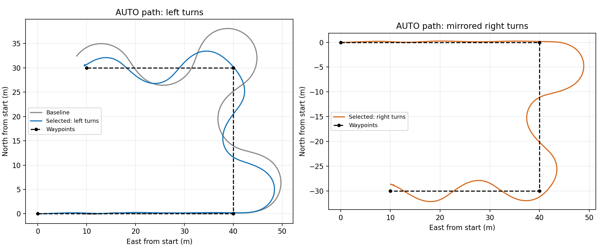

# 低速航线跟踪辨识与重复验收：2026-11-25

最终采用前馈0.3、位置/速度外环0.1/0.5和6 m规划半径；左右两轮完整验收各23/23通过。同方向最大航段误差降低约13.6%，但首弯外扩和有流保持误差仍需完善。仅增加前馈、提高转向限幅的方案均未采用，所有记录保留。

## 辨识依据

采用上一轮 `navigation_repair_final_01` 的 DataFlash STER，仿真约 98–105 s、70 个样本，目标偏航角速度中位数 −15°/s，实际 −9.849°/s。将 SteerOut 除以4500归一化，并除以实际角速度（rad/s），估计该区间输出/角速度中位数约 0.316。见[辨识数据](baseline-yaw-rate.json)。这包含当前闭环影响，是低速候选前馈的工程估计，不是开环辨识或实船标定。

固定 ArduRover 4.7.3 的 `libraries/APM_Control/AR_AttitudeControl.cpp` 中，转向速率 PID 输出叠加 get_ff()；本轮先只把 navigation_low_speed.parm 中 ATC_STR_RAT_FF 由继承的0.1改为候选0.3，保持 P/I/D、最大转速15°/s、最大转向加速度5°/s²及所有船体物理不变。高速 platform15.parm 不变。

## 试验方法

沿用独立容器入口、1 m/s 航速、15 m 原始基础误差门槛、相同物理和 EKF3。补充 `--mirror-course`，将北向30 m航段镜像为南向30 m，以覆盖另一转弯方向。每轮仍完整执行保持、手动接管、返航和失联停推，不用单个转弯变好代替整体验收。

误差定义仍为到 MISSION_CURRENT 对应当前线段的距离。新增最大值、95%分位和 RMS 统计；这些统计按测试循环采样，不是等弧长采样。镜像后只改变航点几何，物理环境和验收门槛相同。

## 结果

最终采用 **ATC_STR_RAT_FF=0.3、PSC_POS_P=0.1、PSC_VEL_P=0.5、TURN_RADIUS=6 m**，仅覆盖低速 navigation 配置。保留原15°/s转速、5°/s²转向加速度和0.03g横向加速度上限；25°/s方案未采用。船体、水动力、高速 profile、地图与 Nav2 均未改动。

| 工况 | 完整验收 | 当前航段最大偏差 | 95%分位 | RMS | AUTO耗时 |
| --- | --- | --- | --- | --- | --- |
| 原基线左向 | 历史23/23 | 9.755 m | 未记录 | 未记录 | 142.456 s |
| 仅增加前馈 | 23/23，但不采用 | 14.530 m | 12.528 m | 5.529 m | 166.081 s |
| 外环减半、12 m半径 | 23/23，中间对照 | 8.648 m | 7.486 m | 2.761 m | 127.614 s |
| **采用：6 m半径左向** | **23/23，exit 0** | **8.431 m** | **7.304 m** | **2.676 m** | **126.302 s** |
| **采用：6 m半径右向** | **23/23，exit 0** | **8.897 m** | **7.667 m** | **2.753 m** | **129.936 s** |
| 25°/s限幅左向候选 | 主动中止，exit 1，不采用 | 14.134 m | 12.705 m | 5.050 m | 136.297 s |

同方向最大误差较原基线降低约13.6%，航点段时间缩短约11.3%。这是有限改善，不是米级跟踪。最终两轮是相反转弯方向的独立试验，不足以证明统计重复性，也没有右向旧参数基线，不能给右向声称相同改善百分比。

图中为Gazebo实际船体位置，坐标减去各自出生位置，右图保留实际南向坐标，没有改变航点位置来使轨迹看起来更准。左向第一直线段最大偏差约0.258 m，主要剩余问题在首弯和后续修正。

### 代价与验收边界

- 最终左/右有流保持最大误差分别4.672/5.330 m，原左向基线3.695 m。该组保持误差较大，不能称各项性能全面提高。后续源码复核确认 LOITER 不直接使用 PSC 位置增益，因此不能把这项差异直接归因为 PSC 外环减缓；见[后续复核](../corner_hold_2026-11-25/README.md)。
- 最终左/右全程最大横摇约0.895°/0.969°，最大俯仰约0.145°/0.285°。这些是静水导航试验结果，不能替代海况包络验证。
- 最终左/右RTL起点距HOME约6.93/58.84 m，RTL阶段耗时约5.65/103.38 s，均进入6 m范围。由于手动阶段后的起点不同，不能用这些耗时直接比较返航效率；今后需在统一距离和航向下专项比较。
- 仅增加前馈和25°/s候选的拒绝依据是航段误差变大。25°/s候选完成AUTO后，在LOITER期间发送SIGINT主动结束，保留 `interrupted` 和未执行检查为失败，未运行右向候选，不将部分阶段说成整轮通过。
- 启动 `tracking_balanced_left_01` 曾在前轮SITL清理结束前被容器互斥检查拒绝，没有进行航行；保留目录，成功重跑使用 `tracking_balanced_left_02`。第一次候选镜像构建被会话中断，重新构建成功后才测试，未使用残缺镜像。

### 证据与桌面应用

[汇总数据](comparison.json)、[左向完整结果](tracking_radius6_left_01/result.json)、[右向完整结果](tracking_radius6_right_01/result.json)、[中止候选](tracking_rate25_left_01/result.json)、[最终源码与冻结输入核对](final-source-check.json)。各运行子目录保留参数、镜像ID、输入摘要、物理和航迹数据；原始DataFlash、JSON帧保留在 `artifacts/navigation/<运行名>/`。`active_segment.csv.gz` 列为世界x、世界y、当前航段序号、仿真秒、到当前有限线段的距离。

干净镜像构建12包、12个C++测试、62个Python测试、5个接口测试通过，见[构建测试](build-test.log)；[Code Supervisor quick](quick-review.txt)通过，不宣称full/deep已重跑。运行中源文件冻结，最终参数和脚本与采用的两轮摘要一致。

桌面 simulation 已更新为 `sha256:bc583d381a9b2988d9c7365394ffb9e286dd16705407a96703416aeefde2311f`，SITL保持原固定4.7.3镜像。旧镜像保留为 `usv-simulation:pre-tracking-20261125`。发现桌面Gazebo已退出但SITL仍等待旧传感器后，成对重启服务；在未解锁状态应用四项参数，并[读回确认](desktop-readback.json)速度、原转向限幅及EKF3，结束为未解锁HOLD。旧EEPROM与测试失败数据均保留。

关闭Gazebo后SITL可能仍留驻，当前仍需使用 `./usv container down` 成对停止，不能只重开物理端。QGC界面完整接管、统一初始条件的返航重复性、定位/传感器故障、完整悉尼有浪自动航行长测、地图配准和Nav2不在本轮完成范围。本轮没有Git推送或发布新tag。

### 第二组候选

单独增加转速前馈后，首段出现较明显交替修正；因此增加 PSC_POS_P=0.1、PSC_VEL_P=0.5 的外环候选，分别由默认0.2、1.0减半。上游 AR_PosControl 中位置 P 将位置误差转换为速度修正，速度 P 将速度误差转换为加速度修正；降低两级响应以匹配已观察到的数秒偏航响应。没有改变路径、航速或验收门槛来缩小误差，是否采用以完整试验及镜像复跑为准。

### 规划半径核对

外环减半的完整试验 `tracking_balanced_left_02` 23/23通过：最大当前航段误差8.648 m、95%分位7.486 m、RMS2.761 m；航点段约127.6 s，返航约15.75 s。有流保持最大误差4.802 m，比原基线3.695 m大。后续复核发现LOITER采用独立控制器，这组对照只能说明保持结果不同，不能证明由PSC增益直接导致。

上游 `AR_WPNav.cpp` 使用 `max(WP_RADIUS, TURN_RADIUS)` 驱动 S 曲线圆角，原低速配置继承12 m半径，WP_RADIUS=3不能单独限制这个圆角。下一候选仅将 TURN_RADIUS 改为6 m：1 m/s、修正前馈后的约14°/s对应稳态半径约4.1 m，6 m保留余量。这个估计不含全部瞬态和侧滑，必须用左右航线验证；没有移动航点、提高误差门槛或改变真实船体几何。

实现依据为本地固定版本 ArduRover 4.7.3：
[航迹圆角半径](https://github.com/ArduPilot/ardupilot/blob/d9c5097c3d8333435712ffed86bca8ce00c4bb46/libraries/AR_WPNav/AR_WPNav.cpp#L447)、[位置/速度控制器](https://github.com/ArduPilot/ardupilot/blob/d9c5097c3d8333435712ffed86bca8ce00c4bb46/libraries/APM_Control/AR_PosControl.cpp)、[偏航速率控制器](https://github.com/ArduPilot/ardupilot/blob/d9c5097c3d8333435712ffed86bca8ce00c4bb46/libraries/APM_Control/AR_AttitudeControl.cpp#L711)。这些源码说明参数作用；参数适合本船的证据来自下面的仿真对照，而不是源码本身证明真实硬件性能。

### 首弯限幅核对

6 m半径左向试验23/23通过，最大误差8.431 m。逐航段记录显示首条直线最大误差仅0.258 m；峰值发生于第一个直角弯（102.177 s，实际位置越过目标航段约8.431 m），第三航段最大3.435 m。90–110 s 内目标偏航速率中位数−15°/s、实际−10.656°/s；全程横摇/俯仰峰值约0.895°/0.145°。

进一步候选保留前馈、外环、6 m规划半径，将低速 ATC_STR_RAT_MAX=25°/s、ATC_STR_ACC_MAX=10°/s²、ATC_TURN_MAX_G=0.05。25°/s在1 m/s下对应约0.436 m/s²，低于0.05g≈0.49 m/s²的控制上限；物理转向仍受原舵机、推进器、水动力和惯性限制。这是基于首弯持续限幅的控制候选，必须检查实际姿态、执行器、双向路线和保护，不代表实船舒适性或安全认证。
