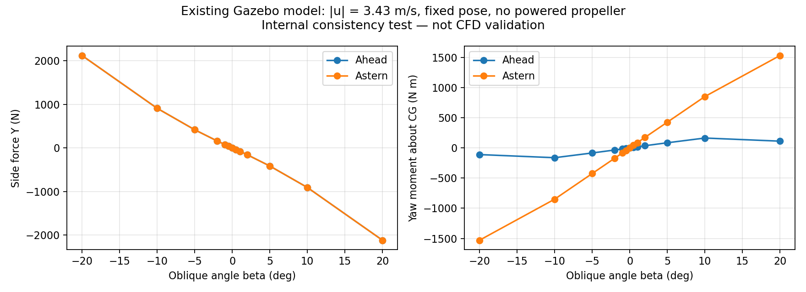

# 固定姿态拖曳台架（2026-11-26）

本步完成**现有Gazebo力模型的内部测量**，不是独立CFD、实体拖曳或实船验证。新增正式工具 `tools/analysis/captive_tow.py` 及4个独立单测；不改船体水动力公式、阻尼、附加惯性、几何或原航行验收阈值。

130个工况均取得有效、稳定、输入一致的测量；另有半步长14组和压力积分网格细化14组复核。**这些是台架有效性检查，不能与上轮32组自由航行验收相加，也不说明满倒车已合格。** 原有两组满倒车、三组横风失败仍保留。

## 方法和适用范围

静态约束固定所有船体位姿，以均匀来流建立相对速度；在静水、均匀流条件下用于同一力模型的稳态拖曳测量。采用船体FLU坐标，u为有符号纵速、v=|u|tan(beta)，r=0。beta是横速的参数化角度，倒车时不是atan2(v,u)的主值航向角。实际流速按静态roll/pitch转到世界坐标并取负号。

候选来自refinement-v1/air_base。静态z=−0.252616239336 m、总质量1571.174530 kg；原质量、惯性、几何保留在台架副本。移除推进执行器/相机等无关系统、关闭空气力和波浪，只保留船体与附体水动力。静态约束是测力台架，不是对自由航行加航向控制；不能拿台架不转弯证明稳定。

[ITTC约束模型试验规程](https://www.ittc.info/media/11866/75-02-06-02.pdf)区分定常斜拖、纯横移/偏航等规定运动及其测力用途。本工具目前只覆盖定常斜拖，没有PMM或旋臂激励，**不能识别Y_r、N_r或加速度导数**，也没有真实尾流/螺旋桨工作状态。

## 固定矩阵与测量检查

- |u|=1.884、2.27、2.66、3.05、3.43 m/s，分别前进、倒车。
- beta=−20、−10、−5、−2、−1、−0.5、0、0.5、1、2、5、10、20°，共130组。大角度只用于观察现有模型曲线，不能扩大其小斜流物理有效范围。
- 每组至少3仿真秒；只统计末1秒，剔除均匀流切换瞬态。这里的静态经验力本来是代数响应，不把3秒等待规则用于CFD收敛。
- 每个主题至少5样本，覆盖≥0.7 s、时间连续、间隔≤0.25 s；任何缺失/异常拒绝测量。
- 位姿变化<1e−8、实际来流/相对速度误差<1e−8、尾段力波动<1e−5、阻力相对水的功率≤1e−6 W。均为本台架测量完整性阈值，不替换航行门槛。
- 各分项原始审计均换算到整船重心、船体轴。分离项原参考点不是重心，使用N_CG=N_ref+(x_ref−x_CG)Y换算后才能从船体阻力中拆出，且不重复叠加。

完整结构化结果见[analysis.json](analysis.json)。



## 已确认的结果

正负斜流侧力/偏航矩的镜像残差≤2.28e−13 N/N·m；相同|u|、beta时正反航侧力差≤1.14e−13 N。后者是**当前附体|u|来流处理和船体侧阻假设的表现**，不是证明真实前后航侧力应该一样。

满速|u|=3.43 m/s、beta=+2°：前进Y≈−158.043 N、N≈+35.121 N·m；倒车Y≈−158.043 N、N≈+171.216 N·m。仅观察N的符号不能判断稳定性，还要结合u的符号、横移/偏航耦合及惯性。

以±0.5°小扰动中心差分，关于横速的偏航矩导数如下，单位N·m/(m/s)：

| u/m·s⁻¹ | 船体阻力含分离 | 附加惯性稳态项 | 推进附体 | 合计 |
| --- | ---: | ---: | ---: | ---: |
| −1.884 | −527.489 | +755.975 | +532.866 | +761.353 |
| −2.27 | −622.975 | +910.862 | +642.041 | +929.929 |
| −2.66 | −719.450 | +1067.354 | +752.348 | +1100.251 |
| −3.05 | −815.925 | +1223.846 | +862.654 | +1270.574 |
| −3.43 | −909.927 | +1376.325 | +970.132 | +1436.530 |
| +3.43 | +706.498 | −1376.325 | +970.132 | +300.305 |

这是测得的现有模型导数，不是拟合的新参数。附加惯性在恒速斜拖下仍有Munk类偏航矩；“加速度为零所以所有附加惯性项都该为零”的判断不成立。相反，不能将该项当阻尼随意缩放。与上一轮的平面线性化相互印证，但仍缺独立水动力参照。

1 ms→0.5 ms的14组关键工况，输出精度内六分量力差为0；压力积分最大边长0.35→0.175 m的14组差≤1.19e−10 N/N·m。这只证明本台架积分/时间采样一致，**不是CFD网格收敛，也不是当前粗船壳符合实船外形的证明**。

## 运行与版本

在已建立的ROS Jazzy/Gazebo Harmonic容器内，source ROS及工作区，给每次试验分配独立`GZ_PARTITION`。运行示例中的路径须替换为实际输入，`--hull-plugin`和`--appendage-plugin`必须是实际共享库文件；台架SDF使用这些绝对库路径，不依赖偶然的插件搜索顺序。

```bash
python3 tools/analysis/captive_tow.py \
  --model artifacts/rebuild/refinement-v1/air_base/model.sdf \
  --equilibrium artifacts/rebuild/recovery-speed15-v1/equilibrium.json \
  --hull-plugin artifacts/rebuild/refinement-v1/build/libUsvHullHydrostatics.so \
  --appendage-plugin /work/usv/ros_ws/install/usv_simulation/lib/libUsvAppendageHydrodynamics.so \
  --output artifacts/rebuild/my-new-towing-run
```

参数：`--step`单位s，默认0.001，范围(0,0.004]；`--speeds`为正纵速绝对值m/s；`--angles`为上述beta，单位度，范围(−45,45)。模型/平衡/库路径必填；输出目录必须不存在。当前工具面向本项目三连杆、usv主题的平坦候选SDF，不声称通用船模兼容。

本轮物理二进制沿用上一轮d0ee82b的已测插件；实际库SHA256、输入几何、源SDF、脚本及平衡输入绑定在各试验binding.json。Docker镜像为`sha256:9a39de035e72e6d673e2b72dd39f33d20741e3990e60eded78ee2fb6adb5de45`。运行前后所有绑定输入一致。

首次正式探针因附体库路径写错而未启动，随后定位到usv_simulation/lib并重跑6组探针通过；该错误不算物理失败或测量样本。正式130组与28组复核没有重选成功子集。

## 检查与下一步

code-supervisor quick通过；完整构建、12原生测试、83 Python测试、5接口测试通过。full仍报告既有ReadSeparationSections CC=10与AzimuthPropulsion::PreUpdate CC=11；重复/覆盖检查通过，不宣称full或deep全部通过。[24项复核](review.md)与原始机器报告归档保留。

本轮没有修改生产力模型，所以不重复宣称完成新的自由航行回归，原[27/32结果](../refinement/acceptance.md)继续有效。下一步先完成[独立CFD验证准备](cfd-plan.md)：官方OpenFOAM容器已固定，独立检查发现附体自交，裸船粗网格仍有凹单元检查失败，流场求解尚未执行。只有拿到可用的独立导数/不确定度后，才决定修改模型及重跑原航行验收。
