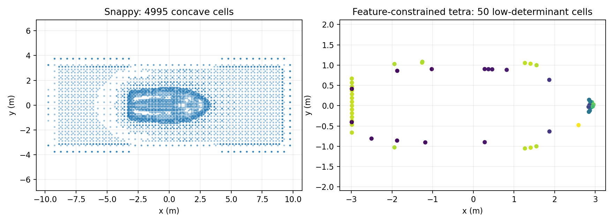

# 裸船壳 CFD 网格：定位凹单元与保形重建

本轮完成预检网格重建，不是倒车恢复修复或 CFD 水动力标定。生产船壳、阻尼、附加质量、推进和原航行验收门槛未修改；不加鳍，不接飞控/Nav2。

## 为什么之前的网格不能用

原 snappyHexMesh 精化后仍有4995个凹单元。单元中心范围约 x[-9.75,9.75]、y[-3.75,3.75]、z[-1.75,2.26] m；仅1772个位于船壳邻域，所以不能全部归咎于船面。关闭贴体的对照仍有8424个凹单元，表明加密过渡拓扑也是来源。该对照仅用于诊断，不保持船壳形状，不能拿来计算船体受力。



随后尝试 cfMesh 四面体：凹单元消除，但16个单元行列式不足，内部平滑后仍剩7个。增加特征边约束后，又出现50个低行列式单元及6个低插值权重面，优化后仍不通过。初版还错误合并外域为一个 patch；后续恢复六个独立外域边界。这些失败全部保留，没有降低检查阈值。

保留每个原始三角形作为独立平面约束的 Gmsh 对照也不合格（30个低行列式单元、11个低权重面）。**合并共面邻接三角形的内部边、保留船壳外轮廓及真实折角**后通过。由此支持“表面剖分约束可引入薄劣质单元”的数值诊断；不能据此声称真实船体设计有缺陷。

## 最终工具与几何边界

正式入口为 [bare_hull_cfd.py](../../../../tools/analysis/bare_hull_cfd.py)。只有这一个新增维护工具，其他试验脚本存于证据归档，不加入日常启动链。

- 使用上一轮同一份静态吃水 STL：55顶点、106三角形。来源是简化压力船壳，不是精细外观网格。
- 几何合并判据：邻面法向点积 > 1−10⁻¹²；再检查整组合并顶点到参考平面距离 ≤ 1微米，避免链式合并累计弯曲。
- 只去掉共面内部边；拒绝开放面、反向体积、非法坐标、多边界环。正式加载路径得到87个平面。
- Gmsh 4.15.0，Delaunay 四面体及 Netgen 优化；4线程。软件依据见 [Gmsh 官方手册](https://gmsh.info/doc/texinfo/)。手册在线版本可能更新，实际版本以 manifest 为准。
- OpenFOAM v2506 镜像固定为 `opencfd/openfoam-run@sha256:690476d30ce93c50b7c8e75ff49fd59faa55b78fae72b90aaba54337f7e0afc5`。
- 外域 x±24、y±12、z[-12,6] m。输入静水面 z=0；世界/船体姿态沿用上一轮静态吃水，而不是重新求平衡。
- 粗网格目标尺寸：船壳顶点0.125 m，外域0.75 m；自由液面区域 x±9、y±3、z±0.5 m 为0.25 m，过渡厚度0.5 m。`scale` 同比缩放目标尺寸，区域尺寸保持不变。目标尺寸不等于所有最终边长。
- `hull` 与 `xmin/xmax/ymin/ymax/bottom/top` 独立。转换后 hull 的 patch 类型还需在流场准备时设为 wall；现在没有流场边界条件。

正式粗网格361366个四面体，完整 `checkMesh -allGeometry -allTopology` 输出 **Mesh OK**：最大非正交角57.7056°，最大偏斜0.875504，最小行列式0.0014435，最小插值权重0.122479，最小体积比0.139574。检查标准未放宽。

船壳边界闭合；几何体积8.358237901 m³与输入8.358237870 m³的相对差约3.70×10⁻⁹。这个是整个封闭壳体积，**不是排水体积**。边界顶点/面中心到源面最大抽样距离约5.001微米，源顶点/面中心到边界约3.404微米，包含六位文本导出的舍入误差；这是采样检查，不能冒充连续表面的严格 Hausdorff 上界。

更细一档将目标尺寸乘以1/√2，得到980722个四面体，同样 **Mesh OK**；最大非正交角60.1853°，最大偏斜0.705644，最小行列式0.00158301。两档结果见 [results.json](results.json)。这只证明两档预检网格可用，不证明受力网格收敛。

## 复现

解压本目录 `mesh-evidence.tar.gz` 到新目录，取其中 `inputs/hull.stl`。Python 环境需 NumPy、SciPy、Trimesh，以及单独安装的 `gmsh==4.15.0`。本地试验环境位于 `artifacts/rebuild/cfd-mesh-v1/gmsh-env`，不是部署依赖。

```bash
artifacts/rebuild/cfd-mesh-v1/gmsh-env/bin/python tools/analysis/bare_hull_cfd.py \
  --hull /absolute/path/to/inputs/hull.stl \
  --output artifacts/rebuild/cfd-new
```

将归档 `final/system` 复制到新 case。在 OpenFOAM 固定镜像内进入 case 后：

```bash
gmshToFoam mesh.msh > log.convert 2>&1
checkMesh -allGeometry -allTopology > log.checkMesh 2>&1
```

必须核对日志结尾 `Mesh OK.`、所有检查及边界区域；不能只看命令退出码，因为失败检查也可能返回0。工具的 manifest 只确认生成完成，不宣称质量通过；记录输入、工具与网格 SHA256。正式输出拒绝覆盖已有目录。多线程生成可能有不同单元排序/数量，每次都须重新检查。

## 未完成的物理验证

1. 当前只有体网格质量和几何检查，尚未增加/验证近壁层、y+、VOF 自由面、压力/湍流边界及流场收敛。
2. 两档网格检查即使全部通过，也不等于网格无关性；需要比较同一工况的侧力/偏航矩，再做时间步及外域敏感性。
3. 首个流场目标保持为裸船壳倒车斜流（例如 u=−3.43 m/s、beta=±2°），先验证流向/力矩符号和零斜流对称性，再扩大矩阵。
4. 推进附体自交尚未修复；裸船壳不包含附体或螺旋桨尾流。
5. 满倒车、风浪流下原自由航行失败不因网格通过而消失。仍禁止把候选模型推广为合格默认模型。

预处理参数含义参考 [cfMesh 作者指南](https://cfmesh.com/wp-content/uploads/2015/09/User_Guide-cfMesh_v1.1.pdf)。后续 CFD 验证按 [ITTC 操纵 RANS 验证建议](https://www.ittc.info/media/11970/75-03-04-02.pdf)及上一轮 [CFD 方案](../captive-tow/cfd-plan.md)进行。软件/程序依据不等于本船实测标定。

代码检查、构建边界和24项审查见 [review.md](review.md)；原始日志、配置、来源和失败记录见归档及 `evidence-sha256.json`。
