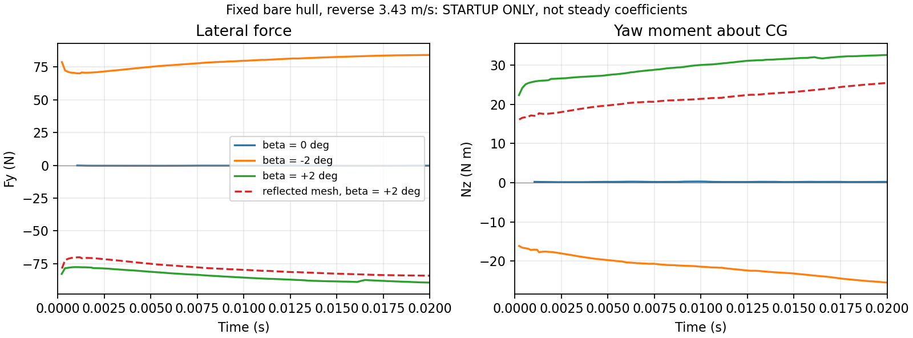

# 裸船体两相流启动预检

本轮把裸船壳网格推进到 **interFoam 两相流短时运行**，先修复静水伪流和满速启动失败。这里的力/力矩是启动瞬态，不能用于改写 Gazebo 水动力系数、证明倒车稳定或宣称与实船一致。生产船形、阻尼、附加质量、推进参数和原操纵验收门槛均未改；不加鳍、不接飞控/Nav2。

## 查到的问题及对照

### 网格质量通过，不等于静水离散平衡

上一轮约36万格的裸船壳网格通过几何/拓扑检查，但单元跨过静水面。按单元中心设置水/空气后，离散相界面不平整。0.1秒静水试验出现约11.125 m/s的空气区数值速度，末帧横力约−6.81 N，不能当作真实水动力。

处理方法是使用同一船壳的共面多边形，以 OCC 布尔操作在 z=0 将**流体**分成上下两个共形体积；共享水面仍是内部面，不是壁面，不移动船壳。船艏折角与水面交点处再对称局部加密。单纯加密/平滑仍留下薄四面体，因此选取同侧、相邻且合并后凸包体积等于原两体积和的单元对，仅删除内部公共面。禁止合并跨静水面的单元。

正式网格处理了4个薄单元；体积一致误差约10⁻²¹ m³量级。完整 checkMesh 重新通过，最小行列式0.00107417（原检查阈值0.001），最大非正交角68.8687°，无凹单元或失败项。没有降低检查阈值。并行 Gmsh 的具体单元排序/数量会变化，所以不能复用另一轮的坏单元编号；工具每次读取本轮坏单元集合。

几何核对：船壳边界仍封闭，体积相对误差3.75×10⁻¹¹；边界顶点/面中心到原船壳的最大抽样距离约1.13×10⁻⁸ m。该采样不是连续表面 Hausdorff 上界。详见 `geometry-comparison.json`。

### 满速均匀初场与不可穿透船壳不相容

直接给全场3.43 m/s来流，在第一时间步才令船壳速度归零，会产生很强的压力投影启动冲击。试验推进到约0.0004秒后速度发散、时间步塌缩，已主动停止并保留失败。仅关闭 momentumPredictor 的单因素对照仍然失败。

先运行 `potentialFoam -initialiseUBCs -pName p_rgh -writephi`，建立满足不可穿透约束及离散连续性的速度/通量，再启动 interFoam，0.002秒及0.02秒试验能够正常完成。该势流仅作初场，不写欧拉压力，不替代黏性两相解，也不是航向控制或船体阻尼补偿。

零斜流正式初试的第一步 alpha.water 最低约−4.24×10⁻⁶，超过本轮预先声明的−10⁻⁶数值筛查限值。因此按官方船舶教程将 nLimiterIter 从3增加到10作同条件复核，保留旧失败，不通过裁剪数据或放宽限值过关。

### 近壁层仍未完成

cfMesh `generateBoundaryLayers` 的首次尝试没有生成期望的层网格，且引入4个低行列式单元，已拒绝用于求解。当前运行网格仍主要是四面体，采用 SST 壁面函数；初始斜流预检的局部 y+ 超过1000。**近壁分辨率未验收，不能将短时受力作为可靠阻力或侧力标定。** 后续需重新设计近壁网格并报告水下壁面 y+ 分布、壁法向分辨率及受力敏感性，而非只看平均 y+。

## 物理及数值设置

| 项目 | 数值/定义及依据边界 |
| --- | --- |
| 几何 | 同一份55顶点、106三角形的简化压力船壳；不是精细视觉模型。无推进附体、旋转桨或尾流。 |
| 参考系 | 固定船壳，FLU与世界轴平行。船体纵速 u，横速 v=abs(u)tan(beta)，世界来流为(−u,−v,0)。倒车 u=−3.43 m/s，beta=−2/0/+2°。 |
| 重心 | 从固定载荷 equilibrium.json 读取，世界 CG≈(−0.566058,0,0.2392515) m；forces 力矩关于此点。CFD中没有船体自由运动。 |
| 物性 | 水 rho=1000 kg/m³、nu=10⁻⁶ m²/s；空气 rho=1.225 kg/m³、nu=1.5×10⁻⁵ m²/s；g=(0,0,−9.81) m/s²；sigma=0.072 N/m。工程假设，不是实测温盐度。 |
| 湍流 | RAS kOmegaSST。入口强度1%、长度0.42 m，k=1.5(UI)²，omega=sqrt(k)/(0.09^0.25 L)。静水小正底值仅防止湍流量奇异，不是背景风流。 |
| 船壳 | noSlip；p_rgh=fixedFluxPressure；alpha=zeroGradient；kqRWallFunction、omegaWallFunction、nutUSpaldingWallFunction。没有以壁面函数掩盖 y+ 限制。 |
| 入口/侧边界 | 依据来流与外法向点积选择入口，侧向来流可以进入域内；速度/k/omega/相分数给定，p_rgh使用fixedFluxPressure。 |
| 出口 | 速度、相分数及湍流量使用inletOutlet，允许规定的远场回流；p_rgh给定静水压参考0。不是波浪无反射边界，后续需扩域对照。 |
| 顶部/底部 | 顶部pressureInletOutletVelocity、空气回流、p_rgh=0参考；底部滑移、压力通量边界。压力最终由p_rgh、rho和重力高度重建。 |
| 外域/初始水面 | x±24、y±12、z[-12,6] m，z=0；setFields初始化纯水/纯空气，要求网格与初始平面共形。 |
| 网格尺寸 | 原船壳目标0.125 m、外域0.75 m、自由面盒0.25 m；艏部 x[1.85,2.35]、abs(y)[0.4,0.7]、z±0.07 m局部目标0.01 m，过渡0.05 m。 |
| 网格优化 | Gmsh 4.15.0，Netgen/Relocate3D；OptimizeThreshold=0.7是网格生成器的优化目标，不是checkMesh验收阈值。 |
| 时间 | Euler真实时间；初始deltaT=0.001 s，自适应maxCo=0.5、maxAlphaCo=0.25、maxDeltaT=0.002 s。尚未做固定比例时间步收敛。 |
| 对流/扩散 | 动量linearUpwind；相分数vanLeer/interfaceCompression；湍流量upwind；梯度cellLimited Gauss linear 1；扩散/面法向修正limited 0.5。这里只是启动设置，后续比较格式误差。 |
| 压力速度耦合 | momentumPredictor=no，nOuterCorrectors=2，nCorrectors=2，nNonOrthogonalCorrectors=1；不使用官方稳态DTC教程的localEuler伪时间。 |
| 相分数 | nAlphaCorr=2，nAlphaSubCycles=1，cAlpha=1，MULESCorr=yes；nLimiterIter从3严格增加至10，无物性改动。 |
| 线性求解 | Phi：GAMG/DICGaussSeidel，绝对残差10⁻¹⁰、relTol=0，势流非正交修正10次；p_rgh：GAMG/DICGaussSeidel，绝对残差10⁻⁸、relTol=0.01，Final时relTol=0；pcorr：PCG/DIC；U/k/omega：smoothSolver/symGaussSeidel，绝对残差10⁻⁸、relTol=0.01；alpha：同平滑器，relTol=0。 |
| 松弛与输出 | 方程松弛1；4个scotch分区。forces每步记录总/压力/黏性分量，yPlus在写出时记录，fieldMinMax每10步记录。因此最大流速统计是日志采样值，不是连续时间严格峰值。 |

forces 输出包括水和空气的压力/黏性贡献，尚未按相分离；静水理论浮力应同时包含空气浮力：9.81×[1000×1.571174530 + 1.225×(8.358237870−1.571174530)]≈15494.78398 N，不能只用整船重量比较。完整壳体积8.358 m³也不能误作排水体积。

## 工具、复现与版本绑定

- [bare_hull_cfd.py](../../../../tools/analysis/bare_hull_cfd.py)：增加 `--waterline` 和 `--select-slivers`，保留原网格路径作对照；合并选择不自动宣称质量通过。
- [cfd_flow.py](../../../../tools/analysis/cfd_flow.py)：准备新case，拒绝覆盖；支持合并后的多边形边界，拒绝边界跨水面；不隐式启动进程。
- [字典模板](../../../../tools/analysis/cfd_templates/)单独维护。没有新增船体运行入口或大量临时启动脚本。
- OpenCFD v2506运行镜像摘要仍为 `sha256:690476d30ce93c50b7c8e75ff49fd59faa55b78fae72b90aaba54337f7e0afc5`。官方教程包2506.250814-1的SHA256为 `6fc374778ad9a15fcb1031d6a4848517fbd1de3ebccb3dfa06fb9dbc39b6eccf`；只解包核对，没有更换求解器。
- 每个case记录生成工具、工况、网格与配置哈希。setFields/势流初始化预期会改变0目录，初始化后的哈希另存；system/constant在求解期间必须保持原哈希。网格生成期间源码变化会拒绝写完成清单。

在新的网格case内依次执行：

```bash
# Python生成阶段需要已安装Gmsh 4.15.0的独立环境。
python tools/analysis/bare_hull_cfd.py --hull INPUT.stl --output NEW_MESH --waterline
# 在固定OpenFOAM容器中，准备controlDict/fvSchemes/fvSolution后执行：
gmshToFoam mesh.msh
checkMesh -allGeometry -allTopology
# 仅若当前失败确认为低行列式四面体，在独立副本选择内部面：
python tools/analysis/bare_hull_cfd.py --select-slivers NEW_MESH_COPY
removeFaces sliverInterfaces -overwrite
checkMesh -allGeometry -allTopology
```

`checkMesh`可能在失败时仍返回0，必须核对日志结尾及所有质量项。不得使用旧坏单元集合处理新网格；后续case准备不复制旧sets诊断集合。

```bash
python tools/analysis/cfd_flow.py --mesh-case CHECKED_MESH --output NEW_CASE \
  --equilibrium EQUILIBRIUM.json --u -3.43 --beta 2 --duration 0.02
# 以下在固定OpenFOAM镜像内显式cd到/case，容器入口会覆盖docker工作目录。
checkMesh -allGeometry -allTopology
setFields
potentialFoam -initialiseUBCs -pName p_rgh -writephi
decomposePar
mpirun -np 4 interFoam -parallel
```

正式试验限定单例4核、3 GiB，求解超时900秒，仅为防止坏算例无限占用。超时、未到终点或步长塌缩不能算通过。试验方案与新启动筛查门槛见 `validation-plan.json`，不替代或放宽原Gazebo验收。

## 科学依据与仍缺的证据

字典/API依据为[官方v2506发行版](https://www.openfoam.com/news/main-news/openfoam-v2506)、[官方教程包](https://dl.openfoam.com/repos/deb/dists/noble/main/pool/2506_250814/binary-all/openfoam2506-tutorials_2506.250814-1_all.deb)中的interFoam/RAS/DTCHull、[forces接口](https://api.openfoam.com/2506/classFoam_1_1functionObjects_1_1forces.html)及[Gmsh官方文档](https://gmsh.info/doc/texinfo/)。本船边界和真实时间设置与教程不完全相同，上表逐项说明，未把教程照搬当作认证。

按[ITTC RANS操纵预测核验](https://www.ittc.info/media/11970/75-03-04-02.pdf)及[原CFD方案](../captive-tow/cfd-plan.md)，仍缺近壁、三档网格、时间步、外域、统计收敛和附体/尾流验证。0.02秒仅约0.0114个L/U，远短于原方案的20 L/U启动与5 L/U平均窗；本轮明确不冒充这些长时间结果。

下一步优先处理近壁与水线局部网格、估算可承受的计算成本，再做有效时长和收敛对照。有独立可信证据后才讨论Gazebo模型修正。

## 镜像网格诊断：失败来自哪里

追加诊断仅对计算域做(x,y,z)→(x,−y,z)反射，反转所有面的顶点绕序以保留向外法向，并交换ymin/ymax边界名称；固定船体与来流一起镜像。保持物性、数值模板和0.02 s时长不变。原始船壳的镜像顶点/表面抽样误差约10⁻¹² m，几何在本精度下左右对称（抽样不等于连续距离上界）。镜像网格再次通过checkMesh。

将原网格−2°与镜像网格+2°配对，末帧侧力镜像误差 **0.00530%**，偏航力矩误差 **0.03062%**；共同时间范围内插值比较的最大误差分别约0.02082%与0.10108%。镜像工况完整到达0.02 s，最小时间步约0.0001011 s，相分数保持原筛查范围内，配置哈希未变。

这组对照有力支持：原网格6.07%/24.54%的不对称含有显著的网格及离散求解路径影响，不能据此解释真实船体的左右差异。它仍不能给出真实稳态侧力，不能单独分离空间离散、并行划分和自适应时间步各自的误差。**镜像网格试验是原因诊断，原网格5%门禁仍失败；没有替换失败样本、对两侧取平均或放宽门槛。**

证据：[镜像结果](reflection-results.json)、[船壳对称性抽样](geometry-symmetry.json)、[镜像算例日志/受力/配置](reflection-evidence.tar.gz)、[证据哈希](reflection-evidence-sha256.json)。后续应建立左右一致的网格拓扑，并同时处理近壁与自由面分辨率，再在同一网格上重做±2°和收敛试验；不能只靠强制对称制造漂亮结果。

## 最终启动筛查（2026-11-28）

同一正式网格、工具和10次相分数限制器迭代，静水0.1 s、倒车三组各0.02 s。2026-11-26三组v2被中断，未到终点，全部不计通过；保留原日志，新建v3完整重跑。所有力矩关于固定工况重心，纵速−3.43 m/s。

| 工况 | 实际时长 s | 末帧 Fy N | 末帧 Nz N·m | alpha最小/最大 | 求解墙钟 s | 本组启动筛查 |
|---|---:|---:|---:|---|---:|---|
| static | 0.100 | -6.10952e-09 | -0.0344781 | 0 / 1 | 95 | 通过 |
| reverse-zero | 0.020 | -0.270823 | 0.234868 | -9.968e-13 / 1.000000039 | 104 | 通过 |
| reverse-minus | 0.020 | 84.1699 | -25.4988 | -1.721e-15 / 1.000000055 | 277 | 通过 |
| reverse-plus | 0.020 | -89.4417 | 32.6328 | -1.58e-12 / 1.000000049 | 193 | 通过 |

**启动筛查未全部通过，不得作为标定依据。**
- 末帧Fy镜像相对误差：6.0731%，门槛5%，未通过。
- 末帧Nz镜像相对误差：24.5444%，门槛5%，未通过。

镜像指标为abs(Q−+Q+)/max((abs(Q−)+abs(Q+))/2,1)，单位底值分别为1 N与1 N·m；不减去直航偏置，也不修饰原始受力。表中是末帧启动镜像筛查，不是完整时间序列对称性证明。



静水日志采样最大速度5.16982e-06 m/s；所有记录时刻的最大水平力分量1.00544e-08 N、最大偏航力矩0.0344781 N·m；含空气浮力的最大相对误差3.28328e-08。不是只抽取末帧判断静水平衡。

| 工况 | 最终船壳 y+ 最小/最大/平均 |
|---|---|
| static | 2.8033e-06 / 0.058083 / 0.00098459 |
| reverse-zero | 2.1759 / 366.57 / 42.104 |
| reverse-minus | 2.4909 / 1224.6 / 112.25 |
| reverse-plus | 2.9558 / 1255.9 / 112.38 |

y+统计包含整个船壳的水/空气侧，不是单独水下分布。没有棱柱层与分辨率敏感性证据，近壁仍未验收。当前曲线处于明显启动过程，不能提取稳态Yv/Nv或证明自由倒车稳定。

复现与核查：[逐项结果](final-results.json)、[完整试验日志/受力/配置压缩包](final-evidence.tar.gz)、[文件哈希](final-evidence-sha256.json)、[初始故障诊断压缩包](diagnostic-evidence.tar.gz)、[诊断文件哈希](diagnostic-evidence-sha256.json)、[固定载荷工况](equilibrium.json)、[源码绑定](source-binding.json)、[24项代码审查](review.md)。压缩包内的一次性evaluate-final.py记录计算方法，不增加维护入口。体网格和体场保留在本地artifacts/rebuild/cfd-flow-v1，Git只保存可审计的小文件。

本轮求解期间system/constant哈希不变；setFields与potentialFoam会按预期改变0目录，另存初始化后哈希。CFD工具源码见提交dd20bc8，最终证据由其后文档提交保存。完整工程构建测试基于supervisor报告记录的当时工作区快照，其中含用户其他未提交变动；source_unchanged只证明检查期间未变，不代表整个工作区等于该Git提交。其他变动未混入本次提交，不能将本轮全工程构建记录宣称为干净检出dd20bc8的复现。

下一步先做水下近壁网格和自由面局部分辨率设计，再做网格/时间步/外域及有效时间收敛。20 L/U启动+5 L/U平均约43.73 s，现有0.02 s仅是很短的启动试验；按短测简单线性外推会非常昂贵，且不代表实际长算例成本。没有把昂贵但不收敛的运行当作物理验证。Gazebo船体参数、鳍、飞控与Nav2均未改动。
