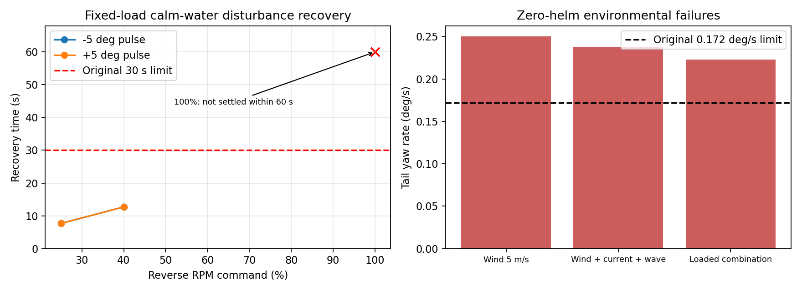

# 第二步：不同速度与操纵工况

完整22组有效工况中20组通过、2组满倒车失败，三个左右回转半径对照通过。使用原`maneuver_audit.json`中除旧油耗工况外的16组，再增加25%、40%、100%倒车各左右2 s、±5°扰动共6组。60%扰动已有相同最终插件的[上轮结果](../hull-separation/README.md)，未重复计入本轮22组。

脚本复用原`assess_maneuvers.py`的阶段指标、舵速/命令跟踪、回转方向、半圈、停车、Z字超越与回舵恢复规则。额外扰动沿用原30 s、相对扰动前偏航率±0.05°/s持续5 s的判据；还用原始舵机记录补核实际扰动>2°、尾段回零误差<0.1°。Z字是按航向到点离散换舵，不是航向保持。

| 类别 | 测试结果 |
| --- | --- |
| 35%、65%、100%前进零舵 | 三组通过 |
| 55%前进左右回转 | 半径5.218/5.233 m，相对差0.294%，通过原20%门槛 |
| 100%前进左右回转 | 半径5.378/5.437 m，相对差1.081%，通过 |
| 40%倒车左右回转 | 半径12.430/12.427 m，差0.024%；方向、半圈及停车通过 |
| 满速滑行停止 | 25.454 s、16.893 m，达到原水平速度<0.1 m/s持续1 s条件 |
| 满速转60%反推制动 | 3.823 s、7.272 m首次纵速过零；剩余横速−0.00124 m/s，不等同完全静止 |
| 55%油门10°/10°Z字 | 最大超越12.971°；回舵恢复4.326 s、额外转向15.220°，通过 |
| 35%油门10°/10°Z字 | 最大超越8.834°；恢复6.249 s、额外转向11.551°，通过 |
| 25%、40%、60%零舵倒车 | 三组通过 |
| 25%倒车左右扰动 | 都约7.668 s恢复，通过 |
| 40%倒车左右扰动 | 都约12.713 s恢复，通过 |
| 100%倒车左右扰动 | **两组失败，详见下节** |

## 满倒车失败不能隐藏

两组独立运行在扰动前都有约+0.66872°/s尾段偏航，超过原0.5°/s。扰动后−5°组尾段−0.26313°/s、额外转向约65.75°；+5°组尾段+0.91058°/s。两组均未在60 s观察窗内恢复到扰动前偏航率±0.05°/s持续5 s，因而不满足30 s要求；+5°组还超过尾段绝对偏航率门槛。

实际推进命令、舵角跟踪、舵速、遥测连续性及耗散检查均通过，不能归为未送达命令。该问题是高倒车速度下的模型表现边界，不能由60%通过外推成100%通过。未把最大油门改小来规避测试，也未提高阻尼或加控制器。

下一步需对这一速度下的横移/偏航耦合与分离近似继续分析；本轮数据本身不足以断言已经证明具体的高功率失效机理。

## 模型可信度与试验完整性

前进急转时，参考点相对水速的斜流角`atan2(abs(v),abs(u))`在|u|>0.3 m/s样本中达到约32.23°（55%）和40.14°（100%）。这是适用性诊断，不是后来新增的验收门槛；显然不能再按“小斜流”解释为精确实船预测。40%倒车回转对应约6.62°。指标通过与物理模型准确性分开报告。

第一次55%左转有实际命令未送达，失败原始数据未覆盖；改为暂停世界确认通信后复测通过。`selected-attempts.json.gz`明确选用该复测，其余本节工况沿用首轮。所有源、插件与验收文件哈希在运行后再次一致；脚本及判据以证据快照为准，不依赖后续主分支漂移。

图中100%位置的红叉表示观察60 s仍未恢复，不表示恢复时间恰为60 s。60%的上轮约24 s结果见链接，未混入本轮图的折线。
