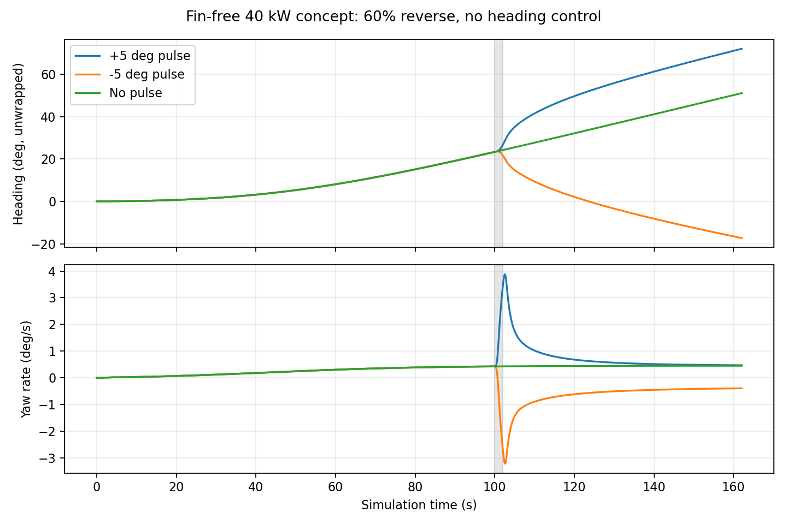

# 高功率无鳍船：倒车恢复未通过

**不能把6 kW通过推广到40 kW方案。** 本轮保持相同原判据，不增加鳍、不改变阻力或质量系数、不使用航向控制。左右脉冲均未通过30秒恢复标准，暂不切换为默认船。

## 输入与范围

使用此前speed15_concept载荷0、静水实例作为转换输入，生成固定载荷无鳍船。原来源文件在工作区有先前未提交内容，故本目录保存其精确压缩副本及SHA256，不将其声称为当前Git提交可单独还原的输入。新的--source入口记录明确来源；转换移除同一5.16854 kg稳定鳍。整船固定质量1571.17453 kg，轴功率上限33.6 kW（40 kW电功率假设×0.84），静推力参考6000 N，额定参考1500 rpm；这只是概念配置，不是实测。

100秒60%反推接2秒±5°舵角脉冲，再零舵反推60秒。原恢复标准是偏航速度回到扰动前参考±0.05°/s并持续5秒，首次恢复≤30秒。复用原评估函数。完全无扰动对照使用相同模型和输入，只有2秒舵脉冲被取消；此项不计算扰动有效/扰动恢复通过率。

| 工况 | 扰动前参考偏航速度 | 末段偏航速度 | 回零后最大额外航向变化 | 恢复结论 |
| --- | ---: | ---: | ---: | --- |
| +5°脉冲 | +0.41761°/s | +0.48208°/s | 45.175° | 未在记录的60秒内满足持续恢复条件 |
| -5°脉冲 | +0.41761°/s | -0.40479°/s | 38.863° | 未在记录的60秒内满足持续恢复条件 |
| 无脉冲 | +0.41761°/s | +0.45290°/s | 同时间窗26.819° | 仅对照：没有扰动，不称为恢复通过 |

三项尾段倒车纵向速度约-1.884 m/s。两次脉冲实际舵角峰值约5.09°，尾段实际零舵<0.1°，排除“指令回零但舵机仍保持大角度”这一解释。无脉冲结果JSON的passed仅表示其列出的6项运行/宽限检查通过，不表示直线稳定、航迹合格；其中settling_time_s是复用指标相对已有偏航的结果，不作恢复验收。不能因为偏航速度低于原0.5°/s宽限就忽略持续转弯。

## 外力矩旁路记录

无脉冲试验中途订阅已有审计话题，不施加额外力。145–160秒各148个样本，力矩统一在整船重心处、船体轴表达，平均偏航力矩为：船体阻尼-15.999 N·m，附加质量项+10.896 N·m，推进附体+4.720 N·m，船体压力+0.392 N·m，风约-0.00146 N·m；推进力直接偏航力矩约+0.000228 N·m，桨水动力反扭矩直接偏航分量近零。

这支持进一步检查船体/附体/惯性耦合，不能把主要偏航归为飞控PWM持续打舵。它也**不证明这些水动力系数正确或某一项就是唯一根因**；均值力矩不是线性稳定性特征值，也没有完成动态转动惯量、陀螺项和所有瞬态的闭合残差分析。各原始话题和统计保存。

## 后续

先线性化或小扰动辨识高功率倒车附近的侧向/偏航耦合，并做不改总质量的分项对照，核查附加质量与分布阻力定义、作用点和符号。未经这些验证，不直接改船底或加回鳍，也不靠航向控制压住。6 kW配置本轮表现可作为对照，但不能用降动力替代15 km/h方案的目标。

本步骤没有新增生产物理修改；检查与候选来源功能对应de0468c，Code Supervisor quick、完整构建及单元测试证据见../contacts。失败完整保留，不以编译、基础浮稳、碰撞或随浪通过替代操纵验收。高功率的完整随浪/碰撞及长时间验证尚未完成。
