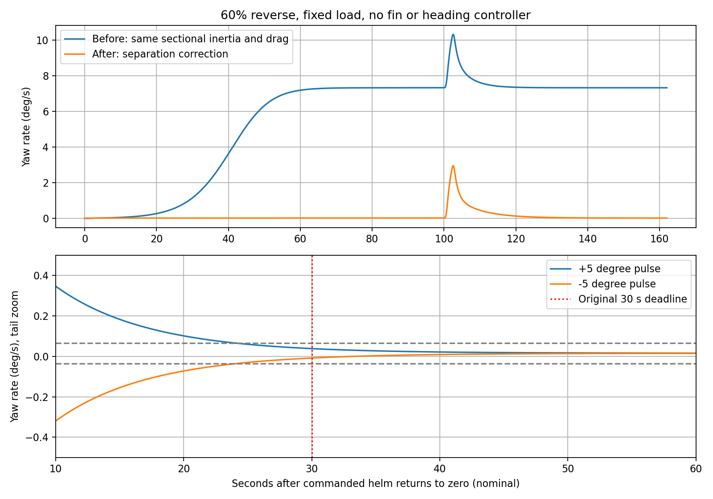

# 船体分离区斜流载荷修正

2026-11-26，基线a997f21。继续使用相同高功率、固定载荷、无额外鳍船体；不接飞控，不改变原倒车验收。默认模型不自动启用此候选功能。

## 第一步：依据与实现

[Sutulo《Basics of Ship Manoeuvrability》§2.3.4，式2.89–2.92](https://fenix.tecnico.ulisboa.pt/downloadFile/1970943312391368/DMN_SS_manoeuvring_2013.pdf)将细长体准定常载荷分成惯性项及截面附加质量梯度项。后者在下游分离区需区别于完整势流压力恢复；书中列出最大截面附加质量区、最大吃水站等分离位置估计，并强调这是粗略近似。不能把该方法当成任意船型的精确预测。

本候选按实际湿剖面的最大μ区域确定下游边界：前进取最大区最小x，倒车取最大区最大x。当前480剖分对应约−1.19375 m和−0.00625 m；不根据恢复时间搜索该位置，也不增加自由增益。最大μ与最大吃水等价来自本次μ=ρπT²/2假设，而非实测分离位置。

保留现有附加惯性和科氏项，只补“已分离”与“完整势流”之间的差额：

- ΔY = −u ∫下游 μ′(x)(v+xr) dx；
- ΔN = −u ∫下游 x μ′(x)(v+xr) dx。

x为原drag_center的相对力臂，u、v为该点相对水速，r为偏航角速度。对μ的每段线性插值解析积分，力矩采用真实二阶位置矩，不能把区间中点平方当作二阶矩。端部μ跳变用零长度区间的有限Δμ表示，无除零。前后方向按相对水速选择，零纵速时修正为零。

该项不是再增加一次完整细长体力或Munk力矩。单峰剖面的下游μ沿来流递减，因此修正项广义功率非正；不按航向误差施力。原模型的线性/二次阻尼不因此调大。空间作用采用现有水平模型的垂向参考点，未额外估计侧力的垂向压力中心。

## 参数与边界

可选SDF `separation_sections_file` 指向固定载荷静水剖面，每行两个数：船体x(m)、μ(kg/m)，无表头。x非递减、μ非负且有限、两端μ=0、剖面单峰并允许平坦最大区；不满足则拒绝加载。为防止惯性与斜流修正来源不一致，剖面积分的A22、A26、A66必须与插件配置在0.1%数值一致性容差内一致。此容差用于数据一致性，不是操纵验收容差。

本轮使用上轮471.26 kg横向惯性、1002.71 kg·m²偏航惯性、97.77 kg·m耦合及重算的351.254横向二次系数；不退回原1500来获得更大阻尼。新遥测`/usv/hydrodynamics/separation`字段为[t(s),u(m/s),v(m/s),r(rad/s),ΔY(N),ΔN(N·m)]，同步现有约10 Hz水动力记录。现有总阻力审计包含该修正，分析时不能再叠加一次。

近似适用小斜流、固定吃水和低弗劳德数；当前约1.88 m/s倒车Fn≈0.25，仍需保留自由面影响的不确定性。不能据此宣称15 km/h、波浪、不同载荷或大漂角同样准确。该模型不含实时涡、CFD或本船实测标定。

## 代码检查

新增头文件负责纯剖面计算；插件仅负责可选配置、同源矩阵校验、施力与遥测。没有新增正式启动脚本。沿用resistance测试目标，新增三角μ剖面的独立质量/惯性积分、前进/倒车方向、旋转解析积分、参考点变换、零速和能量检查，以及坏数据拒绝测试。

固定容器完整构建12个包；12项原生测试、76项Python测试及5项接口测试通过；另用Debug构建运行resistance目标，使其原有assert有效。Code Supervisor quick五项通过；不声称full/deep、全量覆盖率或sanitizer已经通过。操纵结果在完成后单独记录，不以编译通过替代航行验收。

## 第二步：原门槛下的航行结果

先用实现提交`6a15fe0`构建的插件完成下表。测试为固定载荷静水、无鳍、无飞控的直接推进/舵角命令；“60%”是RPM指令，不是40 kW全功率。100 s稳态倒车后给2 s的±5°舵角扰动，再观察60 s。

| 工况 | 结果 | 范围 |
| --- | --- | --- |
| +5°扰动 | 24.015 s恢复；尾段0.01635°/s | 原30 s恢复门槛通过 |
| −5°扰动 | 24.216 s恢复；尾段0.01370°/s | 原30 s恢复门槛通过 |
| +5°、步长减半至0.5 ms | 23.9865 s；尾段0.01633°/s | 对照1 ms，无明显步长依赖 |
| 连续零舵倒车240 s | 6.7830 km/h；尾段0.01505°/s | 原零舵偏航、速度散差、姿态、湿润及实际舵角检查通过 |
| 新模型满油门前进100 s | 15.39551 km/h | 未观察到纵向速度损失；不是全航速水动力准确性认证 |
| 原高功率无鳍模型前进100 s | 15.39551 km/h | 相同推进器与步长、可选分离修正关闭的对照 |

恢复判据直接复用`tests/regression/assess_maneuvers.py::recovery_metrics`与`tests/scenarios/reverse_task_acceptance.json`：相对扰动前偏航率±0.05°/s、持续5 s、30 s内恢复，同时尾段绝对偏航率小于0.5°/s。没有修改判据。此处恢复的是偏航角速度，不是自动返回原航向；左右扰动后的额外航向变化分别约13.37°、11.93°。

修正前同一截面惯性/侧阻候选尾段约7.33°/s，加入分离差额后约0.016°/s。对照只支持该模型缺项解释了本工况的大幅偏航，不能证明真实船体的分离位置已经准确标定。

连续倒车前10/30/60 m按原几何指标后处理，最大横偏分别0.0043/0.0525/0.2259 m，航向误差0.0933/0.2410/0.4780°，均在原走廊门槛内。这是同一连续轨迹的几何检查，不是三个独立的距离触发任务验收。

**仍有残余偏航：240 s累计航向变化约3.56°。** 本轮没有通过航向控制或人为偏置抵消它，不能写成“绝对直行”。大漂角、不同载荷、风浪流和完整操纵包尚未针对这一候选全部复验；前进15.4 km/h对应Fn约0.56，已超出低速近似的可靠解释范围。当前只证明测试下速度与稳定性表现，不把它包装成实船预测。默认船模仍未切换。

## 最终代码复核与证据定位

随后按code-supervisor的结构规则分开输入边界、单峰拓扑校验与物理积分，并将解析测试按积分、参考点/能量、坏输入、平坦峰和端部跳变分类。力的公式及积分表达式未改；新头文件加入真实覆盖率范围，未下调任何阈值。

- 最终完整构建12包；12项原生、76项Python、5项接口测试通过。
- Supervisor quick五项、重复检查、构建测试均通过；所选C++文件行覆盖率97.44%，包含新头文件，不代表全工程覆盖率或正确率。
- full退出码仍为1：输入解析函数CC=10、原有`AzimuthPropulsion::PreUpdate` CC=11。保留完整输入边界检查，不为消除边界告警机械拆分；原推进器不在本次物理修改范围。人工复核接受本步局部例外，**不称full全通过**。sanitizer、变异及deep未执行。
- [24项人工复核](code-review.md)、[最终Supervisor报告](supervisor-final-report.txt.gz)、[结构化报告](supervisor-final-report.json.gz)分别记录范围与限制。
- `runtime/physical`、`runtime/halfstep`、`runtime/old_forward`保存第一版完整原始结果；`runtime/initial-source`保存该版源码。`runtime/final`保存最终版本左右扰动复测及最终构建测试。初版和最终版不能混称同一二进制验收。
- [最终源文件及插件SHA256](runtime/final/source-sha256.json.gz)、[归档文件SHA256](runtime-sha256.json)绑定证据；原验收代码与标准的哈希也已记录。固定容器镜像SHA256为`9a39de035e72e6d673e2b72dd39f33d20741e3990e60eded78ee2fb6adb5de45`，ROS Jazzy、Gazebo Sim 8.15.0。
- 重现用`prepare.py.gz`生成相同剖面候选，`runtime/prepare_checks.py.gz`生成补充对照；`runtime/*/run.py.gz`和`diagnostic.py.gz`为本轮试验快照。解压到原候选目录并按本项目容器环境运行，需挂载记录的插件和模型资源；它们不是新增的正式启动入口，也不是即解即用的独立发行包。

最终整理代码的重新构建复测结果：

| 工况 | 恢复时间 | 尾段偏航率 | 扰动后额外航向变化 | 判定 |
| --- | --- | --- | --- | --- |
| +5° | 24.015 s | 0.016337°/s | 13.2834° | 全部8项检查通过 |
| −5° | 24.216 s | 0.013710°/s | 11.8140° | 全部8项检查通过 |

与第一版的少量航向变化差别包含异步命令实际发布时间差异；不是据此宣称精确数值一致。两版原始`commands.csv`及实际舵角均保留。最终候选仍使用同一剖面、同一SDF、同一推进插件，只有输入校验组织和测试结构整理；源文件与二进制在运行后重新核对SHA256未变。
