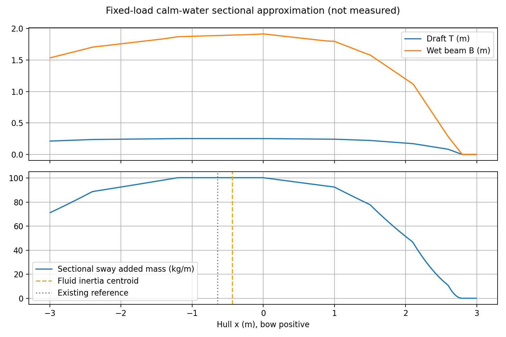

# 湿表面与横剖面重算：高功率无鳍候选

2026-11-26，起点7cbb3f8。保持原船体、附体、固定载荷、无额外稳定鳍；不接飞控，不改变30秒倒车扰动恢复标准。这里是工程估算和候选验证，不是实船标定。

## 第一步：几何与假设

读取实际106个船体三角面，按纵向等距中点截取湿剖面，静水面在船体坐标z=0.2526162393 m。该平衡工况总质量1571.17453 kg，横倾、纵倾近零；不把这个值称为全船任何位置的吃水。截面得到局部吃水T(x)、湿宽B(x)。干段取零；不使用最大宽度代替每个剖面的宽度。

[MIT细长体课程第9讲](https://ocw.mit.edu/courses/2-154-maneuvering-and-control-of-surface-and-underwater-vehicles-13-49-fall-2004/lec9.pdf)给出按单位长度截面附加质量积分质量、一阶矩和二阶矩的方法。本次明确采用工程近似：以局部吃水为横向流的截面半轴，水面镜像后取一半，μ(x)=ρπT(x)²/2；它不是任意断面自由面边界值问题的精确解。真实宽扁、折角截面和波浪频率会改变结果，不能声称相对误差已知。该近似不推导纵向、升沉、横摇和纵摇的系数，暂保留它们的旧工程假设。

在原阻力参考点x₀=−0.642065682056 m处，积分A22=∫μdx，A26=∫μ(x−x₀)dx，A66=∫μ(x−x₀)²dx。A26单位kg·m，是对称横移/偏航惯性耦合，不能以移动质量重心或增加刚体质量来替代。

| 剖分数 | A22，kg | A26，kg·m | A66，kg·m² |
| --- | ---: | ---: | ---: |
| 60 | 471.18639 | 97.59883 | 1002.08286 |
| 120 | 471.24311 | 97.72707 | 1002.55919 |
| 240 | 471.25729 | 97.75913 | 1002.67831 |
| 480 | 471.26084 | 97.76714 | 1002.70810 |
| 原试验值 | 250 | 0 | 200 |

240到480剖分变化：A22约0.00075%，A26约0.0082%，A66约0.0030%。这只证明数值积分趋稳，不证明近似理论对真船准确。附加惯性中心x≈−0.434607 m，湿侧投影面积≈1.286774 m²。

## 侧向二次阻力预算

依据 [Fossen MSS横流阻力实现](https://raw.githubusercontent.com/cybergalactic/MSS/master/LIBRARY/modeling/crossFlowDrag.m)的截面关系 dY=−ρ C_D T |v+xr|(v+xr)dx/2，用[Hoerner数据表](https://raw.githubusercontent.com/cybergalactic/MSS/master/HYDRO/Hoerner.m)按B/(2T)插值。归档脚本保存本次采用的数据，不依赖未来网页变化；资料中的经验曲线并非为本船标定。

得到局部C_D≈0.5598–0.6811，纯横移总二次阻力预算≈366.616 N·s²/m²。为单独对照，在现有面片投影面积分配方式下换算SDF横向二次系数约351.254（原1500）。它只匹配总横移预算，尚未逐剖面替代原空间分布；两者不能宣称完全等价。线性600及其他阻尼不增大。该结果说明“从几何出发”不会自动支持加大侧阻来压住偏航。

## 几何工具检查

新增共用计算模块section_hydrodynamics.py，无新的正式启动脚本。长方体独立解析测试覆盖湿/干截面、均匀截面A66/A22=L²/12、中点积分误差、平行轴变换、正定性及非法输入。宿主直接跑全套Python测试因未加载ROS依赖失败，两次失败日志保留；在固定ROS容器内正确加载环境后76项通过，没有删测试。后续插件及航行检查单独记录，不以本步几何检查宣称倒车合格。
