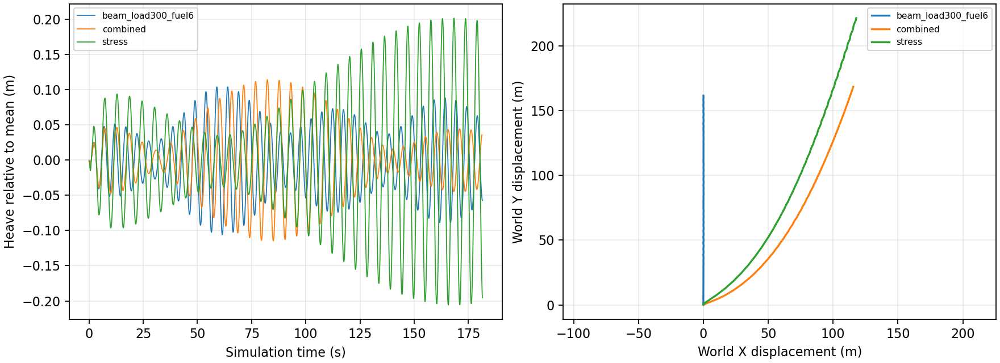

# 第一步：当前布置的环境使用范围

预声明工况：[19 项场景](../../../../tests/scenarios/environment_envelope.json)。轻/重载 0/300 kg、油量 6/60 L，分别静水和初始迎浪/横浪/顺浪；再测横流、综合风浪流与较强应力工况。全部直接油门 0.3、零舵，不保持航向。波传播主方向沿世界 +X，初始船首 0/π/π/2 分别对应顺/迎/横浪；运行中航向会变化，所以不是全程固定遭遇角实验。

使用 VRX 原波谱与 5 s 主周期，gain 0.3/0.6 为谱增益，不称作有效波高。保存实际波高、升沉、姿态、航迹、推进器浸水比例和能源/受力遥测。每组波浪工况 180 s，静水 120 s。

[预声明门槛](../../../../tests/scenarios/environment_acceptance.json)：去掉最初 10 s 后，横倾/纵倾绝对峰值均 <10°，推进器浸水比例不低于 0.8；有浪时实测波高范围 >0.02 m、升沉标准差 >0.003 m。该门槛是工程筛查，不能当作海况等级、舒适性或船级认证。原运行层 20° 姿态、功率/质量/能量一致性门槛保留，环境品质单独判定。

本步修正试验隔离：指定独立输出目录时，波浪模型也生成于该输出目录，避免并行工况修改共享源码。补齐试验载荷重心/质量工况传递，新增波面响应与浮力遥测。外观模型原件保留，未修改生产水动力系数。

19 个工况运行及独立筛查结果见下表。

## 实测结果

| 工况 | 横倾峰值° | 纵倾峰值° | 最小浸水比 | 升沉标准差 m | 航向范围° | 筛查 |
|---|---:|---:|---:|---:|---:|---|
| calm_load0_fuel6 | 0.048 | 0.080 | 1.000 | 0.0000 | 0.05 | 通过 |
| following_load0_fuel6 | 0.334 | 1.096 | 1.000 | 0.0462 | 0.50 | 通过 |
| beam_load0_fuel6 | 0.993 | 0.361 | 1.000 | 0.0471 | 0.34 | 通过 |
| head_load0_fuel6 | 0.335 | 1.064 | 1.000 | 0.0473 | 0.37 | 通过 |
| calm_load0_fuel60 | 0.048 | 0.020 | 1.000 | 0.0000 | 0.09 | 通过 |
| following_load0_fuel60 | 0.333 | 1.034 | 1.000 | 0.0464 | 0.56 | 通过 |
| beam_load0_fuel60 | 0.997 | 0.302 | 1.000 | 0.0475 | 0.31 | 通过 |
| head_load0_fuel60 | 0.334 | 1.003 | 1.000 | 0.0473 | 0.42 | 通过 |
| calm_load300_fuel6 | 0.049 | 0.247 | 1.000 | 0.0000 | 0.25 | 通过 |
| following_load300_fuel6 | 0.335 | 1.263 | 1.000 | 0.0466 | 0.81 | 通过 |
| beam_load300_fuel6 | 1.007 | 0.525 | 1.000 | 0.0479 | 0.53 | 通过 |
| head_load300_fuel6 | 0.337 | 1.201 | 1.000 | 0.0474 | 0.65 | 通过 |
| calm_load300_fuel60 | 0.049 | 0.300 | 1.000 | 0.0000 | 0.28 | 通过 |
| following_load300_fuel60 | 0.335 | 1.315 | 1.000 | 0.0466 | 0.86 | 通过 |
| beam_load300_fuel60 | 1.008 | 0.577 | 1.000 | 0.0480 | 0.58 | 通过 |
| head_load300_fuel60 | 0.337 | 1.256 | 1.000 | 0.0474 | 0.69 | 通过 |
| cross_current | 0.048 | 0.019 | 1.000 | 0.0000 | 0.30 | 通过 |
| combined | 0.984 | 0.683 | 1.000 | 0.0480 | 69.66 | 通过 |
| stress | 1.882 | 1.090 | 1.000 | 0.0924 | 71.17 | 通过 |

[逐项判定及指纹](maneuver_assessment.json) · [运行汇总](summary.json) · [构建与执行绑定](suite_binding.json) · [Code Supervisor full](supervisor-full.txt) · [构建/单元测试](build-test.log) · [公开证据摘要](manifest.json)。完整原始遥测封存于 `artifacts/platform_readiness_2026-11-21/step1`；本页 `evidence/` 为未修改的选取原始文件，缺少部分审计流，不能作为完整 `verify_case` 输入。



这只是指定短时、30% 直接油门、离散环境组合的姿态/浸水筛查；不保证航向、定位精度、任意海况或高速适用性。横流/风浪下航迹偏移不自动判为物理错误，后续控制层必须面对该扰动。未改变生产阻力或增加航向控制。

复现：
```bash
python3 tests/regression/run_performance_suite.py --spec tests/scenarios/environment_envelope.json --output artifacts/my_environment_run --workers 4
python3 tests/regression/assess_maneuvers.py --spec tests/scenarios/environment_envelope.json --criteria tests/scenarios/environment_acceptance.json --suite-kind environment --output artifacts/my_environment_run
```

试验边界：本套原生物理工况采用 `isolated_water=true`，保留船与 VRX 波场、移除岸线/浮标等碰撞物，并省略 GPU 成像计算（设备质量和功耗仍保留）。它验证水面动力学和接口，不是完整悉尼地图避障、图像传感器或实时渲染验收；完整场景的公开入口另行测试。
