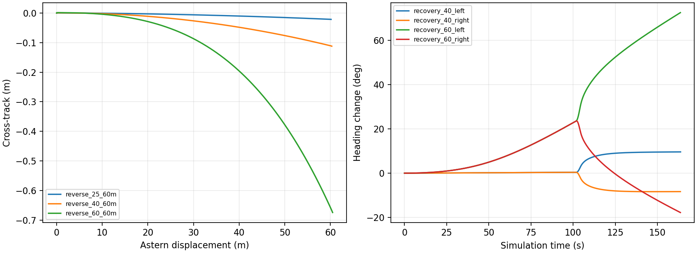

# 第二步：倒车任务与扰动恢复

> 历史硬件版本：后续增加小型被动稳定鳍的原因与复验见 [2026-11-23 报告](../../reverse_recovery_2026-11-23/README.md)。本页原始数值和失败结论不改写。

先声明 [工况](../../../../tests/scenarios/reverse_tasks.json) 和 [判据](../../../../tests/scenarios/reverse_task_acceptance.json)，再运行。全部直接油门/舵角，不使用航向保持。满油轻载、静水，用 25%/40%/60% 倒车指令分别倒退 10/30/60 m；距离以起始船首方向的投影计算，不用绕圈累计路程代替。

项目工程任务门槛：10 m 横偏≤0.5 m、航向变化≤5°；30 m 横偏≤1 m、航向变化≤10°；60 m 横偏≤2 m、航向变化≤15°。不是船级社、IMO 或实船认证标准。最长 300 s，未达到距离即运行失败。评估器独立核查实际距离，不能只相信触发标记。

40%/60% 倒车先运行 100 s，再施加左右各 5°、持续 2 s 的舵角扰动；回零后观察 60 s。要求偏航角速度在 30 s 内回到扰动前末 15 s 拟合均值的 ±0.05°/s，连续保持 5 s。同时报告额外转向，**不要求无控制船自动回到原航向**。该试验衡量局部恢复能力，不证明任意扰动下稳定。

不修改生产水动力参数以迎合门槛。

本轮核实了评估器的短脉冲窗口缺陷：原末 3 s 窗口混入 2 s 脉冲之前的零舵样本，误报舵角跟踪失败；现限定在本阶段开始 1 s 后。补充解析边界测试，使用同一份未修改的遥测重新评估；保留 [修正前判定](assessment_before_window_fix.json)，实际恢复失败不会因此变成通过。

**结论：13 项原生运行均完成，9 项距离任务和 40% 倒车左右扰动恢复通过；60% 左右扰动恢复均不通过。** 60% 右扰动后末段约 -0.405°/s，与扰动前 +0.418°/s 不同；左扰动后约 +0.482°/s，60 s 内也没有连续回到预设 ±0.05°/s 范围。不能把小舵扰动后的持续高速倒车当作已验收能力。建议人工短距倒车使用 25–40% 指令；不是软件硬限幅，也不保证风浪流下同样结果。


## 2026-11-23 实测结果

| 工况 | 横偏 m / 恢复时间 s | 航向偏差° / 回零后额外转向° | 通过 |
|---|---:|---:|---|
| reverse_25_10m | 0.0008 | 0.011 | True |
| reverse_25_30m | 0.0061 | 0.022 | True |
| reverse_25_60m | 0.0214 | 0.039 | True |
| reverse_40_10m | 0.0023 | 0.046 | True |
| reverse_40_30m | 0.0266 | 0.119 | True |
| reverse_40_60m | 0.1110 | 0.228 | True |
| reverse_60_10m | 0.0043 | 0.135 | True |
| reverse_60_30m | 0.0875 | 0.616 | True |
| reverse_60_60m | 0.6607 | 2.307 | True |
| recovery_40_right | 21.8720 | 7.608 | True |
| recovery_40_left | 21.6680 | 8.029 | True |
| recovery_60_right | 未恢复 | 39.215 | False |
| recovery_60_left | 未恢复 | 45.444 | False |

[独立判定](maneuver_assessment.json) · [运行汇总](summary.json) · [构建与源码绑定](suite_binding.json) · [Code Supervisor full](supervisor-full.txt) · [完整构建/单元测试](build-test.log) · [选取原始文件摘要](manifest.json)。完整遥测在 `artifacts/platform_readiness_2026-11-21/step2_final`，公开选取文件不是完整的 `verify_case` 证据包。

首次试验因先发现 Black 格式问题而主动中止，原记录保留在 `artifacts/platform_readiness_2026-11-21/step2`；修正格式、full 通过后新建本次目录，不覆写失败/中断数据。



短距离任务通过不能覆盖 300 s 长倒车、外部风流、重载或任意扰动；旧长倒车累计偏航限制仍然有效。

复现：
```bash
python3 tests/regression/run_performance_suite.py --spec tests/scenarios/reverse_tasks.json --output artifacts/my_reverse_tasks --workers 4
python3 tests/regression/assess_maneuvers.py --spec tests/scenarios/reverse_tasks.json --criteria tests/scenarios/reverse_task_acceptance.json --suite-kind reverse_tasks --output artifacts/my_reverse_tasks
```

试验边界：本套原生物理工况采用 `isolated_water=true`，保留船与 VRX 波场、移除岸线/浮标等碰撞物，并省略 GPU 成像计算（设备质量和功耗仍保留）。它验证水面动力学和接口，不是完整悉尼地图避障、图像传感器或实时渲染验收；完整场景的公开入口另行测试。
