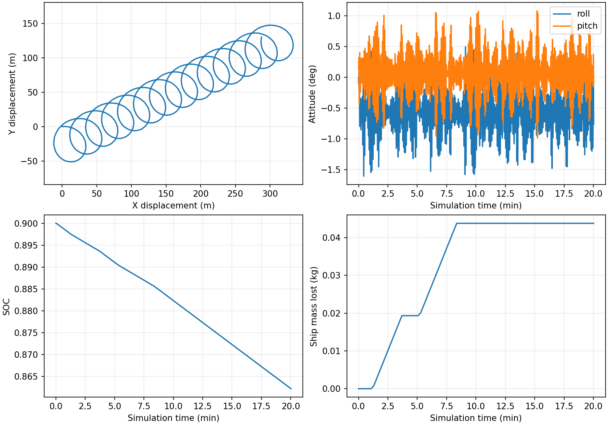

# 第三步：持续运行与故障保护

预声明 [7 项工况](../../../../tests/scenarios/platform_reliability.json)。20 分钟原生六自由度航行：150 kg 载荷、30 L 油、谱增益 0.3、横风 6 m/s、水流 [0.15,0.1,0] m/s，直接油门 0.55、舵角 5°；不保持航向。发电机在 60–220 s、300–500 s 启动，检查燃油消耗、质量更新、功率/能量一致性和全程健康状态。不是全天可靠性或真实续航认证。

保护工况复用既有低 SOC 降额、高温降额、燃油储备停机、导航桥暂停恢复和无 ROS 时钟桥运行；增加手动指令在第 12–25 s 停发，要求第 16–24 s 物理接收油门为零、第 35 s 后恢复 0.5。超时停推不是瞬间刹停。传感器断流仍有显式故障窗口，其他工况不豁免健康状态。

随后单独验证控制进程退出清理及公开 ROS 操船入口重新启动。两小时能源模型计算与原生 20 分钟航行分别标记，不混称两小时六自由度实测。硬断电导致电子设备整体掉线、电池单体失效和任意网络故障仍不在本轮原生覆盖内。

代码已通过 [Code Supervisor full](supervisor-full.txt) 和 [构建/单元测试](build-test.log)。工况实现曾先行提交；现已在独立容器固定版本完成全部七项原生复验，最终结果见下文。

原长时运行在 1158.7 s 收到外部 SIGTERM，未满足 1200 s 门槛，不记为通过；原结果与遥测保留。原套件汇总由未修改的单工况结果重建并明确标记中断。现已由独立后台任务完成完整复验，未覆盖或删除旧记录。

测试实现的补充修正：恢复区间严格截止于阶段结束时间，防止清理停推误报；解析测试同时注入阶段内错误油门，确认仍会失败。公开入口新增墙钟时长参数（默认值不变），软件渲染使用 20 s 指令、180 s 启动观察；实际油门、舵角与 5 s 仿真时间门槛不变。退出检查仅在启动条件满足后注入控制进程退出，并用有界 1 s 观察消除进程正在退出的瞬间采样竞争。没有关闭失联保护或修改物理参数。

试验边界：本套原生物理工况采用 `isolated_water=true`，保留船与 VRX 波场、移除岸线/浮标等碰撞物，并省略 GPU 成像计算（设备质量和功耗仍保留）。它验证水面动力学和接口，不是完整悉尼地图避障、图像传感器或实时渲染验收；完整场景的公开入口另行测试。

## 2026-11-23 运行结果

```json
{
  "max_roll_pitch_deg": [
    1.6072250613619674,
    1.083635575882277
  ],
  "soc_start_end": [
    0.8999999952814537,
    0.8621642176326546
  ],
  "temperature_max_c": 25.14848411413465,
  "fuel_consumed_l": 0.05210910623982912,
  "sim_end": 1201.44
}
```

[最终套件汇总](summary.json) · [版本与构建绑定](suite_binding.json) · [公开原始文件摘要](manifest.json)。最终完整证据保存在 `artifacts/platform_readiness_2026-11-21/step3_final`；首次失败/中断仍保存在 `artifacts/platform_readiness_2026-11-21/step3`，公开选取文件不能替代完整 `verify_case` 数据包。

手动指令停发首次判定误将阶段结束后的清理零油门纳入恢复区间。原始记录不改写；修正评估窗口后，使用独立目录重跑此工况，见 [修正复验](command_dropout_retest/result.json) 和 [对应版本绑定](command_dropout_retest/suite_binding.json)。额外解析边界测试同时确认阶段内失联和漏停推仍会失败。最终七项可靠性工况全部在独立容器、固定源码 `7e33723`、全新构建后运行，使用同一份套件执行指纹。新复验包含完整 1200 s 连续航行，不用首次被中断的 1158.7 s 记录替代通过证据。



预设 5° 舵角形成回转，风流使回转中心随时间漂移。

[两小时能源结果](energy_2h/result.json) 与 [参数](energy_2h/parameters.json) 使用同一生产 C++ 能源模型独立积分。40 kW 恒请求、无发电约 53.5 分钟开始不足额、约 99.7 分钟接近停推；有发电约 55.3 分钟开始不足额，末段 SOC 约 0.023。不能据此预测实际航程或两小时六自由度运行能力。

最终结果：**7/7 通过**，连续阶段实际持续 **1200.004 s**。船舶总质量减少 **0.04377165 kg**，与 0.05210911 L × 0.84 kg/L 一致；起止整船重心差约 [-0.0387, +0.1507, +0.0040] mm，包含燃油、准静态油液姿态和活动附体位置的共同影响。原生质量/惯性遥测与能源数据见 `evidence/endurance_20min/`。油量变化较小，不能据此宣称覆盖整个油箱范围或动态晃荡。

完整悉尼场景的进程退出、无活动子进程、再次启动和前进/倒车/左右转向另见 [独立入口结果](../step4/README.md)。能源模型只证明所建模型内的守恒和保护逻辑，不是实船续航认证。

首次异常留档：[主机长时中断](endurance_interrupted_result.json)、[指令恢复窗口误报](command_dropout_initial_result.json)、[原套件指纹](initial_suite_binding.json)、[中断后重建摘要](interrupted_suite_summary.json)。最终复验使用新的目录、构建和执行指纹，没有给旧数据替换版本标签。
