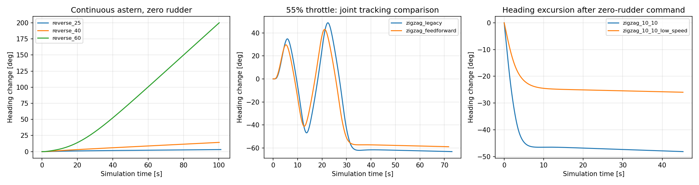

# ArduPilot 接入前：证据绑定与操纵品质检查

> 历史版本报告：后续分布式侧向阻力与实体配重的变化见 [新复验记录](../distributed_drag_2026-11-21/README.md)。本页数据保留原样，不能作为当前配置结果。

本轮只修改和验证 ROS/Gazebo 船体平台，不运行 ArduPilot 或 Nav2。最终数值见本文的验收结果部分。日常操作见 [ROS 2 / VRX 开船指南](../../getting_started/README.md)。

## 版本与数据为什么要绑定

历史 runner 遇到已有 `result.json` 会复用结果，不能证明它来自当前源码、安装插件和当前工况。现在采用内容摘要，而不只记录 Git HEAD：工作区可能含尚未提交的有效修改。

- 构建前保存原生源码、头文件、Python、配置、模型及构建描述摘要；成功构建后核对输入未变化，再绑定安装共享库、Python、模型和参数副本。编译途中改源码会拒绝绑定。
- 每套试验保存 `suite_binding.json`：完整工况、原生构建、配置与运行脚本摘要及整体指纹。
- 每个工况前后检查执行版本，完成后保存 `case_binding.json`，封存生成 SDF、JSON 和 CSV 摘要。离线验收核对实际 stage、实际 spec 和文件内容。
- 默认拒绝非空输出目录。显式 `--resume` 也必须版本与工况完全相同，且已有工况完整、通过并未被修改。失败和中断结果保留，重试另开目录。
- 验收另存判据、工况及分析器的 SHA-256。改判据必须留下新结果，不能给旧遥测悄悄贴上新工况标签。

这是一套防误用机制，不是密码学签名或实船真实性证明。系统 Gazebo/ROS/DART ABI 仍依赖本机固定环境，详见运行指南。构建产物不提交 Git，公开清单保存摘要，复现需重新构建。

本轮早期 `artifacts/preflight_2026-11-21/diagnostics` 和 `diagnostics_v2` 在测试期间检测到原生源码变化而停止，**没有作为完整通过证据**。它们保留用于追查，没有通过改清单消除失败。

代码：[绑定库](../../../tools/lib/trial_evidence.py)、[套件执行器](../../../tests/regression/run_performance_suite.py)、[单元验证](../../../tests/unit/test_trial_evidence.py)。

## 舵机修改的物理含义

原控制力矩为 `Kp*(q_ref-q) - Kd*q_dot + I`。目标舵角按有限速率运动时，即使实际速度已经跟上参考，`-Kd*q_dot` 仍会反对这段运动，迫使位置误差和积分补偿该项。现在使用：

```
T_request = Kp*(q_ref-q) + Kd*(q_ref_dot-q_dot) + I
```

角度、速度都指真实桨舵关节，不是船的航向。原角度限制、参考速率 0.15 rad/s、物理关节速率 0.2 rad/s、100 N·m 力矩限幅和能源约束继续生效；没有凭空提高舵机能力。新增单元测试验证准确跟踪运动参考时速度误差项为零，并保留抗积分饱和检查。

这是关节轨迹跟踪误差的直接计算修正，不是通过调大船体阻尼获得好看的航迹。它不能保证整船所有速度下的超越都小。`reference_velocity_feedforward=false` 只用于旧算法对照，不作为生产默认。

代码：[关节力矩](../../../ros_ws/src/usv_simulation/include/SteeringIntegral.hh)、[推进插件](../../../ros_ws/src/usv_simulation/src/AzimuthPropulsion.cc)、[参数定义](../../parameters/supervisor-vessel-sdf.md)。

## 操纵验收怎样避免“运行成功就是通过”

[工程门槛 v3](../../../tests/scenarios/maneuver_acceptance.json) 在最终试验之前确定：

| 项目 | 新门槛 | 意义 |
|---|---|---|
| 10/10 蛇形各次超越 | <25° | 旧 45° 仅用于宽松运行回归，不能证明操纵品质 |
| 最后回零舵额外航向变化 | <30° | 防止只看末段偏航速度而漏掉早期大转向 |
| 回零后偏航速度 <0.172°/s 持续 5 s | 首次满足时间 <20 s | 短瞬间过零不等于恢复 |
| 持续倒车末段偏航 | <0.5°/s | 旧 8.6°/s 过宽，无法筛出方向品质问题 |
| 实际关节与参考轨迹速率 | 分别读取实际生成 SDF 的上限 | 不混淆电机物理极限与指令速率 |

这些是本项目的工程筛查目标，不是 IMO 认证阈值或实船厂家保证。保留原 55% 油门蛇形与 60% 倒车挑战，同时增加 35% 蛇形、25%/40%/60% 持续倒车，**不会删掉失败项后宣布全通过**。每个工况均直接油门/舵角控制，蛇形只在实测航向达到阈值后反舵，没有连续航向保持。

评估还验证采样有限、时间单调、无大缺样、实测反舵触发、舵角跟踪、左右回转半径、停止位移和重载低油量行为。[指标实现](../../../tests/regression/assess_maneuvers.py)、[解析轨迹单元验证](../../../tests/unit/test_maneuver_metrics.py)。

## 倒车归因的依据与边界

整船动力学保留惯性、附加质量、科氏耦合、阻力和静水恢复力；理论框架参考 [Fossen 海洋航行器模型](https://www.fossen.biz/html/marineCraftModel.html)。这支持受力分解及耗散检查，不直接给出本船未测的系数。

倒车对照保留实际质量、关节和水动力，另设“取消外部桨水动力力偶”“镜像质量”作为诊断反事实。反事实只用来隔离来源，不能作为真实推进器配置发布。正常生产模型仍保留反扭矩和原质量台账。现有附体在倒车时使用对称升阻力近似，船体侧向/偏航阻力仍为工程模型；不能仅凭仿真偏航就宣称已经证明真船会同样转圈。

## 脚本整理与历史文档

删除 `tools/analysis/summarize_sydney.py` 和 `summarize_platform.py`：两者是硬编码旧日志/归档目录的一次性报告器，当前运行链没有调用。同步移除工具路径索引；旧报告、模型和原始 CSV 不删除。保留实际复用的建模、能源、受力分析与集成测试工具。本轮唯一新增公共实现模块为 `trial_evidence.py`，供构建、运行与验收共用，避免三处复制摘要逻辑。

旧 `usv_ardupilot/README.md` 的过期 `scripts/...` 启动推荐及“当前 AUTO 已通过”表述已更新为历史说明。历史报告保持原值，只增加指向当前状态的提示；新旧门槛不能混读。Code Supervisor 的 deep 范围说明也已与当前配置同步。


## 运行中发现的指令通道问题

首批完整操纵测试中的 `turn_055_right` 收到 ROS 指令、健康状态显示 ready，但原生推进遥测中的油门始终为 0，`command_reached_physics` 和回转方向检查失败。该结果保留在 `artifacts/preflight_2026-11-21/maneuvers`，不能作为物理右转不稳定的证据，因为推进指令根本未到达。

修正控制健康判据：同时检查油门/转向发布器是否发现订阅连接；缺连接时以 3 秒间隔重建专用指令发布端，保留传感器订阅。直接模式还用原生推进遥测回读油门，持续 1 秒偏差超过 0.02 时不再宣称 ready。短暂传输延迟有宽限，实际收到指令才恢复。连接标志只证明存在订阅者，因此还需油门回读；舵角的实际跟踪由操纵试验单独核对。这里比对的是插件接收的归一化请求，不是要求真实船速瞬间跟随。

旧记录没有指令连接详情，因此不能事后断言具体是 Gazebo discovery 的哪一处故障。本轮补的是明确存在的观测缺口和断连恢复，仍要靠后续压力测试检验低频通信故障。控制器不会通过这项检查改变舵角以维持航向。

此外，运行套件不再因单个普通工况失败而取消所有剩余工况；源码版本变化仍立即中止，失败工况保留并使整套结果失败。为补齐安装后 Python/参数副本绑定而主动中止的 `maneuvers_v2` 也保留，不纳入验收。


## 最终操纵验收：运行 17/17，品质 14/17

最终工况目录为 `artifacts/preflight_2026-11-21/maneuvers_v3`。17 个原生 Gazebo/ROS 工况完成且运行检查通过，执行前后内容指纹未变；其中 **14 个通过 v3 操纵品质门槛，3 个不通过**。三项跨工况比较（两档左右回转半径差、速度单调性）通过。详见 [完整品质判定](maneuver_assessment.json)。

| 工况 | 实际结果 | 结论 |
|---|---|---|
| 35% / 65% / 100% 前进油门零舵 | 4.34 / 9.47 / 15.21 km/h | 三档通过；100% 末段偏航 -0.0423°/s，180 s 航向约 -8.91°，不是绝对直线 |
| 55% 左 / 右回转 | 半径 3.17 / 3.12 m | 两侧通过；半径相对差约 1.34% |
| 100% 左 / 右回转 | 半径 2.99 / 2.95 m | 两侧通过；相对差约 1.11% |
| 满速停推滑行 | 约 25.44 s、16.90 m 达水平速度 <0.1 m/s 并保持 1 s | 通过 |
| 满速反推制动 + 持续倒车 | 约 3.90 s、7.37 m 纵向速度过零；后续倒车偏航 2.476°/s | **整个组合工况不通过**，失败在后续持续倒车；纵向过零不代表完全无横向运动 |
| 40% 倒车左 / 右转 | 方向、回转、舵角跟踪及停推检查通过 | 只证明列出的转向工况 |
| 55% 油门 10/10 蛇形 | 超越 19.87 / 30.76 / 33.05°；回零额外 48.13°，约 7.49 s 恢复低偏航速率 | **超越角与回零额外航向变化不通过** |
| 35% 油门 10/10 蛇形 | 超越 11.90 / 15.92 / 16.52°；回零额外 25.95°，约 9.92 s 恢复 | 本工况通过，不能外推至全油门蛇形 |
| 25% 持续倒车 100 s | -2.01 km/h；末段偏航 0.0247°/s；累计约 3.15° | 通过，建议先用于手动试航 |
| 40% 持续倒车 100 s | -4.05 km/h；末段偏航 0.1375°/s；累计约 14.28° | 通过本项目门槛，仍非直线航行保证 |
| 60% 持续倒车 100 s | -6.77 km/h；末段偏航 2.4824°/s；累计约 199.53° | **方向品质不通过** |
| 300 kg 载荷 + 6 L 燃油零舵 | 约 14.45 km/h；末段偏航 -0.0290°/s | 本工况通过，不保证载重后仍达 15 km/h |

上述均为静水、无风无流的隔离操纵世界。并行调度使用不同 Gazebo 分区和 ROS domain。完整悉尼场景另通过公开 CLI 的启动、正反油门、左右实际舵角和释放停推检查；这项冒烟测试验证操作链路，不替代长航品质验收。

### 当前可以怎样用

可以按 ROS 文档运行、观察船体和做受控试验。初次人工操船建议 0.3 前进油门、-0.25 倒车油门；需要蛇形品质时本轮只确认 0.35 油门的列出工况通过。**没有偷偷限制模型的最大反推或增加自动航向补偿**，因此大油门失败仍可复现。

暂不把当前配置标为“ArduPilot 接入前所有问题已闭合”。下一项应围绕倒车时的附体/船体侧向受力与有效受力中心、转向速率约束做有来源的辨识或设计取舍，而不是把倒车水动力设零、把质量强行对称或放宽门槛。缺乏实船数据时，工程模型的不确定性必须随结果一起保留。

## 受力对照与不确定性

7 项基础诊断和 3 项倒车敏感性工况均完成运行；这些工况的“品质不通过”是需要保留的诊断结果，不代表试验没有执行。它们与上面的 17 项操纵使用相同的物理、安装产物和执行快照，详见 [基础诊断](diagnostic_assessment.json)、[倒车敏感性](reverse_sensitivity_assessment.json)。

| 60% 倒车诊断 | 末段偏航 °/s |
|---|---:|
| 原配置 | 2.4824 |
| 取消外部桨水动力力偶 | 2.3238 |
| 质量 y 向镜像对称 | 2.3353 |
| 同时对称质量、取消力偶 | 1.9218 |
| 附体受力系数 ×0.8 | 2.3237 |
| 附体受力系数 ×1.2 | 2.6160 |

因此，删除反扭矩或强行对称质量不能合理“修好”倒车。原配置末段关于整船重心的世界竖直力矩中，船体阻力约 -86.45 N·m，附加质量约 +52.69 N·m，推进推力约 +18.82 N·m，附体约 +13.51 N·m，桨水动力力偶约 +1.52 N·m；总外力矩均值约 +0.006 N·m。近稳态转圈时合力矩接近零，**不代表偏航角速度为零**。

附加质量的科氏耦合包含 `-v × (M_A v)`，不能只保留平动惯性而为了消除偏航删掉这项。当前平动附加质量 70/250/250 kg 是工程假设，侧向集中阻力、附体反向升阻力和有效作用点也未标定。上述数据支持“倒车方向品质涉及整体侧向—偏航耦合”的判断，不能把某一个力矩分项直接认定为代码错误或实船真值。后续应做几何/水动力辨识与方向稳定性分析，而不是凭此表随意挑一个更大的阻尼系数。

同版本的旧/新舵机对照：实际峰值转速由约 0.1619 降至 0.1526 rad/s，均低于 0.2 rad/s 物理限速；三次蛇形超越由约 24.78/36.85/38.74° 降至 19.58/31.18/33.00°，回零额外航向变化由 52.61° 降至 48.19°。恢复时间约 6.87 → 7.49 s，不能宣称所有指标都变好。与正式套件的小幅数值差异来自独立运行和离散航向触发时刻，不用覆盖旧数据消除差异。



## 最后一次汇总器加固与检查证据

17 项正式操纵及 10 项诊断结束后，又补了一个失败传播边界：即使子进程遗留 `passed=true` 的 JSON，只要退出码非零，套件也必须失败。故障注入测试验证该分支。最终汇总器另执行 30 s 原生零舵工况，并实际用 `--resume` 复用同一版本成功；见 [最终运行摘要](final_runner_summary.json)。

这里没有把旧结果重新贴成新代码版本：[差异清单](final_runner_delta.json) 确认前后原生源码、安装库、安装 Python/模型/参数完全一致，运行输入只有套件执行器一个文件变化，变化只涉及结果退出码汇总；[当时执行器快照](run_performance_suite.tested.py.txt) 与 17 项试验记录的哈希一致。新旧执行指纹各自保留，旧输出不能直接由最终执行器 `--resume`。最终工况使用 [新绑定](final_runner_binding.json)。

`./usv review --profile full --run-commands` **通过**：[检查报告](supervisor-full.txt)、[机器可读报告](supervisor-full.json)、[测试日志](unit-tests.log)。包含 12 项 C++、35 项 Python 和 5 项设计接口测试；文档、Black、Ruff、参数说明、C++ 复杂度、重复检查及所选核心头文件行覆盖率通过。本轮未把未执行的 deep Sanitizer/变异/额外集成测试算成通过，也未把核心头文件覆盖率说成全项目覆盖率。

## 数据与复现边界

[文件清单](manifest.json) 逐项记录公开选摘文件与本地原件的 SHA-256；公开内容包括实际工况、阶段、推进/舵机 CSV、诊断受力 CSV、完整判定和绑定清单。[运行环境](environment.json) 记录本机版本；Git HEAD 之外的工作区修改由内容摘要识别。

为避免反复复制大型世界和模型，公开目录是证据选摘，**不是可直接传给验收脚本的完整原始结果目录**。完整 SDF、健康日志及所有遥测在对应 `artifacts/preflight_2026-11-21/` 工况目录保留；从源码按 ROS 指南可重新生成新一轮完整证据。`case_binding.json` 中未选摘文件的摘要仍保留，不能删除摘要伪装完整。所有历史失败、中断、模型和测试数据均未清理掉。
