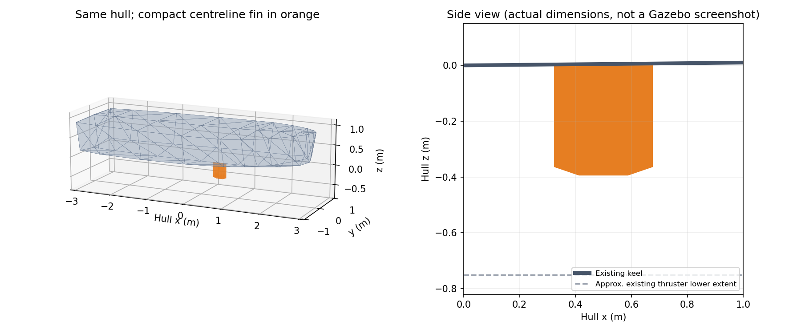

# 60% 倒车受扰恢复：原因与小型被动稳定鳍

本轮不接 ArduPilot/Nav2，不使用航向保持，不改原 30 s / ±0.05°/s / 连续 5 s 的恢复门槛。用户允许适度外形补齐，要求不要过度改变船形。新增的是明确的仿真硬件方案，不冒充原 CAD 已有部件或实船验证结果。

## 原因定位

旧版本固定证据见 [上一轮第二步](../platform_readiness_2026-11-21/step2/README.md)。原始门槛以回零后偏航角速度回到扰动前基线为目标，不要求无控制船回到原航向。左右舵实际回零，但 60% 倒车右扰动后由约 +0.418°/s 转入 −0.405°/s，左扰动后约 +0.482°/s。

使用同一版本做 4 项原生分项对照，全部先倒车 100 s、右舵脉冲 −5° 持续 2 s，再零舵 60 s。人为关闭物理项仅用于归因，不作为生产修复：

| 诊断 | 扰动前末 15 s °/s | 恢复末 15 s °/s |
|---|---:|---:|
| 原模型复现 | +0.41752 | −0.40519 |
| 关闭原艉部附体 | +0.10772 | −0.03793 |
| 关闭附加质量及其耦合 | +0.02502 | +0.02173 |
| 关闭桨外部水动力力偶 | +0.03934 | −0.44567 |

反扭矩和姿态提供偏置，但不是唯一原因。附加质量科氏项与艉部附体的升力作用点，加上现有横流阻尼分布，在这个倒车速度下形成横移—偏航不稳定；小扰动会把船带入另一回转状态。**耗散功率非负不等于有持续推进的船一定方向稳定。** 删除科氏项、删掉附体或直接加航向力矩会改变问题，不能作为物理修复。

## 独立平面线性筛查

以整船重心为参考点，`v` 为横向相对速度、`r` 为偏航角速度，`U` 为有符号纵向速度；`d=x_drag−x_G`。保留原附加质量 `mx=70, my=250 kg, Jz=200 kg·m²`：

```
M = [[m+my, my*d], [my*d, Izz+Jz+my*d²]]
B = -D + [[0, -(m+mx)*U], [-(my-mx)*U, -my*d*U]]
[v_dot, r_dot] = inverse(M) * B * [v, r]
D_hull = sum((600/Awet_ref)*A_i * [[1,x_i],[x_i,x_i²]])
D_surface = 0.5*rho*abs(U)*A*(CL_alpha+CD0) * [[1,x_s],[x_s,x_s²]]
```

这里的 x 均相对重心；船体 A_i 由旧名义平吃水裁切几何获得。小角度时二次横流项的一阶导数为零；各附体的面积、跨度和作用点来自实际几何。对新增鳍用同一计算，不搜索航向增益。

旧模型在 `U=−1.11755 m/s` 的最慢特征值约 **−0.1015 s⁻¹**，在 `U=−1.88378 m/s` 变为 **+0.0515 s⁻¹**；与 40% 能恢复、60% 发散的原生结果方向一致。新增小鳍后后者预测为 **−0.1322 s⁻¹**；前进 4.16667 m/s 仍为负实部。它只是平面小扰动设计筛查，忽略横摇、推进偏置、非线性阻力和运行纵倾，不能替代六自由度运行验收。

原理依据：[Fossen 海洋航行器动力学](https://www.fossen.biz/html/marineCraftModel.html) 的惯性/科氏/阻尼结构；[MIT 海洋航行器操纵课程](https://www.ocw.mit.edu/courses/2-154-maneuvering-and-control-of-surface-and-underwater-vehicles-13-49-fall-2004/resources/mit2_154_f04_coursetextbook_pdf/) 的横移—偏航稳定性分析；[MSS coeffLiftDrag](https://github.com/cybergalactic/MSS/blob/master/LIBRARY/modeling/coeffLiftDrag.m) 的有限展弦比升力斜率及诱导阻力形式。文献提供方法，**不提供本船实测系数，也不保证这个尺寸适用于真船**。

## 小幅硬件设计变更

| 项目 | 设计值/依据 |
|---|---|
| 安装 | 中心线 x=+0.50 m，鳍根 z=+0.007 m，模型 FLU |
| 外包络 | 弦长 0.35 m、最大厚度 0.018 m、跨度 0.40 m |
| 外形 | 前后对称椭圆截面，末端 0.03 m 线性收缩至半尺寸，周向 64 段 |
| 最低点 | z=−0.393 m，高于原推进器；不增加整艇最低点 |
| 侧投影面积 | 0.137375 m² |
| 材料与质量 | 均质铝代理 2700 kg/m³，定向四面体积分约 5.16854 kg |
| 流体模型 | 复用局部相对水速升阻力；CD0=.03、e=.7 为工程假设；无倒车专用增益 |
| 质量/惯性 | 同源实体网格积分后进入逐件台账，仅合并一次 |
| 浮力 | 同源闭合网格逐步按波面裁切压力积分；独立静水求解也包含鳍体积 |
| 碰撞与显示 | 同一个带法向的凸网格，不能只显示一个装饰鳍 |
| 能耗/阻力 | 无电功耗；实际升阻力额外施加，不从原轴向预算扣掉以维持航速 |

鳍根局部与原船壳有不足 4 mm 的安装搭接，两个闭合浮力体的微小重叠未做布尔差集；安装结构强度、紧固件细节未认证。原模型总附加质量预算未重新标定，也没有独立求解新鳍与船体的非定常流体惯性耦合。流线型升阻力、倒车对称性、自由面和船体遮挡仍是工程近似，须结合敏感性试验理解结果。

## 开发中发现并修复的问题

原生测试先于结果声明。初次新鳍启动暴露遥测子路径与船名验证冲突；改为保留船名、单独验证遥测子组。第二次启动发现新 OBJ 未含法向，DART 忽略该子网格后崩溃；生成器补齐单位法向及面引用，并增加对应验证。原失败目录 `candidate`、`candidate2` 保留，不冒充操纵试验通过。

原箱体质量测试仅适用于箱体；新增椭圆鳍采用独立解析椭圆柱/棱台体积与闭合网格验证。名义配平测试由旧“严格零纵倾”改为新增实体后的实际排水量与浮心—重心平衡残差校验，并约束静态姿态 <0.05°；没有移动设备来抵消新增鳍质量，也没有放宽操纵验收。



这是从实际生成网格绘制的结构示意，不是 Gazebo 截图。灰色船体仍为原几何；橙色标示新增部件，运行时材质为灰色。

## 初步有效运行与最终验收计划

第三次运行完成并通过全部 5 项检查：40% 左右恢复均 12.128 s；60% 右/左恢复分别 19.696 / 18.968 s，回零后额外转向约 11.607 / 12.884°；100 s 满油轻载全速末段约 15.0269 km/h。该初步结果用于决定是否继续扩大验证，不能代替最终固定版本回归。

最终 [44 项工况](../../../tests/scenarios/passive_stabilizer_regression.json) 在运行前声明：原 13 项倒车距离/恢复任务，9 项低油量/重载/鳍系数 −25%/艉部系数 +25%/附加质量 +25%/2 ms 扩展，300 s 持续倒车，原 17 项操纵，以及 4 项有限风浪流筛查。使用原 [恢复与操纵门槛](../../../tests/scenarios/reverse_task_acceptance.json)，不新增有利于通过的门槛。波浪工况检查姿态/湿润和波动响应，不要求回到静水偏航率。

另外执行真实接触探针、Code Supervisor deep 和单元测试。接触测试采用固定船体与下落球，原六方向之外增加倒置鳍端和横置鳍侧，避免把“网格加载成功”当作“碰撞已经验证”。所有航行工况均为独立通信分区、隔离水面、无 GPU 图像生成；保留质量功耗及 VRX 波场，不代表完整悉尼地图避障或相机验收。
