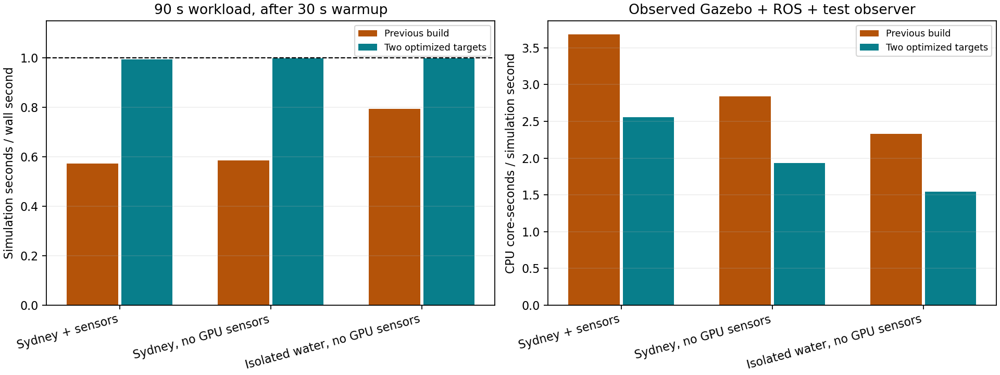
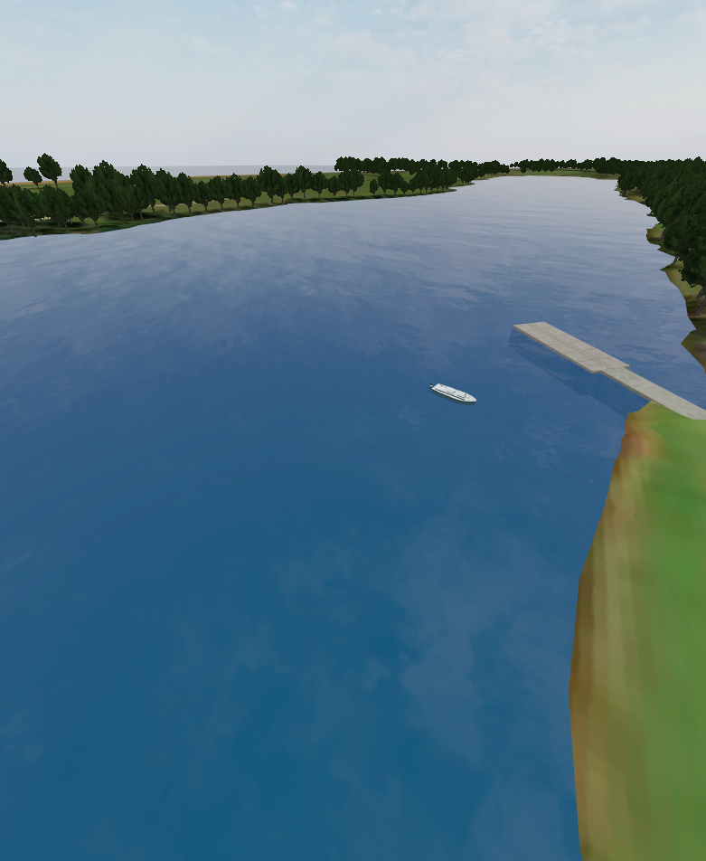
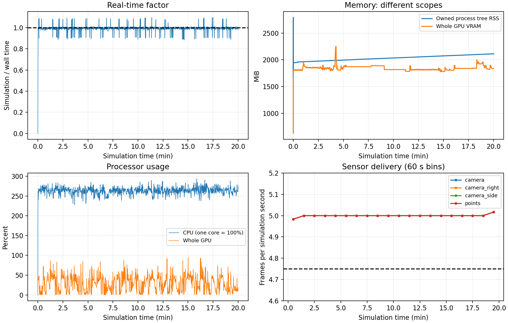

# 独立复现、性能归因与稳定基线

本轮针对上轮完整悉尼 + GPU 传感器约0.569实时率，先做同版本负载分项，再检查实际编译参数；不改变1 ms步长、接触参数、船体/鳍几何、推进功率或传感器频率。不接ArduPilot/Nav2。独立复现、性能对照、惯性/接触/操纵/保护及最终完整传感器长测均已完成，通过范围与未覆盖项如下。

## 事前范围与对照

三项90 s仿真工况串行运行：完整悉尼 + 三路相机/二维三维GPU雷达；完整悉尼但删除GPU传感器；隔离水域且删除GPU传感器。后三者是诊断负载，绝不把删除传感器后的速度当正式运行性能。载荷150 kg、油30 L、wave gain 0.3、survey用电，直接油门0.35/舵12°与上轮一致。完整渲染沿用原5 Hz交付与资源门槛；实际实时率另报。

`perf_event_paranoid=4` 禁止普通用户性能事件；本轮没有修改系统权限或声称取得函数级perf热点。以2 s间隔只读采样自有进程、Gazebo线程累计CPU和每项sim/wall进度。CPU100%表示一个逻辑核心，线程名不能直接证明具体函数。采样包含观察器，窗口排除起始30 s，地图/渲染负载差分不是可相加的独立耗时预算。

## 编译配置核对

最初仅看CMake构建类型为空不足以认定所有插件未优化。实际flags表明浮力和推进已有目标级`-O2`；附体水动力及自有DART后端未带优化选项。正式结论以保存的逐目标编译flags为准。比较目标级标准优化，保留断言，不使用`-Ofast`/`-ffast-math`，不通过删除物理项提速。

依据：[CMake构建类型语义](https://cmake.org/cmake/help/latest/variable/CMAKE_BUILD_TYPE.html)、[GCC优化选项](https://gcc.gnu.org/onlinedocs/gcc/Optimize-Options.html)。编译优化的性能收益必须由实测确定；浮点结果仍需操纵、接触和惯性回归，不能只看编译成功。

## 优化前后短测

仅两项目标增加`-O2`，没有设置`-DNDEBUG`，没有启用fast-math。下表使用试验器自身的sim_s/wall_s进度，排除前30 s，避免文件采样轮询和退出清理时间污染分母；完整传感器的内部资源探针另得到0.573→0.994，结论一致。

| 工作负载 | 原构建实时率 | 优化候选实时率 |
|---|---:|---:|
| 完整悉尼 + GPU传感器 | 0.574 | 0.994 |
| 完整悉尼、无GPU传感器（诊断） | 0.586 | 0.998 |
| 隔离水域、无GPU传感器（诊断） | 0.793 | 0.999 |

原构建本来已有浮力/推进的O2；原始目录名`unoptimized`仅表示这两个待补齐目标未优化，不是整仓库所有目标均未优化。完整场景关闭GPU传感器收益很小，移除地图静态实体则有明显收益；结合Gazebo主计算线程占用及目标编译差分，支持实体处理/物理热路径是当前主要瓶颈。没有取得函数级采样，不能将收益百分比精确分配给某个函数或两个插件之一。构建摘要逐项比较确认：输入仅两份CMakeLists.txt变化，安装产物仅libUsvPhysics.so与libUsvAppendageHydrodynamics.so变化，关键环境相同；见[内容差分](optimization_delta.json)。

新配置受场景实时率目标1.0限制；接近1.0并不证明有多少额外算力余量。CPU每墙钟秒占用可能升高，因为每秒推进更多仿真时间；图右按每仿真秒消耗的核心秒比较。采样含观察器，不是只计算船体插件。单次短测对照不是统计置信区间；最终长测还需单独核对持续性。

## 独立环境范围

从项目Dockerfile构建依赖镜像，创建新容器，不挂载主机源码、ROS安装、构建产物或Fuel缓存；从公开GitHub获取固定源码、LFS与VRX，从官方Fuel下载地图资产。允许复用依赖镜像层，这不是再次从零下载整个操作系统。

首次clone因Docker自动注入`172.17.0.1:10808`失效代理失败；仅对容器命令清除代理后重试，不改全局代理、不关闭TLS校验。失败日志保留。此容器默认软件渲染，不冒充GPU性能或GUI验收。

## 独立容器已完成结果

公开源码候选 `1bf459e0918b94a9318e7dfb040c977856da35cf`，固定VRX为 `7609d1bd90ce7edb29d040a082f949e8b089c864`。容器使用`--shm-size=256m`，无主机挂载；新容器初始没有build/install/log；全部12个包构建，12项C++、55项Python、5项设计接口测试通过。构建中发生主机重启：容器退出143且OOMKilled=false；恢复同一容器的同一源码构建，保留首次与恢复日志，不宣称首次不中断完成。

公开入口从项目外的`/tmp`启动：前进、倒车、左右转向、释放停推通过；控制器被终止后平台自动结束，18个被观察子进程无活动残留。使用原180 s启动上限、20 s指令时长；没有放宽舵角和物理指令门槛。软件渲染日志为Mesa llvmpipe，`LP_NUM_THREADS=4`只限制本次软件渲染线程；不声称该容器已通过NVIDIA/GPU性能或GUI验收。

容器重建生成的PBR配置、基础船模、物理世界与主机对应文件，替换项目根目录和用户主目录后逐字相同。原始差异是环境路径，不能把git生成物变更误认成手动换参数；具体参数仍以独立构建与运行证据为准。

## 接触与惯性

原生F=ma和转矩/惯性响应通过。14项单位置接触工况通过，包含8个名义接触位置、薄鳍两面的0.5 ms、0.1 kg及10 kg/1 m落高；全部为当前40 kW概念装配。两个重载工况在主机重启后新建目录重跑，旧未完成目录保留。

最初同时启动8个探针时，starboard与propeller_hub没有在冲击前完成消息发现，测试明确失败而非假通过。后续使用既有`--case`逐位置隔离入口，不改接触判据；尚未证明多探针同时启动的发现可靠性。复现接触矩阵应沿用逐位置方式。

## 操纵与保护复验

11项运行检查及独立`assess_case`品质判定全部通过，沿用上轮接触专项的完整判据；另核对55%左右回转半径差。没有把“程序跑完”替代操纵验收；本轮未重跑35/65%速度单调性或100%左右回转对比。

- 60%倒车两向扰动后恢复时间18.97 / 19.58 s，原30 s门槛不变，恢复指回到扰动前角速度附近。
- 600 s全速前进累计偏航37.145°，60%倒车累计10.245°；仍不自动直航，未添加航向保持。
- 轻载全速约15.03 km/h，重载低油量约14.29 km/h；编译提速没有冒充船的航速增加。
- 时钟独立、传感器失联、指令失联三项原保护工况通过。低SOC、过温、油量保护的完整上一轮矩阵保留历史证据，不宣称这三项代表全部故障覆盖。

复现指纹边界：主机工作区原有闲置预览模型/波场仍保留，未混入本轮提交；本机完整运行快照可能包含这些未使用资产。干净容器没有这些预览副本，两环境的全树哈希也会因绝对路径、编译环境而不同。基线以固定源码、各自构建绑定、实际工况快照、运行判据和关键生成输入的路径归一比较证明复现，不声称两套文件系统或二进制逐字节相同。

## 最终完整场景长测

| 工况 | 平均实时率 | 预热后进程树 RSS 峰值 MiB | 预热后 RSS 增量 MiB | 整卡显存峰值 MiB |
|---|---:|---:|---:|---:|
| GUI 90 s | 0.978 | 3610.2 | 6.0 | 3097 |
| EGL + GPU 1200 s | 0.993 | 2112.4 | 150.3 | 2250 |

两项均通过全部原物理与传感器/资源判据；16个上游场景include保留，三路640×360 RGB、二维扫描及360×16点云仍按5 Hz仿真时间产生。长测20分钟仿真按平均实时率折算约20.1分钟墙钟，不含启动和收尾；是本机接近实时，不是硬实时承诺。CPU平均262.9%（一核心=100%），整卡GPU平均28.8%。资源统计范围和门槛沿用[前一轮方法](../sydney_rendering_2026-11-23/README.md)。

[逐流结果与交付链](sensor_summary.json)、[完整场景版本绑定](sensor_suite_binding.json)、[独立操纵品质](maneuver_quality.json)、[保护结果](protection/summary.json)、[接触矩阵](contacts/summary.json)、[Code Supervisor与人工审查](code-review.md)。公开保留压缩遥测和选择样本，原始case_binding描述本机完整包，不把删减后的公开目录冒充完整原包。

## 冻结范围与下一步

生产源码为`1bf459e0918b94a9318e7dfb040c977856da35cf`；后续文档封存提交不改变运行源码。稳定标记`sim-baseline-2026-11-23`用于固定这套工程验证基线，不等于实船标定、适航认证或所有海况保证。关键物理依赖与上游版本见容器清单及sources.repos，OS其他软件包仍需按环境变化重新验收。

本轮没有启动ArduPilot SITL或Nav2；已有历史适配包被正常编译不等于完成集成。下一步可以在此基线上选定SITL版本，验证仿真时钟、坐标系、PWM方向/中点、执行器唯一控制权及失联停推，再做低速闭环。Nav2待飞控与定位稳定后再接。

仍保留：自然配平偏航、重载约14.29 km/h、无海试/CFD标定的水动力、复杂海况/热管理/结构强度限制；水面激光回波不等于真实光学。GUI只验收90 s，未证明GUI长期、多船、高分辨率、跨机DDS或其他RMW性能。多探针同时启动的发现问题仍有记录，生产接触验收使用逐位置方式。

完整本机证据位于`artifacts/baseline_2026-11-23`。公开文件校验见[manifest](manifest.json)；源码/构建/原始工况核验见[最终完整性记录](final_integrity.json)。
