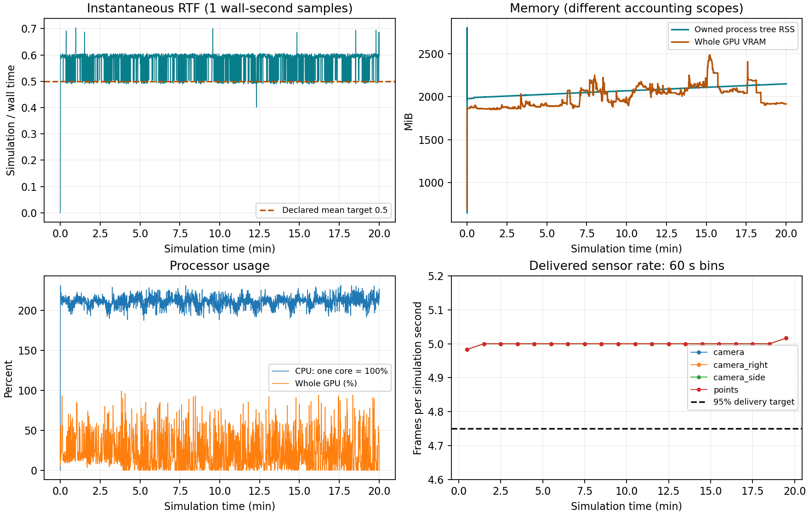
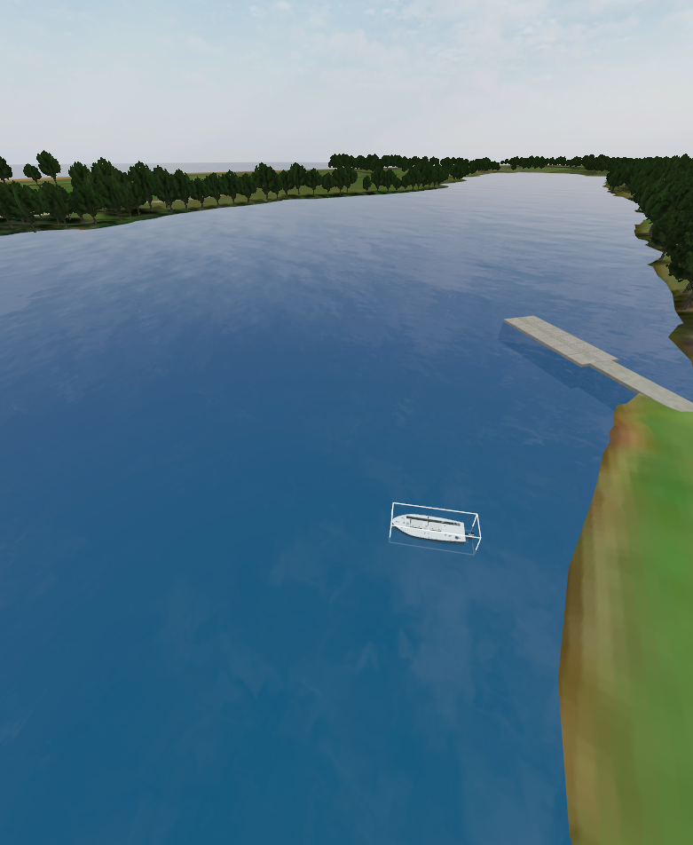
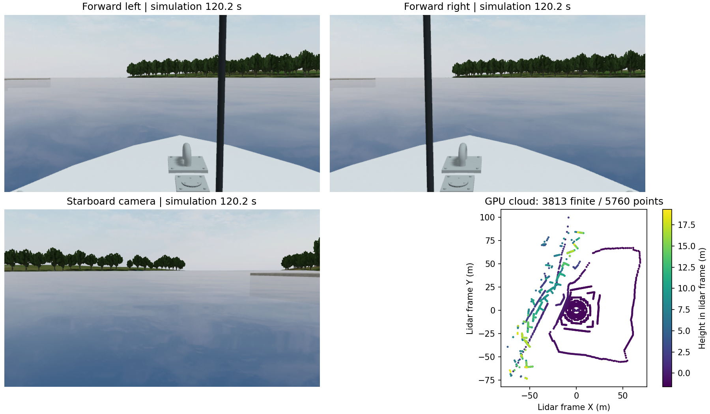

# 完整悉尼场景、相机与点云连续运行

本轮保留官方悉尼地图资产、三路 640×360 RGB 相机、360×16 三维 GPU 雷达及二维扫描，默认均为 5 Hz 仿真频率；使用加鳍后的 1 ms 接触配置。不是删去 GPU 载荷的物理长测，不接 ArduPilot/Nav2。已在固定版本完成 GUI 90 s 与保留 GPU 渲染的 1200 s 连续测试，结果及边界如下。

## 最终验收结果

同一最终源码与构建快照完成两项串行运行，均通过原物理检查及全部渲染/性能门槛。这里的“通过”只针对预声明工况和本机配置，不是无缺陷或真船精度认证。

| 工况 | 结果 | 平均实时率 | 三路图像/点云 Hz（仿真） | 预热后进程树 RSS 峰值 MiB | 预热后 RSS 增量 MiB | 整卡显存峰值 MiB |
|---|---|---:|---:|---:|---:|---:|
| GUI / 90 s | 通过 | 0.514 | 4.994–4.994 | 3606.4 | 7.3 | 3190 |
| EGL + GPU / 1200 s | 通过 | 0.569 | 5.000–5.000 | 2150.8 | 157.6 | 2487 |

长测 CPU 平均为 210.6%（一个逻辑核心=100%），整卡 GPU 平均 22.8%。20 分钟仿真按平均实时率折算约 35.2 分钟墙钟，不含启动和收尾。本机尚不能保持实时率1.0；0.5是事前可用性下限，不是事后降低目标。资源增长筛查通过不能证明任意时长无泄漏。

长测排除30 s预热后，每路图像各5850帧；Gazebo源→ROS原始→公开输出的时间戳集合无缺帧，每张公开图像均有对应 CameraInfo。三路图像及点云最大仿真帧间隔均为0.2 s；公开图像最大墙钟到达间隔约0.541 s，点云约0.522 s。最大仿真时间差分别为图像0.041 s、点云0.081 s；它是与最新物理遥测比较的指标，不是真实设备端到端时延。

物理健康检查通过：横摇/纵摇绝对峰值约1.415°/1.129°，SOC由90.000%降至89.022%。本工况电池电量高、发电机未启机，燃油消耗为0，不能用本轮重新证明燃油动态质量路径。分进程快照中 Gazebo约1469–1470 MiB、桥接128 MiB、控制节点178 MiB较稳定；观察器保存元数据带来增长，最终RSS判断仍包含它，没有剔除。



机器可读 [最终摘要](verified_summary.json)、[工况及版本绑定](suite_binding.json)、[GUI 原判定](sydney_gui_90s/result.json)、[长测原判定](sydney_sensors_20min/result.json)、[逐流与资源判定](sydney_sensors_20min/rendering_result.json)。公开各工况目录保留压缩的逐帧元数据、资源和物理遥测，以及选择图片/点云；原始 case_binding 对应本机完整包，不能直接拿删减后的公开目录冒充完整封存包。

## 预声明工况与门槛

工况在 `tests/scenarios/sydney_rendering.json`：150 kg 载荷、30 L 油、wave gain 0.3、survey 用电，直接油门 0.35、舵 12°在起点附近连续回转。保留全图及障碍物；本轮针对渲染链路与资源稳定性，不是航线规划、避障或高速海况验收。沿用原物理运行健康/能量/质量检查，不以视觉存在代替物理正常。

| 参数 | 含义与本轮值 | 依据和限制 |
|---|---|---|
| duration | 1200 s 连续仿真时间 | 对齐上一轮物理长测；墙钟另记，不是寿命试验 |
| warmup_s | 起始 30 s 排除资源预热 | 计时前要求所有接口已有新鲜合法消息；原始启动时间仍保留 |
| minimum_delivery_ratio | ≥0.95，即 5 Hz 中至少 4.75 Hz | 本机可用性门槛，按完整测量窗口计数，不只除相邻帧间隔 |
| max_gap_sim_s | ≤1 s，包含首尾缺流 | 最多五个名义周期；不是实时系统保证 |
| max_latency_sim_s | ≤1 s | 以最新物理遥测与帧 stamp 比较；遥测可能滞后，允许 −0.25 s |
| minimum_mean_rtf | ≥0.5 | 本机交互可用性最低目标；1.0 是实时，不把 0.5 称为实时 |
| maximum_rss_mib | 自有进程树 RSS 合计 ≤6144 MiB | 16 GB 主机预算，RSS 可能重复计入共享页，不等于独占物理内存 |
| maximum_rss_growth_mib | 预热后末/初各10个资源样本中位数增量 ≤512 MiB | 发现明显持续增长的筛查，不能证明无内存泄漏 |
| GPU 显存 | 整卡用量 <95% 总显存 | 留运行余量；含桌面等其他进程，不能冒充本船独占 |
| startup_timeout / wall_timeout_factor | 180 s 启动；总阶段秒数×8+90 s 墙钟上限 | 有界失败，增加诊断超时不改变通过性能门槛 |

逐帧检查尺寸、字节数、图像非全黑、光学 frame_id、相机内参/双目基线、点云 XYZ 字段和行步幅/大小端；无回波的非有限点允许，但全空三维点云不算有效观测。保存逐帧元数据与每分钟样本，避免逐帧原图导致观察器自己占满内存/磁盘。CPU 百分比按一个核心为100%，进程树包括观察器；GPU 数值来自整卡 nvidia-smi。本轮该性能探针要求 NVIDIA 主机，不能据此声称跨平台性能一致。

参考：[Gazebo EGL 无窗口渲染](https://gazebosim.org/api/sim/8/headless_rendering.html)、[Harmonic 混合显卡排障](https://gazebosim.org/docs/harmonic/troubleshooting/)。无 GUI 的 EGL 仍会渲染相机和 GPU 雷达；GUI 窗口的额外代价单独说明。

## 开发中已复现的问题

1. 首轮短测未进入计时：侧相机 `CameraInfo.P[3]` 为约 −414.35，而它是独立朝向的单目。左右相机的焦距约552.47像素、基线0.2 m，应只有右相机 `Tx≈−110.49`。修复转发边界后，独立相机 Tx 清零，右相机保留真实双目基线，frame_id 仍分别对应自己的 optical frame。旧失败目录保留。
2. 修复投影后的短测显示 Gazebo 源图像约5 Hz，ROS 图像存在明显丢帧；同一原始 ROS topic 的额外只读对照中，可靠订阅约5 Hz，而 best-effort 约3.36 Hz。该对照会增加链路负载，只用于定位，不能冒充正式无干扰性能结果。
3. 单独启用 `FASTDDS_BUILTIN_TRANSPORTS=LARGE_DATA` 未消除问题。进一步试验显式配置共享内存和缓冲，保留原图像尺寸与 best-effort 传感器 QoS。原图单帧640×360×3=691200字节，超过 Fast DDS 2.14.7 文档的默认512 KiB共享段；实际传输还包含序列化及并发缓冲，不能只按一帧大小分配。

依据：[Fast DDS 2.14.7 SHM 缓冲与默认大小](https://fast-dds.docs.eprosima.com/en/2.x/fastdds/transport/shared_memory/shared_memory.html)、[2.14.7 传输环境变量](https://fast-dds.docs.eprosima.com/en/2.x/fastdds/env_vars/env_vars.html)。对照支持本机大消息传输配置是丢帧原因；尚未用内核抓包把每个丢失片段归因到唯一队列，不能把该结果推广为所有 DDS 实现的问题。

相机投影契约依据 [ROS 2 Jazzy CameraInfo 定义](https://github.com/ros2/common_interfaces/blob/jazzy/sensor_msgs/msg/CameraInfo.msg)：单目及左目 Tx/Ty 为零，水平双目的右目 Tx = −fx × baseline。点云解析依据 [PointCloud2 定义](https://github.com/ros2/common_interfaces/blob/jazzy/sensor_msgs/msg/PointCloud2.msg)，不能假设字段紧密排列或全部为有限回波。

## 正式入口的修复范围

`usv_control/config/dds_transport.xml` 使用 1 MiB 最大共享内存消息、64 MiB 参与者共享段及 4 MiB UDP 收发缓冲请求。`interfaces.launch.py` 只把它传给本次桥接和控制子进程；调用方显式设置 `FASTRTPS_DEFAULT_PROFILES_FILE` 时保留其配置。没有改动全局 sysctl、没有改传感器 best-effort QoS、没有减少分辨率/频率。普通本地订阅端仍可使用默认设置，外部网络和其他 RMW 未作相同保证。该 XML 关闭额外内置传输，因此若要自行控制 `FASTDDS_BUILTIN_TRANSPORTS`，应同时提供自己的 XML。

版本绑定补入 XML、影响渲染/DDS 的环境变量和外部配置文件内容摘要；样本 PNG/NPZ 也被封存，不能替换图片后继续引用旧通过结果。两项正式工况串行执行：90 s 带 GUI 短验，以及 1200 s 无 GUI、保留 GPU 渲染的长验。GUI 短验不冒充 GUI 长期验收。


## 显示样本与解释





相机图像中的甲板和天线遮挡，以及点云中的船体自身回波，按实际模型保留，没有为“更好看”删除几何。该 GPU 雷达依照渲染几何产生回波；水面真实反射强弱、镜面/多径及恶劣天气尚未标定，不能把水面点直接当作已验证的导航障碍物。左右图像的同步和基线检查也不等于完成真实镜头标定或深度估计验收。

## 复现方式与证据范围

从项目根目录，在已安装 ROS/Gazebo、固定 VRX 依赖及 Python requirements 的环境执行：

```bash
./usv build
./usv test
source /opt/ros/jazzy/setup.bash
source ros_ws/install/setup.bash
python3 tests/regression/run_performance_suite.py \
  --spec tests/scenarios/sydney_rendering.json \
  --output artifacts/my_sydney_rendering --workers 1
```

本套件需要 NVIDIA GPU、`nvidia-smi`，GUI 工况还需要可用的 DISPLAY。不要对同一 GPU 并行运行本套件；使用新的输出目录。`result.json` 同时包含原物理运行检查和 `rendering_and_performance`；`rendering_result.json` 列出各流与资源检查，不能仅看进程退出。

完整地图的16个原有 include 均保留，另加本船；仍是起点附近回转的固定工作负载，没有走遍整张地图。没有改变物理步长、鳍几何、推进功率或设备重量。长测中保持直接油门/舵角，既有健康检查继续核对物理、执行器、导航与能量反馈；本轮不重新证明倒车恢复或最高航速。无 GUI 长测仍实际执行相机/雷达 GPU 渲染，不是原来的物理-only 场景。

报告的代码起点是 `6331cab` 加本轮工作树修改，证据以完整内容 SHA-256 和构建绑定为准，不将旧提交直接标成已含此次修复。原有用户预览生成文件未提交；快照包含本机闲置预览资产，实际工况另封存自己的船模、世界与波场。干净检出的未使用资产树不保证与原机逐字相同。

开发阶段的探针对照用于定位；其中 `smoke_projection_fixed` 中途加入了额外 QoS 只读订阅，会影响负载，不能单独当作公平性能基线。早期对照的版本格式尚未绑定外部 DDS 环境值，执行配置按本报告及命令记录说明；最终工况已将环境与 XML 内容纳入绑定。完整原始包在本机 `artifacts/sydney_rendering_2026-11-23`，公开目录提供结果、哈希、压缩元数据和选择样本，不冒充原始包完整镜像。


## 观察器调度修正

首次长测中途审查发现：控制循环每次只处理一条 ROS 回调，随后休眠20 ms；本轮11路 ROS 渲染/对照流加健康流在实时率更高的机器上会超过该处理上限。当前慢于实时的主机尚未触发明显积压，但不能保留这个测量瓶颈。停止并保留首轮部分记录（`final` 目录，明确不是20分钟通过），改为每轮最多额外处理8条已到达回调，均不阻塞；有上限防止载荷洪泛饿死指令和健康检查。正式完整复验使用新的 `final_verified` 目录，没有拼接前后两次数据。

## 保护回归与代码审查

最终代码下，既有 `platform_reliability.json` 的 clock_independent、sensor_dropout、command_dropout 三项原工况串行复验全部通过，判据未放宽。[保护回归摘要](transport_regression/summary.json) 与各工况判定保留；使用的精确工况也在其 suite_binding 中。

Code Supervisor 最终 full 检查通过，12项C++、55项Python、5项设计接口测试通过；[24项人工检查与未执行范围](code-review.md)。最终 runtime/build 快照及完整本机原包重新验签，公开文件另附 SHA256 清单。

## 最终代码的传输反向对照

主验收及保护回归完成后，保持相同源码、构建、分辨率、频率与 QoS，仅以显式外部 XML 恢复 Fast DDS 内置默认传输，再跑60 s同载荷工况；没有附加 QoS 探针。[保留的失败结果](diagnostics/default_dds_counterfactual/rendering_result.json) 显示三路公开图像分别约4.165/4.365/4.765 Hz，前两路低于原4.75 Hz下限；源图像约5 Hz，原始桥接的前两路也失败。正式默认配置的1200 s长测三路约5.000 Hz且源/公开集合无缺帧。对照的外部 XML 内容与环境值已经绑定，没有把失败删掉或提高容许丢帧量。失败工况不会生成通过用的 case_binding；公开文件在本报告 manifest 中核验。

这些结果支持本机传输预算修复的效果；不同测试时段的GPU桌面负载并非完全相同，仍不宣称已定位每个丢包的唯一底层队列，也不外推到其他RMW或跨机网络。

公开附件完整性见 [SHA256 清单](manifest.json) 与 [最终核验记录](final_integrity.json)。源码、构建和结果的绑定以内容摘要为准；提交仅封存这些已经完成的结果。
