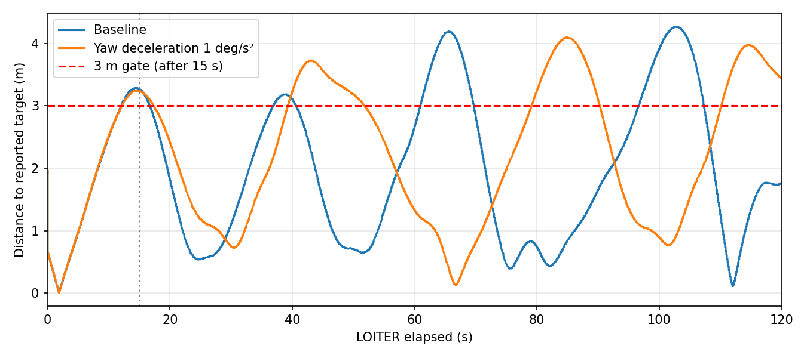

# 转向减速度候选筛选（2026-11-25）

**未采用，3 m 有流保持问题仍未解决。** 本轮完整完成25项导航验收，24项通过，唯一失败仍为 `loiter_target_radius`。正式参数、官方飞控和船体物理均未改动。

## 假设与配置

前一轮[响应辨识](../response_identification_2026-11-25/README.md)显示：完整换舵约7.8秒，回中后偏航低于0.5°/s约需9.4秒。官方控制器未单独设置转向减速度时，使用10°/s²加速度限制估算转向制动。因此只在隔离配置添加 `ATC_STR_DEC_MAX 1.0`（°/s²），测试更保守的转向制动规划是否有用。1°/s²是包含执行器限速和船体响应的试验假设，不是机械参数标定或最优值。

源码依据为固定上游 [AR_AttitudeControl::get_turn_rate_from_heading](https://github.com/ArduPilot/ardupilot/blob/d9c5097c3d8333435712ffed86bca8ce00c4bb46/libraries/APM_Control/AR_AttitudeControl.cpp)，其允许转速受 `sqrt(2 × 航向误差 × 转向减速度)` 限制。未修改该源码，也未提高舵机速度或力矩。

北向水流0.30 m/s，AUTO/LOITER/RTL阶段启用；目标航速1 m/s、默认载荷、无风浪。保持120秒，第15–120秒使用GPS到飞控报告目标的距离检查原3 m门槛。每组仅单次试验，不足以判断微小差异的统计显著性。

## 完整结果

| 指标 | 原正式基线 | 减速度候选 |
| --- | ---: | ---: |
| 保持距离峰值 | 4.265 m | 4.093 m |
| 保持距离RMS | 2.288 m | 2.526 m |
| AUTO路径最大偏差 | 9.091 m | 8.906 m |
| 检查通过数 | 24/25 | 24/25 |

峰值略小，但RMS更大；这不是可靠改善，更不是修复。正常解锁、估计健康、三个航点、路径走廊、手动接管、HOLD、有流返航和清流后失联停推均通过。保留原3 m门槛，不把24/25写成验收通过，也不推广该参数到正式配置。

证据：[汇总](summary.json)、[完整结果及参数读回](result.json)、[候选配置](navigation_low_speed.parm)、[镜像ID](images.json)、[运行输入哈希](runtime-inputs.json)、[输入清单](input-sha256.txt)、[测试代码提交绑定](verified-code-commit.json)。候选参数实际读回为1.0。原始数据目录为 `artifacts/navigation/hold_yaw_decel1_north030_20261125_01`；CSV无损gzip归档，解压后字节SHA256见[manifest](manifest.json)。未覆盖旧测试。

[Code Supervisor quick](supervisor-quick.log)通过，仅代表quick范围；本步骤没有修改生产或测试源码，因此沿用[上一步构建和测试证据](../response_identification_2026-11-25/build-test.log)，另完成本轮受影响的完整SITL集成测试。未重复执行full/deep，不能称为全档审查通过。

## 后续方向

单独降低转向减速度不足以解决保持振荡。下一步应对齐目标方位跨越90°、正反推切换、真实换舵和横向漂移的时序，检验方向切换是否发生在执行器尚未完成响应时，再决定是否需要有边界的切换迟滞策略。此处只是待验证假设；当前既没有证明唯一根因，也没有证明该船无法达到3 m。暂不继续盲扫参数、不接Nav2。

后续[切换调查与官方模式对照](../loiter_switching_2026-11-25/README.md)已完成：始终船头朝向目标使保持峰值增至11.766 m，未采用；仍需保留倒车能力并进一步研究切换协调。
